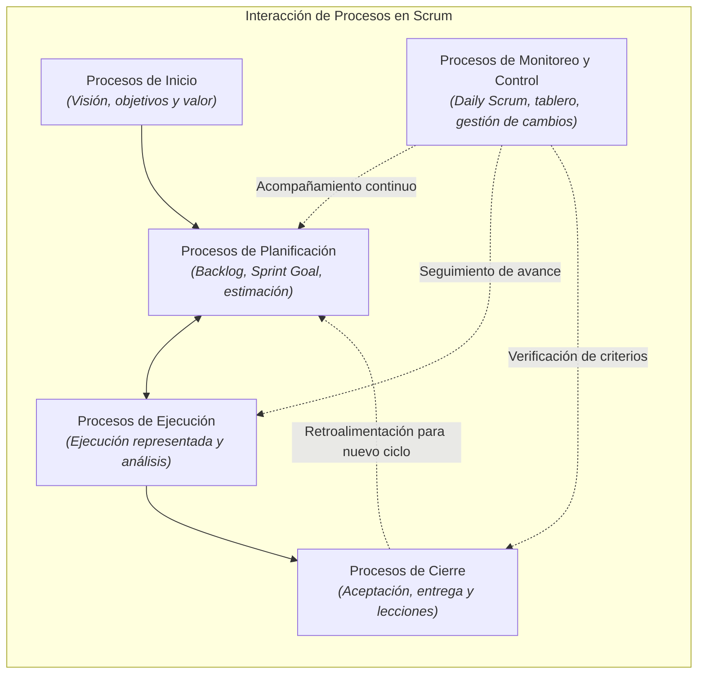
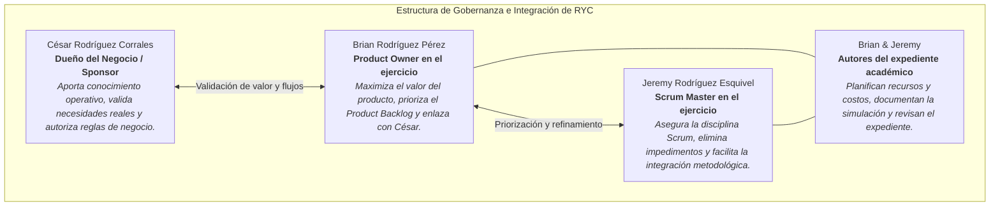

# Sistema de Gestión para RYC Control de Plagas

**Universidad Técnica Nacional**\
Sede Regional San Carlos

| Información | Detalle |
| --- | --- |
| Curso | Administración de Proyectos Informáticos |
| Proyecto | Sistema de Gestión para RYC Control de Plagas |
| Profesor | Deiver Cubero Molina |

**Integrantes**

- Brian Rodríguez Pérez
- Jeremy Rodríguez Esquivel

---

**Naturaleza de la entrega académica:** este documento plantea y simula un proyecto de software completo para RYC. Brian y Jeremy entregan su planificación y la simulación de su ejecución. Las funciones, tecnologías y condiciones operativas describen el producto que construiría el equipo profesional supuesto; el curso no exige entregar a César una aplicación web implementada. El plan cubre diez semanas y cinco sprints, con todas las tareas, recursos y costos previstos.

## Contenido

- [Sistema de Gestión para RYC Control de Plagas](#sistema-de-gestión-para-ryc-control-de-plagas)
  - [Contenido](#contenido)
  - [Semana 1 · Definición del proyecto](#semana-1--definición-del-proyecto)
    - [Problema](#problema)
    - [Proyecto propuesto](#proyecto-propuesto)
    - [Valor esperado](#valor-esperado)
    - [Objetivo general](#objetivo-general)
    - [Objetivos específicos](#objetivos-específicos)
  - [Semana 2 · Taller: interesados de nuestro proyecto](#semana-2--taller-interesados-de-nuestro-proyecto)
    - [Contexto y restricciones del proyecto](#contexto-y-restricciones-del-proyecto)
    - [Registro de interesados](#registro-de-interesados)
    - [Justificación de valoraciones relevantes](#justificación-de-valoraciones-relevantes)
    - [Mapa Poder–Interés](#mapa-poderinterés)
    - [Tres interesados críticos y su involucramiento](#tres-interesados-críticos-y-su-involucramiento)
    - [Preguntas de análisis de interesados](#preguntas-de-análisis-de-interesados)
      - [¿A quién debemos involucrar primero?](#a-quién-debemos-involucrar-primero)
      - [¿Quién puede bloquear una decisión?](#quién-puede-bloquear-una-decisión)
      - [¿Quién necesita información frecuente?](#quién-necesita-información-frecuente)
      - [¿Qué interesado estamos subestimando?](#qué-interesado-estamos-subestimando)
      - [¿Qué conflicto de expectativas puede aparecer?](#qué-conflicto-de-expectativas-puede-aparecer)
    - [Enfoque de gestión del proyecto](#enfoque-de-gestión-del-proyecto)
  - [Semana 3 Planeamiento del proyecto](#semana-3-planeamiento-del-proyecto)
    - [Alcance y organización de la información](#alcance-y-organización-de-la-información)
      - [Cuenta, cliente y asociación](#cuenta-cliente-y-asociación)
      - [Atención sin cuenta: recorrido principal](#atención-sin-cuenta-recorrido-principal)
      - [Atención con cuenta: recorrido opcional](#atención-con-cuenta-recorrido-opcional)
    - [Landing Page y contacto por WhatsApp](#landing-page-y-contacto-por-whatsapp)
      - [Contenido y recorrido](#contenido-y-recorrido)
      - [Formulario breve para preparar el mensaje](#formulario-breve-para-preparar-el-mensaje)
    - [Necesidades de los usuarios y resultados esperados](#necesidades-de-los-usuarios-y-resultados-esperados)
      - [Necesidades de las personas interesadas y los clientes](#necesidades-de-las-personas-interesadas-y-los-clientes)
      - [Necesidades de César](#necesidades-de-césar)
      - [Necesidades de RYC como empresa](#necesidades-de-ryc-como-empresa)
    - [Registro e inicio de sesión](#registro-e-inicio-de-sesión)
      - [Campos del registro](#campos-del-registro)
      - [Opciones del login](#opciones-del-login)
      - [Validación de formularios y seguridad de las cuentas](#validación-de-formularios-y-seguridad-de-las-cuentas)
        - [Mensajes al completar los formularios](#mensajes-al-completar-los-formularios)
        - [Páginas y funciones de acceso](#páginas-y-funciones-de-acceso)
        - [Medidas para proteger las cuentas](#medidas-para-proteger-las-cuentas)
    - [Diseño y comportamiento en dispositivos](#diseño-y-comportamiento-en-dispositivos)
      - [Dirección visual](#dirección-visual)
      - [Colores](#colores)
      - [Tipografía](#tipografía)
      - [Login](#login)
      - [Presentación de la administración y el portal](#presentación-de-la-administración-y-el-portal)
    - [Experiencia de uso de César](#experiencia-de-uso-de-césar)
      - [Registro por etapas y reutilización](#registro-por-etapas-y-reutilización)
      - [Guardado de formularios](#guardado-de-formularios)
      - [Acciones y estado](#acciones-y-estado)
    - [Empresas, sedes y cuentas](#empresas-sedes-y-cuentas)
      - [Permisos de consulta y solicitud](#permisos-de-consulta-y-solicitud)
      - [Ejemplo de acceso por sede](#ejemplo-de-acceso-por-sede)
      - [Justificación](#justificación)
    - [Asociación mediante ID](#asociación-mediante-id)
    - [Consultoría y aceptación del servicio](#consultoría-y-aceptación-del-servicio)
      - [Formulario de consultoría](#formulario-de-consultoría)
      - [Costo de la visita inicial](#costo-de-la-visita-inicial)
      - [Estados de la consultoría](#estados-de-la-consultoría)
      - [Cómo se registra la aceptación del trabajo](#cómo-se-registra-la-aceptación-del-trabajo)
      - [Orden y situación financiera](#orden-y-situación-financiera)
      - [Medios e instrucciones de pago](#medios-e-instrucciones-de-pago)
      - [Datos del reporte de pago](#datos-del-reporte-de-pago)
      - [Comunicación y seguimiento de los pagos](#comunicación-y-seguimiento-de-los-pagos)
      - [Archivos, permisos y alcance comercial](#archivos-permisos-y-alcance-comercial)
    - [Clientes, ubicaciones y servicios](#clientes-ubicaciones-y-servicios)
      - [Cliente particular](#cliente-particular)
      - [Empresa](#empresa)
      - [Ubicación del servicio](#ubicación-del-servicio)
      - [Servicio realizado](#servicio-realizado)
    - [Plagas, productos y tratamientos](#plagas-productos-y-tratamientos)
      - [Catálogo de plagas](#catálogo-de-plagas)
      - [Catálogo de productos](#catálogo-de-productos)
      - [Registro del tratamiento](#registro-del-tratamiento)
      - [Publicación del historial](#publicación-del-historial)
    - [Visitas y calendario](#visitas-y-calendario)
      - [Datos de una visita](#datos-de-una-visita)
      - [Reglas](#reglas)
      - [Presentación](#presentación)
    - [Información histórica](#información-histórica)
    - [Tecnología, alojamiento y entrega](#tecnología-alojamiento-y-entrega)
      - [Tecnologías](#tecnologías)
      - [Alojamiento de la demostración y del piloto](#alojamiento-de-la-demostración-y-del-piloto)
      - [Respaldo y entrega](#respaldo-y-entrega)
    - [Páginas del sistema y su contenido](#páginas-del-sistema-y-su-contenido)
      - [Convenciones de presentación](#convenciones-de-presentación)
      - [Mensajes de validación de campos](#mensajes-de-validación-de-campos)
      - [Navegación](#navegación)
      - [Cómo se organiza cada página](#cómo-se-organiza-cada-página)
      - [Landing Page y acceso a la aplicación web](#landing-page-y-acceso-a-la-aplicación-web)
        - [Landing Page de RYC](#landing-page-de-ryc)
          - [Formulario de contacto por WhatsApp](#formulario-de-contacto-por-whatsapp)
        - [Inicio de sesión](#inicio-de-sesión)
        - [Crear cuenta](#crear-cuenta)
        - [Recuperar acceso](#recuperar-acceso)
        - [Cambiar contraseña por recuperación](#cambiar-contraseña-por-recuperación)
      - [Portal del cliente](#portal-del-cliente)
        - [Panel del cliente](#panel-del-cliente)
          - [Verificación del correo en el portal](#verificación-del-correo-en-el-portal)
          - [Solicitudes y seguimiento del cliente](#solicitudes-y-seguimiento-del-cliente)
          - [Formulario de consultoría del portal](#formulario-de-consultoría-del-portal)
          - [Formulario de nueva visita](#formulario-de-nueva-visita)
          - [Propuesta del trabajo y decisión del cliente](#propuesta-del-trabajo-y-decisión-del-cliente)
          - [Próximas visitas y solicitud de cambios](#próximas-visitas-y-solicitud-de-cambios)
          - [Historial de servicios del cliente](#historial-de-servicios-del-cliente)
        - [Pagos y documentos](#pagos-y-documentos)
          - [Pagos y reportes del cliente](#pagos-y-reportes-del-cliente)
          - [Datos de facturación de la orden](#datos-de-facturación-de-la-orden)
          - [Documentos y descargas del cliente](#documentos-y-descargas-del-cliente)
      - [Administración de César](#administración-de-césar)
        - [Panel de administración de César](#panel-de-administración-de-césar)
          - [Registro rápido de un contacto](#registro-rápido-de-un-contacto)
          - [Consultorías y propuesta del trabajo](#consultorías-y-propuesta-del-trabajo)
          - [Nuevas visitas y cambios por revisar](#nuevas-visitas-y-cambios-por-revisar)
          - [Programación y estado de una visita](#programación-y-estado-de-una-visita)
          - [Servicio y tratamiento realizado](#servicio-y-tratamiento-realizado)
          - [Pagos y documentos dentro de la ficha de atención](#pagos-y-documentos-dentro-de-la-ficha-de-atención)
        - [Clientes](#clientes)
          - [Formulario de cliente particular o empresa](#formulario-de-cliente-particular-o-empresa)
          - [Ficha del cliente y cuentas autorizadas](#ficha-del-cliente-y-cuentas-autorizadas)
          - [Ubicaciones del cliente](#ubicaciones-del-cliente)
          - [Registro de servicios anteriores](#registro-de-servicios-anteriores)
        - [Calendario](#calendario)
        - [Catálogos](#catálogos)
        - [Cobros y documentos](#cobros-y-documentos)
          - [Revisión de pagos recibidos](#revisión-de-pagos-recibidos)
          - [Recibos no fiscales](#recibos-no-fiscales)
          - [Documentos fiscales de la atención](#documentos-fiscales-de-la-atención)
          - [Entrega de documentos de la atención](#entrega-de-documentos-de-la-atención)
      - [Cuenta compartida por portal y administración](#cuenta-compartida-por-portal-y-administración)
        - [Mi cuenta](#mi-cuenta)
    - [Comprobaciones del sistema](#comprobaciones-del-sistema)
  - [Semana 4 · Interacción e integración entre procesos](#semana-4--interacción-e-integración-entre-procesos)
    - [Alcance de la simulación y entrega académica](#alcance-de-la-simulación-y-entrega-académica)
    - [Product Backlog priorizado](#product-backlog-priorizado)
    - [Criterios utilizados para priorizar](#criterios-utilizados-para-priorizar)
    - [Sprints y Sprint Backlogs](#sprints-y-sprint-backlogs)
      - [Sprint 1: base técnica, acceso y presentación](#sprint-1-base-técnica-acceso-y-presentación)
      - [Sprint 2: clientes, solicitudes y programación](#sprint-2-clientes-solicitudes-y-programación)
      - [Sprint 3: cobros y registro de atenciones](#sprint-3-cobros-y-registro-de-atenciones)
      - [Sprint 4: propuestas, historial y operación](#sprint-4-propuestas-historial-y-operación)
      - [Sprint 5: validación, respaldo y cierre](#sprint-5-validación-respaldo-y-cierre)
    - [Backlog técnico de implementación](#backlog-técnico-de-implementación)
      - [Simbología de las historias y las tareas](#simbología-de-las-historias-y-las-tareas)
      - [H01: Conocer RYC y contactar desde la Landing Page](#h01-conocer-ryc-y-contactar-desde-la-landing-page)
      - [H02: Iniciar sesión en la aplicación web](#h02-iniciar-sesión-en-la-aplicación-web)
      - [H03: Crear una cuenta de cliente](#h03-crear-una-cuenta-de-cliente)
      - [H04: Recuperar el acceso desde Olvidé mi contraseña](#h04-recuperar-el-acceso-desde-olvidé-mi-contraseña)
      - [H05: Consultar mi resumen y gestionar mis atenciones](#h05-consultar-mi-resumen-y-gestionar-mis-atenciones)
      - [H06: Consultar mis pagos y documentos](#h06-consultar-mis-pagos-y-documentos)
      - [H07: Consultar pendientes y gestionar las atenciones](#h07-consultar-pendientes-y-gestionar-las-atenciones)
      - [H08: Consultar y administrar Mi cuenta](#h08-consultar-y-administrar-mi-cuenta)
      - [H09: Gestionar clientes, ubicaciones y cuentas autorizadas](#h09-gestionar-clientes-ubicaciones-y-cuentas-autorizadas)
      - [H10: Programar visitas y administrar la disponibilidad](#h10-programar-visitas-y-administrar-la-disponibilidad)
      - [H11: Administrar los catálogos de plagas y productos](#h11-administrar-los-catálogos-de-plagas-y-productos)
      - [H12: Verificar cobros y gestionar documentos y entregas](#h12-verificar-cobros-y-gestionar-documentos-y-entregas)
      - [Componentes y tareas comunes](#componentes-y-tareas-comunes)
        - [Preparación inicial de la aplicación web](#preparación-inicial-de-la-aplicación-web)
        - [Componentes utilizados en las páginas](#componentes-utilizados-en-las-páginas)
        - [Pruebas de la aplicación web](#pruebas-de-la-aplicación-web)
        - [Entorno de entrega y respaldos](#entorno-de-entrega-y-respaldos)
        - [Guía, aceptación y cierre](#guía-aceptación-y-cierre)
      - [Estimación y asignación de las tareas](#estimación-y-asignación-de-las-tareas)
    - [Equipo profesional y capacidad](#equipo-profesional-y-capacidad)
      - [Puestos, experiencia y dedicación](#puestos-experiencia-y-dedicación)
      - [Disponibilidad y carga por sprint](#disponibilidad-y-carga-por-sprint)
      - [Secuencia, capacidad y sensibilidad del plazo](#secuencia-capacidad-y-sensibilidad-del-plazo)
    - [Presupuesto del proyecto simulado](#presupuesto-del-proyecto-simulado)
      - [Tarifas profesionales y costo del equipo](#tarifas-profesionales-y-costo-del-equipo)
      - [Infraestructura y operación prevista](#infraestructura-y-operación-prevista)
      - [Presupuesto total y distribución](#presupuesto-total-y-distribución)
      - [Fuentes y límites de la estimación](#fuentes-y-límites-de-la-estimación)
    - [Criterios de terminación y aceptación](#criterios-de-terminación-y-aceptación)
    - [Mecanismo de seguimiento del Sprint](#mecanismo-de-seguimiento-del-sprint)
      - [Tablero y evidencia del trabajo](#tablero-y-evidencia-del-trabajo)
      - [Comunicación y revisión](#comunicación-y-revisión)
    - [Tratamiento de cambios durante el Sprint](#tratamiento-de-cambios-durante-el-sprint)
    - [Interacción entre los procesos](#interacción-entre-los-procesos)
      - [Aplicación concreta en RYC Control de Plagas](#aplicación-concreta-en-ryc-control-de-plagas)
      - [Flujo de salidas como entradas entre procesos](#flujo-de-salidas-como-entradas-entre-procesos)
    - [Integración y toma de decisiones](#integración-y-toma-de-decisiones)
    - [Resultado documentado en la Semana 4](#resultado-documentado-en-la-semana-4)

---

## Semana 1 · Definición del proyecto

### Problema

RYC Control de Plagas lleva el seguimiento de sus clientes, visitas, tipos de plagas, productos químicos utilizados y próximas fumigaciones de forma poco centralizada. Esto puede dificultar saber cuándo corresponde volver a visitar a un cliente, qué tratamiento se utilizó anteriormente, qué tipo de plaga presenta cada lugar y cuál es la frecuencia de atención necesaria.

Además, los clientes no cuentan con un medio digital propio donde puedan consultar la información de los servicios recibidos, conocer sus próximas visitas o solicitar una nueva visita, lo que genera una mayor dependencia de la comunicación directa con la empresa.

### Proyecto propuesto

Planificar y simular la construcción de una aplicación web con una página pública de presentación (Landing Page), Administración de César y un Portal del cliente opcional. Las funciones siguientes describen el producto que construiría el equipo profesional del escenario.

La página pública presentará información real de RYC y facilitará el contacto por WhatsApp sin cuenta. César gestionará clientes, empresas, ubicaciones, solicitudes, agenda, servicios, tratamientos, pagos y documentos desde celular y computadora.

La consultoría inicial será gratuita en el cantón de San Carlos; fuera se cotizará y cobrará completamente antes de la visita. El trabajo requiere 50% antes de iniciar y 50% al finalizar, verificados por César.

Facturas y documentos se emitirán externamente y se entregarán sin exigir cuenta. Quien se registre podrá consultar el historial autorizado, solicitar atención o informar pagos; César asociará registros existentes mediante el ID, con acceso por empresa o sede.

### Valor esperado

Mejorar la organización y el control de los servicios realizados por RYC Control de Plagas, facilitando el seguimiento de clientes, tratamientos y próximas visitas.

Además, se busca mejorar la experiencia del cliente mediante un espacio donde pueda consultar de manera sencilla la información relacionada con sus servicios y solicitar nuevas visitas sin depender únicamente de llamadas o mensajes.

### Objetivo general

Planificar y simular el desarrollo de un sistema web para gestionar los clientes, visitas y tratamientos de RYC Control de Plagas, con un portal opcional para consultar los servicios, definiendo el trabajo, equipo, presupuesto y aceptación necesarios para completarlo en diez semanas y cinco sprints.

### Objetivos específicos

Los siguientes objetivos describen las capacidades que debe cubrir el producto del escenario. El expediente académico especifica y planifica cómo se construirían y comprobarían.

- Presentar servicios, operador, zonas y condiciones reales de RYC.
- Facilitar contacto por WhatsApp sin registro, directo o mediante un mensaje preparado.
- Administrar particulares, empresas y ubicaciones con o sin cuenta.
- Registrar contactos recibidos por César y solicitudes del portal en un seguimiento común.
- Aplicar gratuidad de consultoría en San Carlos y cotización con pago previo fuera del cantón.
- Registrar propuestas, órdenes y pagos con anticipo del 50% y saldo al finalizar.
- Verificar SINPE, efectivo y transferencias sin duplicar pagos.
- Registrar servicios y próximas atenciones según necesidades y frecuencia acordada.
- Conservar plagas, productos, cantidades, tratamientos y recomendaciones reales.
- Mantener historial por cliente/lugar y calendario de visitas.
- Facilitar tareas de César en celular y computadora, reutilizando datos ya registrados.
- Adjuntar documentos fiscales externos y registrar entrega de documentos y recomendaciones sin cuenta.
- Ofrecer cuenta opcional para consultar historial, pagos, documentos y próximas visitas.
- Permitir solicitudes y reportes de pago desde el portal como alternativa.
- Asociar mediante ID un historial autorizado sin duplicarlo.
- Aplicar acceso de empresa a todas sus sedes y acceso de sede solo a la asignada.
- Consultar pagos confirmados por periodo y moneda.

---

## Semana 2 · Taller: interesados de nuestro proyecto

### Contexto y restricciones del proyecto

RYC Control de Plagas es una empresa pequeña administrada principalmente por César Rodríguez Corrales, quien además realiza la mayor parte de los servicios y concentra gran parte del conocimiento operativo del negocio. Debido a esto, su disponibilidad será importante para obtener información, aclarar procesos y validar los requisitos y casos del escenario.

Brian Rodríguez Pérez y Jeremy Rodríguez Esquivel elaborarán la planificación y simulación dentro del periodo del curso. La ejecución del sistema se modela con un equipo profesional hipotético en Costa Rica, cuya dedicación y presupuesto se justifican en Semana 4. La disponibilidad, el plazo y los costos son restricciones que deben comprobarse en el escenario.

A nivel tecnológico, el sistema propuesto funcionaría como una aplicación web y requeriría acceso a Internet, dispositivos compatibles y un servicio de alojamiento. También será necesario considerar que parte de la información histórica de clientes y servicios puede encontrarse distribuida en distintos medios, por lo que deberá determinarse qué información podrá incorporarse al sistema.

El plazo de diez semanas, la disponibilidad de los profesionales del escenario y la información que proporcione César condicionan la secuencia de implementación. La priorización conserva todas las funciones del alcance y organiza cuándo se trabajarían dentro de los cinco sprints.

### Registro de interesados

| Interesado | Necesidad | Poder | Interés | Actitud inicial | Estrategia | Responsable |
| --- | --- | :---: | :---: | --- | --- | --- |
| César Rodríguez Corrales, propietario y operador de RYC | Centralizar la información de clientes, visitas, tratamientos y próximas fumigaciones. | 5 | 5 | Favorable | Gestionar de cerca: consultar necesidades y validar avances. | Brian y Jeremy |
| Brian Rodríguez Pérez y Jeremy Rodríguez Esquivel, autores del expediente académico | Contar con requisitos claros y retroalimentación para planificar y simular el proyecto. | 4 | 5 | Favorable | Gestionar de cerca: coordinar la elaboración del expediente, resolver dudas y revisar decisiones. | Brian y Jeremy |
| Equipo profesional hipotético de ocho personas | Disponer de requisitos, dependencias y bloques de trabajo suficientes para construir el sistema del escenario. | 4 | 5 | Favorable, como supuesto del ejercicio | Representar su participación mediante asignaciones, capacidad, costos y revisión de los incrementos. | Brian y Jeremy |
| Clientes particulares | Consultar su historial, próximas visitas y solicitar nuevas visitas desde su cuenta. | 2 | 4 | Favorable | Mantener informados y recoger comentarios sobre el portal. | Jeremy |
| Empresas clientes, como organizaciones que contratan los servicios | Consultar el historial de servicios y dar seguimiento a los tratamientos recibidos. | 3 | 5 | Favorable | Mantener informadas y consultar sus necesidades durante las validaciones del portal. | Brian |
| Encargados o contactos de empresas clientes | Coordinar las visitas y consultar la información necesaria para recibir los servicios. | 3 | 5 | Favorable | Mantener informados y consultar el proceso de coordinación de visitas. | Jeremy |
| Proveedores de productos utilizados por RYC | Que los productos suministrados se identifiquen correctamente en los registros de tratamientos. | 2 | 2 | Neutral | Monitorear y consultar información de los productos cuando sea necesario para su registro. | Brian |
| Proveedor de alojamiento o infraestructura web | Contar con requisitos técnicos claros para prestar el servicio de alojamiento. | 2 | 2 | Neutral | Monitorear las condiciones y disponibilidad del servicio. | Brian |
| Entidades reguladoras aplicables | Que el proyecto considere las disposiciones que le correspondan. | 5 | 2 | Neutral | Mantener satisfechas mediante la identificación y atención de los requisitos aplicables. | Brian y Jeremy |

### Justificación de valoraciones relevantes

- **Autores del expediente y equipo profesional del escenario — poder 4 e interés 5:** Brian y Jeremy toman las decisiones de la planificación académica. El equipo profesional ejecutaría el desarrollo representado. En ambos casos, las necesidades y decisiones del negocio se contrastan con César.

- **Empresas clientes — poder 3 e interés 5:** sus necesidades influyen en el portal y el resultado les afecta directamente, pero no se ha identificado autoridad para aprobar cambios en el proyecto.

- **Encargados de empresas clientes — poder 3 e interés 5:** pueden facilitar o dificultar la coordinación y aportar información relevante, aunque no necesariamente deciden por la empresa que representan.

- **Proveedores de productos utilizados por RYC — poder 2 e interés 2:** pueden aportar información para identificar correctamente los productos registrados en los tratamientos, pero no tienen autoridad sobre las decisiones del sistema. Su participación sería puntual, por lo que inicialmente se les asigna poder e interés bajos.

- **Entidades reguladoras — poder 5 e interés 2:** se propone un poder alto porque los requisitos que resulten aplicables podrían condicionar decisiones del proyecto. Su interés se considera bajo por no participar en el trabajo cotidiano. Las entidades y disposiciones concretas deberán identificarse.

### Mapa Poder–Interés

En el mapa, la etiqueta **equipo del proyecto** agrupa a Brian y Jeremy como autores del expediente y al equipo profesional hipotético. Los dos grupos se clasifican para gestionar de cerca, con poder 4 e interés 5 según el registro.

### Tres interesados críticos y su involucramiento

| Interesado crítico | Cómo se involucrará | Momento o frecuencia propuesta | Responsable |
| --- | --- | --- | --- |
| César Rodríguez Corrales | Mediante consultas para identificar necesidades y revisión de requisitos, recorridos y condiciones de aceptación del escenario. | Al inicio y al finalizar cada ciclo de trabajo, según su disponibilidad. | Brian y Jeremy |
| Empresas clientes | Mediante consultas sobre servicios, próximas visitas y solicitudes, y revisión de los recorridos propuestos del portal. | Durante la definición y revisión de los casos del portal; las pruebas de una aplicación implementada pertenecen al escenario. | Brian |
| Autores del expediente académico | Mediante reuniones breves y mensajes para distribuir la documentación, revisar avances y tomar decisiones entre Brian y Jeremy. | Coordinación semanal y comunicación cuando surjan dudas o bloqueos. | Brian y Jeremy |

### Preguntas de análisis de interesados

#### ¿A quién debemos involucrar primero?

A César Rodríguez Corrales, debido a que es el propietario y la persona que posee mayor conocimiento sobre el funcionamiento de RYC Control de Plagas.

#### ¿Quién puede bloquear una decisión?

César Rodríguez Corrales puede modificar o detener decisiones relacionadas con las necesidades reales del negocio. También podrían existir requisitos regulatorios que obliguen a modificar alguna decisión del proyecto.

#### ¿Quién necesita información frecuente?

César Rodríguez Corrales y los autores del expediente académico necesitan información frecuente para definir y validar el plan. La comunicación con los profesionales se representa dentro de los cinco sprints del escenario.

#### ¿Qué interesado estamos subestimando?

Los encargados o contactos de empresas clientes, debido a que pueden aportar información importante sobre la forma en que coordinan las visitas y reciben los servicios de RYC.

#### ¿Qué conflicto de expectativas puede aparecer?

Puede existir un conflicto entre la cantidad de funcionalidades que se desean desarrollar y el tiempo disponible para completar el proyecto. También pueden existir diferencias entre las necesidades internas de RYC y las funcionalidades que los clientes esperan encontrar en el portal.

### Enfoque de gestión del proyecto

Se propone un enfoque adaptativo, porque los detalles de los procesos y las funcionalidades deberán precisarse mediante consultas con César y retroalimentación de los usuarios.

La empresa concentra gran parte de sus decisiones y conocimiento operativo en su propietario, por lo que será necesario coordinar las consultas según su disponibilidad. Los dos estudiantes preparan y revisan el expediente; el personal requerido para ejecutar el producto se dimensiona como un recurso del escenario simulado.

Por estas condiciones, se simula el desarrollo en cinco ciclos cortos, con Product Backlog, Sprint Backlogs y revisión de las decisiones. La planificación conserva los objetivos del producto y representa el efecto de la retroalimentación sobre su ejecución.

---

## Semana 3 Planeamiento del proyecto

Las reglas y páginas de esta semana especifican el producto del escenario. Sus comprobaciones son criterios previstos para la simulación y para una posible ejecución posterior.

### Alcance y organización de la información

RYC Control de Plagas atiende a personas y empresas. **César es el dueño de RYC y quien organiza y realiza los servicios.** Un cliente es la persona o empresa que solicita o recibe esos servicios.

La solución es una **aplicación web**: un sistema que se utiliza desde el navegador del celular o la computadora. La aplicación web incluye las siguientes áreas:

| Área de la aplicación web | Quién la usa | Qué hace allí |
| --- | --- | --- |
| Landing Page | Cualquier persona, sin crear una cuenta. | Conocer RYC, sus servicios y zonas de atención; contactar por WhatsApp. |
| Acceso y Mi cuenta | Clientes y César, cada uno con su correo y contraseña. | Iniciar sesión, recuperar la contraseña y consultar sus datos personales. El registro público crea cuentas de cliente. |
| Portal del cliente | Cada cliente que ingresa con su cuenta. | Consultar sus solicitudes, servicios, próximas visitas, pagos y documentos; solicitar atención e informar pagos. |
| Administración de César | César con su cuenta administrativa. | Gestionar clientes, lugares, solicitudes, visitas, tratamientos, pagos y documentos. Consultar los registros de todos sus clientes. |

**Ejemplo:** César registra y publica un tratamiento desde Administración. El cliente correspondiente consulta ese tratamiento y sus recomendaciones desde el Portal del cliente. El registro se guarda una sola vez y se muestra según lo que puede consultar cada persona.

El cliente y César utilizan la misma página de inicio de sesión. El cliente entra al Portal del cliente con su correo y contraseña. César ingresa a Administración con su correo y contraseña. En Mi cuenta, cada persona consulta y modifica únicamente sus propios datos permitidos.

Crear una cuenta no da acceso automático a servicios anteriores. El cliente confirma su correo y César relaciona la cuenta con el historial que esa persona puede consultar. Si una empresa tiene varios locales, César indica qué locales puede ver cada persona. Las solicitudes, pagos y documentos propios conservan las reglas descritas más adelante.

El formulario de la Landing Page **solo prepara un mensaje de WhatsApp**: la persona debe enviarlo desde WhatsApp. Una solicitud queda guardada cuando el cliente la envía desde el Portal del cliente, cumpliendo los requisitos indicados, o cuando César registra el contacto recibido en Administración.

WhatsApp será el principal medio de comunicación comercial. Tener cuenta es opcional: César puede atender, registrar pagos y entregar documentos a personas que no se registren.

Las tareas de **preparación y pruebas de la aplicación web** corresponden al equipo que la construiría y comprobaría. Incluyen preparar el alojamiento, guardar archivos, hacer copias de seguridad y revisar que la aplicación web cumpla lo descrito.

Brian Rodríguez Pérez y Jeremy Rodríguez Esquivel son los autores de esta planificación académica. Cuando una tarea del documento corresponde a los dos autores, se escribe **Brian y Jeremy**.

#### Cuenta, cliente y asociación

| Elemento | Qué representa |
| --- | --- |
| Cuenta de acceso | Credenciales personales de correo y contraseña, datos de perfil e ID único. |
| Registro de datos del cliente | Ficha de un particular o empresa, con contactos, ubicaciones e historial; existe aunque nadie cree una cuenta. |
| Asociación | Autorización que César comprueba y registra para que una cuenta consulte un cliente y las ubicaciones permitidas. |

Asociar una cuenta permite consultar el historial existente; no duplica servicios ni documentos. Las cuentas de particulares, principales de empresa y de sede usan el mismo portal con distintos permisos. Solo César utiliza administración.

| Persona | Qué puede hacer |
| --- | --- |
| Sin cuenta | Consultar la Landing Page; contactar, coordinar, aceptar condiciones, informar pagos y recibir documentos por el medio acordado. |
| Con cuenta sin asociación | Gestionar su perfil, copiar su ID y solicitar consultoría con correo verificado. Puede haber historial previo pendiente de asociar. Pagos y documentos se limitan a órdenes de sus propias solicitudes. |
| Con cuenta asociada | Consultar servicios, plagas, productos, tratamientos, recomendaciones, pagos, documentos y próximas visitas autorizados; solicitar atención para esas ubicaciones. |
| César | Gestionar todos los registros, verificar pagos, registrar entregas y administrar asociaciones. |

#### Atención sin cuenta: recorrido principal

1. La persona conoce RYC en la Landing Page y contacta por WhatsApp directamente o con el mensaje del formulario público.
2. César busca coincidencias y registra el contacto recibido; reutiliza el cliente y los datos existentes.
3. Comprueba la ubicación y aplica el costo de consultoría: gratuita en San Carlos; fuera, cotización aceptada y 100% confirmado antes de la visita.
4. Después de la consultoría presenta el trabajo, ubicación, total y moneda, con 50% de anticipo y 50% al finalizar. Registra la decisión; aceptar crea la orden, no un pago.
5. Comparte datos de cobro por SINPE, transferencia o efectivo; registra y verifica el dinero informado. Puede programar antes, pero iniciar exige el anticipo confirmado.
6. Al finalizar registra productos, cantidades, tratamiento y recomendaciones reales, y cobra el saldo.
7. Adjunta los documentos de su herramienta externa de facturación electrónica; entrega documentos y recomendaciones y registra la entrega.
8. Si el cliente se registra después, el cliente comunica su ID. César comprueba su autorización y asocia el historial con el cliente correspondiente.

#### Atención con cuenta: recorrido opcional

La persona puede elegir WhatsApp o el portal. Una solicitud del portal queda guardada una vez y ofrece Consultar por WhatsApp con su referencia. La coordinación, decisión y pagos siguen la misma orden aunque cambie el canal.

El portal permite aceptar propuestas e informar pagos con comprobante; César registra las respuestas recibidas por WhatsApp y confirma el dinero una sola vez. Se aplican las mismas condiciones del recorrido principal.

La cuenta consulta los servicios publicados y documentos autorizados. Tenerlos en el portal no sustituye su entrega. La asociación habilita el historial y las sedes permitidas, sin duplicar registros ni otorgar administración.

### Landing Page y contacto por WhatsApp

#### Contenido y recorrido

La Landing Page se consulta sin cuenta. Acción principal: Contactar por WhatsApp; Secundaria: Ver mi historial.

| Sección, en orden | Contenido y acciones |
| --- | --- |
| Encabezado | Identificación de RYC; Servicios, Cómo trabajamos, Zonas y Contacto; WhatsApp y acceso al portal. |
| Presentación | Servicio y zona de atención; foto real autorizada del operador si existe; WhatsApp y Preparar mi consulta. |
| Quién atiende | Nombre y función de César; datos reales autorizados por RYC. |
| Servicios | Servicios y plagas confirmados; consulta por WhatsApp sin confirmar precio ni disponibilidad. |
| Cómo trabajamos | Contacto, consultoría, propuesta, anticipo, tratamiento, saldo y entrega de documentos. |
| Zonas y condiciones | Gratuidad en San Carlos y cobro fuera; condiciones del trabajo y total confirmado antes de aceptar. |
| Historial opcional | Servicios, tratamientos, recomendaciones, pagos y documentos; Crear cuenta o Ver mi historial. |
| Contacto y cierre | Número autorizado de WhatsApp y formulario breve. |

#### Formulario breve para preparar el mensaje

| Campo, en orden | Obligatorio | Regla |
| --- | --- | --- |
| Nombre de contacto | Sí | Entre 2 y 100 caracteres; no exige campos separados para apellidos. |
| Teléfono de contacto | Sí | Ocho dígitos nacionales de Costa Rica; acepta el prefijo +506 y separadores, hasta 20 caracteres. El contacto puede responder desde el número con que envíe el mensaje. |
| Cantón o lugar de atención | Sí | Entre 2 y 150 caracteres; César comprueba después la dirección y el cantón real. |
| Descripción de la consulta | Sí | Entre 10 y 2000 caracteres. |
| Fecha preferida | No | Hoy o una fecha futura; no reserva una visita. |

Una columna y controles comunes. Acciones: Continuar en WhatsApp y Contactar sin formulario.

Texto de apoyo: Prepararemos tu mensaje en WhatsApp. Revísalo y pulsa Enviar allí. Esto no reserva una visita.

El enlace usa el número real de RYC y el saludo con los campos completados, codificados para conservar tildes y saltos de línea. Abre WhatsApp o su versión web; el usuario debe enviar el mensaje allí. Abrir, copiar o regresar al formulario no confirma recepción, guarda una solicitud ni reserva una visita.

Los datos permanecen mientras la página siga abierta; no se guardan en la base de datos, direcciones de la propia aplicación, analítica ni registros de diagnóstico. Si falla WhatsApp o el portapapeles, se muestra el número y el texto para copiar manualmente.

No se piden correo, contraseña, identificación fiscal, pagos ni archivos. César registra el contacto que recibió y completa después los datos necesarios. No habrá chat web ni lectura automática de WhatsApp.

### Necesidades de los usuarios y resultados esperados

Cada historia indica quién necesita una función, para qué y dónde se utiliza. **H** identifica una historia de usuario y **T** una tarea. Las **12 historias H01–H12** cubren las 13 páginas existentes: recuperar el acceso es una sola historia con solicitud de enlace y cambio de contraseña.

Login, registro y Landing Page conservan historias independientes. **Olvidé mi contraseña** es la entrada desde el login a la historia de recuperación. Los componentes utilizados por varias páginas, las pruebas y la entrega se detallan en [Componentes y tareas comunes](#componentes-y-tareas-comunes).

#### Necesidades de las personas interesadas y los clientes

| ID | Historia | Página | Necesidad del usuario | Resultado esperado |
| --- | --- | --- | --- | --- |
| H01 | [Conocer RYC y contactar desde la Landing Page](#h01-conocer-ryc-y-contactar-desde-la-landing-page) | [Landing Page de RYC](#landing-page-de-ryc) | Como persona interesada, quiero conocer RYC y preparar o abrir un contacto por WhatsApp desde la Landing Page para consultar sus servicios sin registrarme. | Presentación pública adaptable, contenido aprobado y contacto por WhatsApp directo o mediante un mensaje preparado. |
| H02 | [Iniciar sesión en la aplicación web](#h02-iniciar-sesión-en-la-aplicación-web) | [Inicio de sesión](#inicio-de-sesión) | Como cliente o como César, quiero iniciar sesión con mi cuenta para acceder a las funciones que me corresponden. | Acceso con correo y contraseña y mensajes de error; cada cuenta entra en su área autorizada. |
| H03 | [Crear una cuenta de cliente](#h03-crear-una-cuenta-de-cliente) | [Crear cuenta](#crear-cuenta) | Como persona interesada, quiero crear una cuenta de cliente para utilizar el Portal del cliente de forma opcional. | Cuenta de cliente e ID creados con los campos y validaciones del registro, sin acceso administrativo ni asociación automática al historial. |
| H04 | [Recuperar el acceso desde Olvidé mi contraseña](#h04-recuperar-el-acceso-desde-olvidé-mi-contraseña) | [Recuperar acceso](#recuperar-acceso); [Cambiar contraseña por recuperación](#cambiar-contraseña-por-recuperación) | Como persona con una cuenta, quiero recuperar mi acceso desde Olvidé mi contraseña para volver a ingresar cuando olvide mi contraseña. | Solicitud por correo con respuesta genérica, enlace de un solo uso y cambio de contraseña con confirmación; al guardar se invalidan el enlace y las sesiones anteriores. |
| H05 | [Consultar mi resumen y gestionar mis atenciones](#h05-consultar-mi-resumen-y-gestionar-mis-atenciones) | [Panel del cliente](#panel-del-cliente) | Como cliente, quiero ver mi resumen y gestionar solicitudes, visitas e historial desde un solo panel para dar seguimiento a mis servicios. | Un solo panel con resumen arriba y pestañas de solicitudes, próximas visitas e historial debajo; los formularios y detalles conservan la pestaña y los filtros. |
| H06 | [Consultar mis pagos y documentos](#h06-consultar-mis-pagos-y-documentos) | [Pagos y documentos](#pagos-y-documentos) | Como cliente, quiero buscar mis pagos, informar uno realizado y descargar mis recibos y facturas para dar seguimiento a mis servicios. | Pagos con filtros sencillos, estado de cada pago, datos para la factura y descarga de recibos y facturas. |
| H08 | [Consultar y administrar Mi cuenta](#h08-consultar-y-administrar-mi-cuenta) | [Mi cuenta](#mi-cuenta) | Como cliente o como César, quiero consultar mi perfil y modificar los datos permitidos desde Mi cuenta para mantener mi información actualizada. | Perfil e ID disponibles, copia del ID y edición de nombre y teléfono según las reglas del registro. |

#### Necesidades de César

| ID | Historia | Página | Necesidad del usuario | Resultado esperado |
| --- | --- | --- | --- | --- |
| H07 | [Consultar pendientes y gestionar las atenciones](#h07-consultar-pendientes-y-gestionar-las-atenciones) | [Panel de administración de César](#panel-de-administración-de-césar) | Como César, quiero consultar los pendientes y gestionar cada atención desde un solo panel para dar seguimiento al contacto, la programación, los pagos y el servicio realizado. | Panel con resumen de pendientes arriba, listado de atenciones con filtros debajo y ficha de cada atención con contacto, propuesta, programación, pagos, servicio y documentos. |
| H09 | [Gestionar clientes, ubicaciones y cuentas autorizadas](#h09-gestionar-clientes-ubicaciones-y-cuentas-autorizadas) | [Clientes](#clientes) | Como César, quiero gestionar clientes, lugares y cuentas autorizadas desde Clientes para conservar su información y controlar el acceso al historial. | Particulares y empresas registrados con sus ubicaciones, asociaciones autorizadas e información histórica conocida. |
| H10 | [Programar visitas y administrar la disponibilidad](#h10-programar-visitas-y-administrar-la-disponibilidad) | [Calendario](#calendario) | Como César, quiero programar y revisar visitas desde Calendario para organizar mi disponibilidad y resolver cambios sin conflictos de horario. | Agenda con visitas, reprogramaciones, cancelaciones y bloqueos que conservan su seguimiento y evitan superposiciones. |
| H11 | [Administrar los catálogos de plagas y productos](#h11-administrar-los-catálogos-de-plagas-y-productos) | [Catálogos](#catálogos) | Como César, quiero mantener los catálogos de plagas y productos para seleccionar los elementos utilizados en cada atención. | Plagas y productos buscables, editables y desactivables conservando las referencias de los servicios anteriores. |
| H12 | [Verificar cobros y gestionar documentos y entregas](#h12-verificar-cobros-y-gestionar-documentos-y-entregas) | [Cobros y documentos](#cobros-y-documentos) | Como César, quiero verificar cobros y gestionar los documentos y sus entregas desde Cobros y documentos para conservar el dinero recibido y lo entregado al cliente. | Pagos comprobados, recibos privados, documentos fiscales originales y correcciones, con entrega registrada sin exigir cuenta. |

#### Necesidades de RYC como empresa

RYC necesita una aplicación validada, guía de uso, archivos privados y persistentes, respaldo y restauración comprobados. Estos requisitos de entrega y continuidad se registran como trabajo transversal y criterios de aceptación. Su cumplimiento se representa en el Sprint 5 junto con las historias funcionales.

### Registro e inicio de sesión

El portal usa correo y contraseña. El registro público crea cuentas de cliente; César recibe su acceso administrativo durante la configuración.

Una cuenta puede iniciar sesión y editar su perfil sin verificar correo. La verificación se exige para enviar solicitudes y consultar información asociada; el teléfono se exige al solicitar atención. Los correos automáticos son para acceso, y WhatsApp para comunicación comercial.

#### Campos del registro

| Campo | Obligatorio | Regla |
| --- | --- | --- |
| Nombre completo | Sí | Entre 2 y 100 caracteres; permite espacios, tildes, apóstrofos y guiones. |
| Correo electrónico | Sí | Formato de correo, hasta 254 caracteres; único entre las cuentas. Se recortan espacios exteriores y se normaliza para comparar duplicados. |
| Teléfono | No en registro | Ocho dígitos nacionales de Costa Rica; acepta el prefijo +506 y separadores, hasta 20 caracteres. |
| Contraseña | Sí | Entre 8 y 128 caracteres; permite espacios y caracteres Unicode; admite pegar desde un gestor de contraseñas. |
| Confirmación de contraseña | Sí | Debe coincidir exactamente con la contraseña. |

Al validar un teléfono se retiran los separadores y el prefijo +506, si existe, y se comprueban los ocho dígitos nacionales. Se guarda con el prefijo +506 para preparar contactos. Esta regla se aplica al registro, Mi cuenta, los contactos, los clientes y las solicitudes.

#### Opciones del login

- Dos campos: correo electrónico y contraseña.
- Botón principal: **Entrar**.
- Control para mostrar u ocultar la contraseña.
- Enlace **Olvidé mi contraseña**.
- Enlace **Crear cuenta**.
- Recuperación mediante enlace de un solo uso enviado al correo, con vencimiento de 30 minutos.
- Cierre de sesión disponible desde el menú de cuenta.
- Inactividad máxima de 60 minutos por sesión.

#### Validación de formularios y seguridad de las cuentas

Esta sección define los mensajes que aparecen al completar formularios y las reglas que protegen el registro, el inicio de sesión y la recuperación del acceso a las cuentas.

##### Mensajes al completar los formularios

La tabla [Mensajes de validación de campos](#mensajes-de-validación-de-campos) está en [Páginas del sistema y su contenido](#páginas-del-sistema-y-su-contenido). Indica qué mensaje aparece cuando falta un dato obligatorio o cuando el correo, el teléfono, una fecha, una cantidad o un archivo no cumple sus reglas.

##### Páginas y funciones de acceso

Las páginas de acceso y los controles dentro del portal se describen por su nombre en [Páginas del sistema y su contenido](#páginas-del-sistema-y-su-contenido):

| Página o función | Dónde se utiliza |
| --- | --- |
| [Inicio de sesión](#inicio-de-sesión) | Página de ingreso con correo y contraseña y el enlace Olvidé mi contraseña. |
| [Crear cuenta](#crear-cuenta) | Página de registro opcional. |
| [Recuperar acceso](#recuperar-acceso) | Página para solicitar el enlace por correo. |
| [Cambiar contraseña por recuperación](#cambiar-contraseña-por-recuperación) | Página que abre el enlace recibido. |
| [Verificación del correo](#verificación-del-correo-en-el-portal) | Aviso y acciones dentro de Panel del cliente. |

##### Medidas para proteger las cuentas

- **Limitar los intentos de inicio de sesión:** se permiten hasta cinco intentos fallidos por minuto para una misma combinación de correo y dirección IP. La IP es la dirección de red desde la que llega el intento. Al alcanzar el límite, aparece Demasiados intentos. Espera un minuto y vuelve a intentarlo.
- **Guardar las contraseñas de forma protegida:** se configurará **Laravel 13** para utilizar **Argon2id** al guardar y comprobar las contraseñas, sin almacenarlas como texto legible. Las contraseñas tampoco se incluirán en los registros de errores o diagnóstico.
- **Separar el acceso del cliente y el administrativo:** el registro público crea cuentas del portal para clientes. El acceso administrativo de César se asigna durante la configuración y nunca se obtiene mediante el registro público.
- **Confirmar el correo antes de usar funciones restringidas:** una cuenta puede iniciar sesión y editar su perfil sin verificarlo. Para solicitar consultoría debe verificar su correo; para consultar el historial de un cliente también necesita una asociación activa y los permisos correspondientes.

### Diseño y comportamiento en dispositivos

#### Dirección visual

Una interfaz clara que presente RYC, facilite el contacto y permita administrar atenciones y consultar servicios. La prioridad de uso será César, que introduce la mayoría de los datos desde celular y computadora por igual. En el portal, una línea de tiempo del historial mostrará fecha, lugar, plagas, tratamiento y recomendaciones de cada atención.

Se utilizará el logo real que facilite RYC. Mientras esté pendiente, el encabezado mostrará el texto **RYC Control de Plagas**.

#### Colores

| Uso | Color |
| --------------------------------------------- | -------------- |
| Acciones principales y encabezados destacados | Verde #166534 |
| Fondo de página | #F4F7F5 |
| Superficies de formularios y paneles | Blanco #FFFFFF |
| Texto principal | #1F2937 |
| Bordes | #CBD5E1 |
| Errores | #B91C1C |

#### Tipografía

- Encabezados: Manrope, peso 600.
- Texto, formularios y tablas: Source Sans 3, peso 400; etiquetas en peso 600.
- Fuentes servidas desde el proyecto, con alternativa sans-serif del sistema.
- Texto base: 16 px y altura de línea 1.5.
- Etiquetas: 14 px.
- Título principal de una página: 28 px; en celular, 24 px.

#### Login

| Elemento | Definición |
| --- | --- |
| Ubicación | Centrado horizontal y verticalmente cuando el espacio disponible lo permite. |
| Ancho | 100% del espacio disponible, con máximo de 420 px. |
| Alto | Determinado por el contenido. Permite desplazamiento si el formulario supera el alto disponible. |
| Espacio exterior | 16 px en celular; 24 px en pantallas mayores. |
| Espacio interior | 24 px en celular; 32 px desde 640 px de ancho. |
| Radio del contenedor | 12 px. |
| Campos y botón principal | 48 px de alto mínimo. |
| Separación entre etiqueta y campo | 8 px. |
| Separación entre grupos de campos | 16 px. |
| Separación entre encabezado y formulario | 24 px. |
| Error de campo | Debajo del campo, con texto además del color. |

#### Presentación de la administración y el portal

| Elemento | Regla |
| --- | --- |
| Navegación | Desde 1024 px, menú lateral de 240 px y encabezado de 64 px; debajo, menú desplegable. |
| Formularios | Una columna bajo 640 px; hasta dos desde 640 px para campos relacionados. |
| Contenido | Máximo 1280 px; espacios de 16 a 32 px según tamaño. |
| Listados | 20 registros por página; tarjetas bajo 1024 px y tablas desde 1024 px. Comparación horizontal como vista adicional. |
| Accesibilidad | Áreas táctiles de 44 × 44 px, teclado, etiquetas y foco visible. |
| Registro | Una columna, máximo 520 px; estilo del login. |
| Tareas | Grupos de contacto, lugar, condiciones, programación, trabajo y documentos; datos precargados y siguiente acción clara. |

### Experiencia de uso de César

César utilizará celular y computadora por igual. La administración tendrá las mismas funciones en ambos; las vistas se adaptarán al espacio disponible y conservarán la referencia del cliente, la ubicación y la atención que se está gestionando.

#### Registro por etapas y reutilización

1. **Contacto:** buscar cliente por nombre, teléfono o identificación; elegirlo o guardar el contacto sin exigir una ficha completa.
2. **Lugar:** elegir o crear la ubicación sin salir de la atención; comprobar cliente, provincia, cantón, distrito y dirección antes de cotizar o programar.
3. **Condiciones:** registrar la propuesta y decisión recibida por WhatsApp o portal.
4. **Pago:** revisar el comprobante y movimiento real; confirmar o rechazar en la misma orden.
5. **Atención:** precargar cliente, ubicación y orden; registrar lo realmente utilizado.
6. **Cierre:** publicar el servicio, cobrar saldo, adjuntar documentos y registrar entrega.
7. **Seguimiento:** consultar historial y próxima visita; asociar una cuenta solo si el cliente la desea y está autorizado.

Una coincidencia de nombre o teléfono no fusiona clientes. Se reutilizan solicitudes y productos de catálogo; las cantidades, el tratamiento y las recomendaciones se comprueban para cada atención.

#### Guardado de formularios

Cada formulario guarda el registro cuando se confirma su acción y se cumplen sus validaciones. Ante un error, los datos permanecen en la página abierta para corregirlos o reintentar. Cancelar o salir con cambios sin guardar exige confirmación. El guardado requiere conexión y una sesión válida.

#### Acciones y estado

Cada atención muestra lo registrado, lo pendiente y la siguiente acción. Programar enlaza visita y solicitud; confirmar dinero recalcula saldo; publicar finaliza el servicio y la visita relacionada. Las acciones se completan en la ficha de atención y sus secciones muestran el resultado actualizado.

César confirma decisiones comerciales, dinero, horarios y tratamiento real. En celular se priorizan el dato principal y la siguiente acción; los grupos extensos se despliegan por tarea. En computadora se usan hasta dos columnas y tablas, manteniendo visible la referencia.

### Empresas, sedes y cuentas

Una **empresa** es la ficha administrativa; una **sede** es una ubicación suya con historial propio. Ambas existen sin cuentas. La asociación vincula una cuenta a la empresa y define las sedes autorizadas.

#### Permisos de consulta y solicitud

El historial incluye visitas, plagas, productos, tratamientos, recomendaciones, pagos, recibos, facturas y próximas visitas.

| Cuenta | Información y solicitudes permitidas |
| --- | --- |
| Principal de empresa | Historial y atención de todas las sedes de esa empresa. |
| De sede | Historial y atención de una sola sede asignada. |
| De cliente particular | Información y atención de las ubicaciones de ese cliente. |
| Sin asociación | Perfil, ID y solicitudes propias; consultoría con correo verificado. Pagos y documentos solo de órdenes originadas en sus solicitudes. |
| Administrativa de César | Gestionar todos los clientes, sedes y atenciones de RYC. |

- Una cuenta se asocia como máximo a un particular o empresa. Una empresa puede tener varias cuentas personales; cada cuenta de sede corresponde a una sola sede.
- El historial empresarial sin sede conocida solo es visible para César y cuentas principales, hasta que César la clasifique.
- Las solicitudes conservan la cuenta que las envió. Tener una solicitud propia no amplía un alcance activo: si la cuenta ya está asociada, se aplican su cliente y sedes incluso sobre órdenes anteriores.
- El servidor comprueba permisos al listar, abrir, informar pagos y descargar; cambiar un ID en la dirección web no amplía acceso.
- El historial pertenece al cliente y ubicación, no a cada cuenta. La cuenta administrativa permanece separada del portal.

#### Ejemplo de acceso por sede

Una empresa tiene Sede A y Sede B:

| Cuenta | Historial de A | Historial de B |
| ---------------- | -------------- | -------------- |
| Principal | Sí | Sí |
| Cuenta de Sede A | Sí | No |
| Cuenta de Sede B | No | Sí |
| César | Sí | Sí |

#### Justificación

Las sedes separan tratamientos y documentos por lugar; las credenciales individuales identifican quién solicita o informa pagos. La cuenta principal consulta la empresa y la de sede limita el acceso a su ubicación.

### Asociación mediante ID

1. La cuenta recibe un UUID v4, visible en **Mi cuenta** con **Copiar ID**.
2. César pega el ID en la ficha; el sistema muestra nombre y correo verificado.
3. Comprueba autorización por WhatsApp o llamada a un número ya conocido del cliente, o registra otra vía verificable acordada. Un ID enviado desde un contacto desconocido no basta.
4. Para empresas elige **Todas las sedes** o **Una sede**, perteneciente a esa empresa; confirma la comprobación y guarda.
5. Se registran responsable, fecha, cuenta, cliente, alcance, sede y canal.

La asociación habilita el historial existente dentro de esos permisos. Cambiar alcance o retirar una asociación conserva el seguimiento; no duplica registros. Clientes con el mismo nombre siguen separados. Los controles y mensajes están en [Ficha del cliente y cuentas autorizadas](#ficha-del-cliente-y-cuentas-autorizadas), dentro de Clientes.

### Consultoría y aceptación del servicio

Enviar una solicitud es gratuito. La **visita inicial de consultoría** es gratuita en todo el **cantón de San Carlos, Alajuela**; fuera se cobra, incluidos otros cantones de Alajuela. El tratamiento posterior tiene su propia propuesta.

**Solicitar nueva visita** permite pedir atención para una ubicación autorizada cuando ya se conoce la necesidad; César confirma condiciones y aceptación antes del trabajo.

#### Formulario de consultoría

Formulario del portal: guarda la solicitud y precarga cuenta y ubicación. El formulario público solo prepara el mensaje descrito en su apartado.

| Campo | Obligatorio | Regla |
| --- | --- | --- |
| Tipo de solicitante | Sí | Particular o empresa. |
| Nombre de contacto | Sí | Inicialmente toma el nombre de la cuenta; entre 2 y 100 caracteres. |
| Nombre de empresa | Para empresas | Entre 2 y 150 caracteres. |
| Teléfono | Sí | Ocho dígitos nacionales de Costa Rica; acepta el prefijo +506 y separadores, hasta 20 caracteres. |
| Correo de contacto | Sí | Correo verificado de la cuenta, mostrado como solo lectura. |
| Provincia | Sí | Selector del catálogo territorial; inicialmente sin selección. |
| Cantón | Sí | Selector de cantones de la provincia elegida. |
| Distrito | Sí | Selector de distritos del cantón elegido. |
| Dirección del lugar | Sí | Entre 10 y 500 caracteres. |
| Descripción del problema | Sí | Entre 10 y 2000 caracteres. |
| Fecha preferida | No | Fecha presente o futura; expresa una preferencia y César confirma la atención. |

Si la cuenta ya tiene un cliente asociado, se selecciona una ubicación activa dentro de sus permisos y se muestran sus datos territoriales. Una cuenta de sede solo puede elegir la sede asignada; una cuenta principal puede elegir cualquier sede activa de su empresa. Las solicitudes deben corresponder al registro de cliente asociado.

#### Costo de la visita inicial

- César verifica cantón y dirección. San Carlos: **₡0**, sin reporte de pago.
- Fuera: cotización inicial en CRC de **₡15.000 + ₡150 × kilómetros de ida y vuelta + peajes**. César introduce recorrido real desde su salida; no se calcula ruta automáticamente.
- La base de ₡15.000 y el costo de ₡150 por km se definen al preparar la aplicación. César revisa costos e impuestos antes de enviar cálculo, total final, moneda, lugar y descripción.
- Para enviar una cotización fuera de San Carlos, el recorrido de ida y vuelta debe ser mayor que cero; kilómetros y peajes admiten hasta dos decimales y valores no negativos. Ajustar el total exige motivo de 2 a 1000 caracteres. Una cotización aceptada conserva valores e instrucciones; modificarla exige nueva aceptación y revisar pagos.
- Aceptar por WhatsApp o portal conserva decisión, fecha y canal, y crea una sola orden de consultoría. El **100% del pago de la consultoria debe estar confirmado antes de la visita**.
- El costo de consultoría se registra aparte del trabajo y no se descuenta automáticamente del tratamiento.

#### Estados de la consultoría

Los estados cambian por acciones confirmadas de César, con o sin cuenta del cliente. Leer un detalle no cambia el estado.

| Estado | Acción y siguiente estado |
| --- | --- |
| Recibida | Revisar → En revisión; cancelar → Cancelada. |
| En revisión | Confirmar visita → Consultoría programada; cancelar → Cancelada. |
| Consultoría programada | Registrar atención → Consultoría realizada; cancelar antes de atender → Cancelada. |
| Consultoría realizada | Preparar propuesta con lugar, descripción y precio → Pendiente de decisión del trabajo. |
| Pendiente de decisión del trabajo | Registrar decisión y canal → Aceptada o No aceptada. |

La programación puede quedar prevista con pago pendiente, pero iniciar consulta cobrada exige el 100% confirmado. Cancelar registra motivo y conserva pagos y documentos para revisión. Aceptada, No aceptada y Cancelada cierran el seguimiento; corregir exige fecha y motivo y no elimina la solicitud.

#### Cómo se registra la aceptación del trabajo

La propuesta requiere cliente, ubicación, descripción de 10 a 2000 caracteres, total mayor que cero con hasta dos decimales y moneda CRC o USD. El anticipo corresponde al 50%, redondeado a dos decimales; el saldo es el total menos el anticipo, para que ambos sumen exactamente el total acordado.

Aceptar servicio en el portal exige confirmación y autorización sobre la solicitud propia. César puede registrar la respuesta recibida por WhatsApp u otro medio acordado, con fecha y canal.

Aceptar crea una única orden anterior al servicio, con solicitud de origen cuando exista, concepto, descripción, monto, moneda y condiciones. No confirma dinero ni asocia cuentas. Rechazar conserva la decisión y no crea orden del trabajo.

#### Orden y situación financiera

La orden reúne lo acordado con el cliente: servicio, ubicación, precio y condiciones. Su estado —aceptada, en atención, finalizada o cancelada— se controla por separado de los pagos recibidos.

| Estado operativo | Cuándo se registra |
| --- | --- |
| Aceptada | Al aceptar la propuesta. |
| En atención | Al iniciar la visita. |
| Finalizada | Al finalizar el servicio. |
| Cancelada | Al cancelar con motivo. |

Cada transición conserva fecha y responsable. El pago se muestra aparte: **Sin pagos confirmados**, **Pago parcial**, **Pago completo** o **Saldo a favor pendiente de revisión**.

#### Medios e instrucciones de pago

El cliente paga por SINPE, transferencia o efectivo, siguiendo los datos que César comparte por WhatsApp o portal. El sistema registra los pagos; César comprueba que recibió el dinero.

El beneficiario, número SINPE, cuenta bancaria, moneda e instrucciones se acuerdan con César y se cargan al preparar la aplicación. Se ofrecen los medios con datos completos y moneda igual a la del servicio; cada aceptación conserva las instrucciones usadas.

#### Datos del reporte de pago

| Campo | Obligatorio | Regla |
| --- | --- | --- |
| Orden | Sí | Orden autorizada; cliente, ubicación, total y moneda se muestran de solo lectura. |
| Concepto | Sí | Consultoría, anticipo o saldo, según la orden. |
| Monto reportado | Sí | Mayor que cero, hasta dos decimales; moneda igual a la orden. |
| Medio | Sí | SINPE, efectivo o transferencia. |
| Fecha y hora del pago | Sí | Fecha real, no futura; America/Costa_Rica. |
| Referencia bancaria | Para SINPE o transferencia | De 2 a 100 caracteres. |
| Comprobante | Para SINPE o transferencia | PDF, JPG o PNG; máximo de 5 MiB, con tipo real comprobado. |
| Comentario | No | Hasta 1000 caracteres; visible para el cliente autorizado y César. |

El reporte indica la orden, concepto, monto, medio y fecha del pago. SINPE y transferencia requieren referencia y comprobante. Queda pendiente de revisión y se evitan reportes duplicados.

#### Comunicación y seguimiento de los pagos

Los reportes recibidos por WhatsApp o portal se reúnen en la misma orden. César comunica el resultado por el canal acordado y registra cuándo y por cuál canal lo hizo. El portal muestra Pendiente de revisión, Confirmado o Rechazado, con el motivo cuando corresponda.

#### Archivos, permisos y alcance comercial

Los archivos son privados y cada cuenta consulta únicamente lo autorizado. César adjunta recibos y documentos fiscales; el cliente reporta pagos y aporta datos de facturación. Se excluyen la emisión fiscal automática, las pasarelas de pago, la conciliación bancaria automática, los contratos y la integración de conversaciones.

### Clientes, ubicaciones y servicios

#### Cliente particular

| Campo | Obligatorio | Regla |
| --- | --- | --- |
| Nombre completo | Sí | Entre 2 y 100 caracteres. |
| Teléfono principal | Sí | Ocho dígitos nacionales de Costa Rica; acepta el prefijo +506 y separadores, hasta 20 caracteres. |
| Correo de contacto | No | Formato válido; hasta 254 caracteres. Puede registrarse un cliente sin correo. |
| Identificación | No | Hasta 30 caracteres; conserva el formato real facilitado a César. |
| Nota interna | No | Hasta 2000 caracteres. |
| Estado | Sí | Activo o inactivo; inicialmente activo. |

#### Empresa

| Campo | Obligatorio | Regla |
| ---------------------------- | ----------- | --------------------------------------------------------- |
| Razón social | Sí | Entre 2 y 150 caracteres. |
| Nombre comercial | No | Hasta 150 caracteres. |
| Identificación de la empresa | No | Hasta 30 caracteres; se conserva según el documento real. |
| Nombre de contacto principal | Sí | Entre 2 y 100 caracteres. |
| Teléfono de contacto | Sí | Ocho dígitos nacionales de Costa Rica; acepta el prefijo +506 y separadores, hasta 20 caracteres. |
| Correo de contacto | No | Formato válido; hasta 254 caracteres. |
| Nota interna | No | Hasta 2000 caracteres. |
| Estado | Sí | Activo o inactivo; inicialmente activo. |

La identificación no se utiliza para asociar automáticamente una cuenta. La asociación requiere la comprobación indicada en la asociación mediante ID.

#### Ubicación del servicio

- Cliente al que pertenece.
- Nombre de ubicación: entre 2 y 100 caracteres.
- Dirección: entre 10 y 500 caracteres.
- Provincia, cantón y distrito: selectores dependientes del catálogo territorial; se conserva la selección correspondiente al lugar real.
- Indicaciones de acceso: opcionales, hasta 1000 caracteres.
- Estado activo o inactivo.
- Cada visita pertenece a una ubicación; clientes particulares también pueden tener más de una.

#### Servicio realizado

- Cliente y ubicación.
- Visita programada de origen, cuando exista.
- Fecha real de atención.
- Tipo: consultoría, tratamiento o seguimiento.
- Plagas observadas.
- Productos y cantidades realmente utilizados.
- Tratamiento aplicado.
- Recomendaciones para el cliente.
- Observaciones internas de César.
- Próxima atención, cuando César la programe.
- Orden del cobro, pagos confirmados, recibos y documentos fiscales asociados cuando correspondan.

Para tratamientos se requiere al menos una plaga o la justificación de un tratamiento preventivo. Las notas internas permanecen en administración; el portal consulta las recomendaciones y el contenido del servicio destinado al cliente.

Los clientes, empresas, ubicaciones y elementos de catálogo se pueden desactivar conservando el historial. Las correcciones de un servicio ya finalizado registran la fecha y el motivo del cambio.

### Plagas, productos y tratamientos

César mantiene catálogos sencillos de plagas y productos. Cada atención selecciona los elementos utilizados y permite registrar sus detalles reales.

#### Catálogo de plagas

- Nombre: entre 2 y 100 caracteres.
- Descripción: opcional, hasta 1000 caracteres.
- Estado activo o inactivo.

#### Catálogo de productos

- Nombre comercial: entre 2 y 150 caracteres.
- Ingrediente activo: opcional, hasta 150 caracteres.
- Referencia interna o del proveedor: opcional, hasta 100 caracteres.
- Nota descriptiva: opcional, hasta 1000 caracteres.
- Estado activo o inactivo.

#### Registro del tratamiento

- Una o varias plagas seleccionadas.
- Descripción de lo realizado: entre 10 y 2000 caracteres.
- Zona atendida dentro de la ubicación: opcional, hasta 500 caracteres.
- Para cada producto utilizado: producto, cantidad mayor que cero y unidad.
- Unidades: mL, L, g, kg y unidad.
- Método de aplicación: opcional, hasta 500 caracteres; describe la atención real.
- Recomendaciones para el cliente: opcionales, hasta 2000 caracteres.
- Observaciones internas: opcionales, hasta 2000 caracteres.

Las cantidades, productos y métodos se registran a partir de lo que informe César. Este planeamiento no prescribe qué químico ni qué dosis debe aplicarse.

#### Publicación del historial

El portal distingue propuesta, programación y servicio publicado. Solo este último muestra el tratamiento realmente realizado; conserva datos históricos incompletos y excluye notas internas. Publicación y correcciones se especifican en [Servicio y tratamiento realizado](#servicio-y-tratamiento-realizado), dentro del Panel de administración de César.

### Visitas y calendario

César crea y confirma las visitas. El portal permite solicitar atención y consultar la programación confirmada.

#### Datos de una visita

- Cliente.
- Ubicación.
- Tipo: consultoría, tratamiento o seguimiento.
- Fecha y hora de inicio.
- Duración prevista, de 15 a 480 minutos.
- Descripción breve, hasta 500 caracteres.
- Estado: programada, en curso, realizada o cancelada.
- Motivo de cancelación o reprogramación, cuando corresponda.

#### Reglas

- La agenda se muestra en la zona horaria America/Costa_Rica.
- Las visitas nuevas se programan para el presente o el futuro.
- El sistema impide que dos visitas activas de César ocupen el mismo intervalo.
- La duración debe contemplar el tiempo que César necesita para esa atención. Los espacios de traslado se reservan manualmente en la agenda.
- Reprogramar conserva la fecha anterior y el motivo.
- Cancelar conserva la visita y su motivo.
- Los clientes solicitan los cambios y César los confirma en la agenda.
- Una frecuencia definida en días permite sugerir la siguiente fecha; César confirma la creación de la visita siguiente.
- Al finalizar una visita, César registra el servicio realmente realizado.
- Cada atención con cobro se relaciona con su orden aceptada. Iniciar visita comprueba 100% confirmado para consultoría fuera de San Carlos o al menos 50% para el trabajo.
- Las atenciones históricas no se bloquean por no disponer de una orden o de pagos antiguos registrados.

#### Presentación

- Administración: vistas de mes, semana y lista.
- Portal: listado de próximas visitas con fecha, hora, lugar y estado.
- Fechas visibles en formato día/mes/año y horas en formato de 24 horas.
- Calendario construido con FullCalendar Standard.

### Información histórica

La carga inicial será manual y se centrará en los clientes activos, sus ubicaciones y los servicios que César considere relevantes para su seguimiento.

- César crea los registros de clientes y empresas.
- Registra sus servicios anteriores con la fecha real disponible.
- Puede adjuntar los recibos y documentos fiscales originales disponibles, sin inventar archivos ni respuestas de Hacienda.
- Si un documento antiguo de empresa no identifica sede, lo consultan César y la cuenta principal hasta que César lo clasifique.
- Los campos desconocidos se marcan como no registrados.
- El registro histórico indica que fue incorporado a partir de información anterior.
- La carga no exige una cuenta de portal.
- Las cuentas creadas posteriormente consultan esa misma información al asociarse.

### Tecnología, alojamiento y entrega

#### Tecnologías

| Parte | Tecnología |
| --- | --- |
| Aplicación | Laravel 13 y PHP 8.4. |
| Interfaz | Livewire, Blade y Tailwind CSS, con starter kit oficial. |
| Base de datos | MySQL. |
| Autenticación | Herramientas del starter kit, configuradas según las reglas de registro e inicio de sesión. |
| Calendario | FullCalendar Standard. |
| Comprobantes, recibos y documentos fiscales | Archivos en almacenamiento privado y persistente. |
| Correos | Servicio SMTP para verificación y recuperación. |
| Repositorio | GitHub |

Una sola aplicación permite desarrollar las páginas, secciones y formularios junto con la lógica del negocio dentro del mismo proyecto. El starter kit cubre funciones de acceso que serían necesarias en cualquier caso. Las versiones finales de paquetes se fijarán al iniciar la implementación. La compatibilidad de Laravel 13 con PHP 8.4 y el uso configurable de Argon2id se contrastan con la documentación oficial de [versiones de Laravel](https://laravel.com/docs/13.x/releases) y [protección de contraseñas](https://laravel.com/docs/13.x/hashing).

**Datos iniciales del negocio:** César entrega y aprueba el número público de WhatsApp, los datos para SINPE y transferencia, las instrucciones de efectivo, los textos y las fotografías. El equipo los incorpora al preparar el proyecto. El número de WhatsApp incluye código de país y se comprueba en celular y computadora antes de publicar. La tarifa de consultoría queda definida en [Costo de la visita inicial](#costo-de-la-visita-inicial); cada cotización conserva los valores e instrucciones que se aceptaron.

#### Alojamiento de la demostración y del piloto

Railway, con un servicio para Laravel, otro para MySQL y almacenamiento persistente para los documentos.

El alojamiento propuesto para la demostración y el piloto del escenario es Railway. El perfil DevOps realizaría el despliegue; Brian y Jeremy documentan su preparación, dependencias y condiciones de aceptación como parte de la simulación.

La provisión del ejercicio es de ₡15.000 mensuales para alojamiento, sujeta al consumo y a cotización. Correo, copia externa y dominio se calculan por separado en [Infraestructura y operación prevista](#infraestructura-y-operación-prevista). El monto no constituye una contratación realizada ni un precio total garantizado por Railway.

#### Respaldo y entrega

Las siguientes son condiciones previstas para aceptar el producto en una ejecución del escenario. En el curso se documentan los procedimientos y sus casos de comprobación; los resultados que se representen se identifican como simulados.

- Respaldo diario de la base de datos y los documentos.
- Retención de siete copias diarias y cuatro semanales mediante el procedimiento de respaldo que se implemente.
- Los originales fiscales se conservan al menos cinco años en el escenario; la rotación de respaldos no borra ese archivo. La referencia es el [Decreto 44739-H, considerando III](https://www.pgrweb.go.cr/DOCS/NORMAS/1/VIGENTE/D/2020-2029/2020-2024/2024/19326/16FAC2.HTML). Antes de una ejecución se revisan con RYC las obligaciones aplicables y cualquier conservación adicional.
- Copia semanal cifrada fuera del alojamiento, bajo control de RYC.
- Prueba de restauración antes de entregar el sistema.
- Entrega inicial mediante una versión accesible por HTTPS, datos de demostración y una guía breve para César.
- Uso real con datos de clientes después de comprobar permisos, archivos, respaldo y aceptación del negocio.

### Páginas del sistema y su contenido

#### Convenciones de presentación

Las páginas y los formularios aplican las medidas, mensajes y permisos comunes. Cada página agrupa sus funciones y enlaza los campos que utiliza.

| Elemento | Especificación |
| --- | --- |
| Idioma | Español en etiquetas, acciones, mensajes y fechas. |
| Pantalla pequeña | Ancho inferior a 640 px. |
| Pantalla intermedia | Desde 640 px hasta menos de 1024 px. |
| Pantalla amplia | Desde 1024 px. |
| Espacio del contenido | 16 px en pantallas pequeñas; 24 px en intermedias; 32 px en amplias. |
| Caja de los formularios de gestión | Ancho disponible, máximo de 960 px; superficie blanca, espacio interior de 24 px y radio de 12 px. |
| Títulos y acciones | Título al inicio del contenido; acciones al final del formulario. En celular los botones ocupan el ancho disponible y se apilan con 12 px de separación. |
| Campos | Etiqueta visible sobre el control; 8 px entre ambos; 16 px entre grupos. El carácter * identifica los obligatorios y una leyenda explica su significado. |
| Controles de una línea | Altura mínima de 48 px. Correo: campo de correo; teléfono: campo de texto con teclado telefónico; contraseña: campo oculto; cantidades y duración: controles numéricos. |
| Texto extenso | Área de texto con alto inicial de 96 px y ancho del contenedor; permite ampliar el alto. |
| Formularios de dos columnas | Dos columnas de igual ancho desde 640 px, con 16 px de separación; una columna por debajo de ese ancho. Dirección, descripciones y notas ocupan ambas columnas. |
| Listados | Filtros sobre el listado; 20 registros por página; navegación Anterior y Siguiente debajo. Tarjetas bajo 1024 px y tablas desde 1024 px, con los mismos datos y acciones; desplazamiento horizontal como vista adicional de comparación. |
| Confirmaciones | Contenedor centrado, ancho máximo de 420 px, espacio interior de 24 px; descripción de la operación y botones Cancelar y confirmar la acción. Permite desplazamiento vertical. |
| Mostrar u ocultar contraseña | Control al final del campo; cambia entre Mostrar contraseña y Ocultar contraseña sin alterar el valor. |
| Guardado | El botón muestra Guardando… y queda inhabilitado mientras se procesa el envío. Un envío repetido no crea otra solicitud, visita, asociación o recibo. |
| Validación | Error debajo del campo, en el color de error y con texto; se conservan los valores y el foco pasa al primer campo inválido. |
| Foco | Contorno visible de 2 px en el verde principal, separado 2 px del control. |
| Estado inicial | Se muestran los datos disponibles; los campos opcionales sin valor permanecen vacíos. |
| Carga de información | Se muestra Cargando… en el área que recibe datos; los controles dependientes se habilitan cuando termina la carga. |
| Sin resultados | No hay registros para mostrar. Si hay filtros, se ofrece Limpiar filtros. |
| Error general | No se pudo completar la operación. Inténtalo de nuevo. Se conserva el contenido cuando corresponde. |
| Operación completada | Confirmación acorde a la acción: Contacto guardado, Pago confirmado, Visita programada o Servicio publicado. La vista muestra el registro actualizado. |
| Falta de autorización | No tienes permiso para consultar esta información. No se muestra el contenido solicitado. |
| Sesión finalizada | Tu sesión terminó. Inicia sesión para continuar; los cambios aún no guardados permanecen en la pantalla mientras siga abierta. |

Acceso en una columna: medidas de [Login](#login); registro de 520 px. Recuperación y cambio de contraseña usan el contenedor del login.

#### Mensajes de validación de campos

Los límites indicados entre llaves se sustituyen por los valores de la tabla del campo correspondiente.

| Condición | Mensaje |
| ------------------------------------------------- | ------------------------------------------------------------------- |
| Campo obligatorio vacío | Completa este campo. |
| Correo incorrecto | Escribe un correo válido. |
| Texto fuera de un intervalo | Escribe entre {mínimo} y {máximo} caracteres. |
| Texto que supera un máximo | No superes {máximo} caracteres. |
| Teléfono inválido | Escribe un teléfono de 8 dígitos; puedes incluir +506 y separadores. |
| Opción inválida o ajena al cliente autorizado | Selecciona una opción válida. |
| Cantidad o monto no positivo | Escribe un número mayor que cero. |
| Duración fuera de límites | Escribe una duración de entre 15 y 480 minutos. |
| Frecuencia inválida | Escribe un número entero de días entre 1 y 365. |
| Fecha preferida en el pasado | Selecciona hoy o una fecha futura. |
| Fecha y hora de programación nueva en el pasado | Selecciona una fecha y hora actuales o futuras. |
| Fecha de atención o documento en el futuro | La fecha no puede ser futura. |
| Formato de fecha o de hora inválido | Escribe una fecha y hora válidas. |
| Comprobante o recibo no permitido | Adjunta un archivo PDF, JPG o PNG. |
| Documento fiscal no permitido | Adjunta un XML original o un PDF de representación, según el campo. |
| Archivo demasiado grande | El archivo no puede superar 5 MiB. |
| Final de bloqueo anterior o igual al inicio | El final debe ser posterior al inicio. |

Los opcionales vacíos no generan error. Los valores introducidos cumplen formato y límites; al registrar en el sistema se comprueban también en servidor. El [Formulario de contacto por WhatsApp](#formulario-de-contacto-por-whatsapp) solo prepara el mensaje y no registra datos.

#### Navegación

| Área | Opciones del menú, en orden |
| --- | --- |
| Landing Page | Servicios; Cómo trabajamos; Zonas; Contacto; Contactar por WhatsApp; Ver mi historial. |
| Portal del cliente | Inicio; Pagos y documentos; Mi cuenta; Contactar por WhatsApp. |
| Administración de César | Inicio (Panel de administración de César); Clientes; Calendario; Catálogos; Cobros y documentos; Mi cuenta. |
| Cuenta | Cerrar sesión. |

RYC al inicio del encabezado. En administración y portal, el menú lateral permanece visible desde 1024 px; debajo, **Menú** lo abre/cierra, una selección lo cierra y Escape también. La página pública utiliza el encabezado descrito en [Landing Page de RYC](#landing-page-de-ryc).

Historial y próximas visitas requieren verificación y asociación activa; solicitudes, pagos y documentos usan los permisos generales. Sin asociación: **Aún no tienes un historial asociado. Comunica tu ID a César si ya has recibido servicios.**

#### Cómo se organiza cada página

Los encabezados de página indican áreas a las que se puede entrar. Debajo se describen las secciones, listados y formularios que contiene cada una. Una acción como aceptar, programar, confirmar un pago o adjuntar un archivo se completa en la página y el registro donde se abrió.

El portal del cliente utiliza **Inicio (Panel del cliente), Pagos y documentos y Mi cuenta**. La administración de César utiliza **Inicio (Panel de administración de César), Clientes, Calendario, Catálogos, Cobros y documentos y Mi cuenta**. Mi cuenta se comparte entre ambas áreas con los permisos correspondientes.

| Área | Página | Contenido | Historia principal |
| --- | --- | --- | --- |
| Landing Page | [Landing Page de RYC](#landing-page-de-ryc) | Presentación, servicios, zonas y formulario para preparar WhatsApp. | [H01: Conocer RYC y contactar desde la Landing Page](#h01-conocer-ryc-y-contactar-desde-la-landing-page) |
| Acceso | [Inicio de sesión](#inicio-de-sesión) | Correo y contraseña; Crear cuenta y Olvidé mi contraseña. | [H02: Iniciar sesión en la aplicación web](#h02-iniciar-sesión-en-la-aplicación-web) |
| Acceso | [Crear cuenta](#crear-cuenta) | Registro opcional. | [H03: Crear una cuenta de cliente](#h03-crear-una-cuenta-de-cliente) |
| Acceso | [Recuperar acceso](#recuperar-acceso) | Solicitud del enlace por correo. | [H04: Recuperar el acceso desde Olvidé mi contraseña](#h04-recuperar-el-acceso-desde-olvidé-mi-contraseña) |
| Acceso | [Cambiar contraseña por recuperación](#cambiar-contraseña-por-recuperación) | Nueva contraseña desde el enlace recibido. | [H04: Recuperar el acceso desde Olvidé mi contraseña](#h04-recuperar-el-acceso-desde-olvidé-mi-contraseña) |
| Portal del cliente | [Panel del cliente](#panel-del-cliente) | Resumen, solicitudes, propuestas, próximas visitas e historial, con aviso para verificar el correo. | [H05: Consultar mi resumen y gestionar mis atenciones](#h05-consultar-mi-resumen-y-gestionar-mis-atenciones) |
| Portal del cliente | [Pagos y documentos](#pagos-y-documentos) | Listado y filtros de pagos, estados, comprobantes, datos para la factura, recibos y facturas. | [H06: Consultar mis pagos y documentos](#h06-consultar-mis-pagos-y-documentos) |
| Administración de César | [Panel de administración de César](#panel-de-administración-de-césar) | Resumen de pendientes, listado con filtros y ficha completa de cada atención. | [H07: Consultar pendientes y gestionar las atenciones](#h07-consultar-pendientes-y-gestionar-las-atenciones) |
| Administración de César | [Clientes](#clientes) | Listado, ficha, ubicaciones, asociaciones e historial anterior. | [H09: Gestionar clientes, ubicaciones y cuentas autorizadas](#h09-gestionar-clientes-ubicaciones-y-cuentas-autorizadas) |
| Administración de César | [Calendario](#calendario) | Visitas, programación y bloqueos de agenda. | [H10: Programar visitas y administrar la disponibilidad](#h10-programar-visitas-y-administrar-la-disponibilidad) |
| Administración de César | [Catálogos](#catálogos) | Plagas y productos. | [H11: Administrar los catálogos de plagas y productos](#h11-administrar-los-catálogos-de-plagas-y-productos) |
| Administración de César | [Cobros y documentos](#cobros-y-documentos) | Verificación de pagos, recibos, documentos fiscales y entregas. | [H12: Verificar cobros y gestionar documentos y entregas](#h12-verificar-cobros-y-gestionar-documentos-y-entregas) |
| Compartida | [Mi cuenta](#mi-cuenta) | Perfil, ID y edición de datos personales. | [H08: Consultar y administrar Mi cuenta](#h08-consultar-y-administrar-mi-cuenta) |

**Uso dentro de una página:** los formularios largos se despliegan en su sección y las confirmaciones breves usan un diálogo. Guardar actualiza el registro; Cancelar descarta los cambios del formulario después de confirmar cuando haya datos sin guardar. Ambas acciones conservan el registro abierto, los datos ya guardados, la pestaña y los filtros. En celular las secciones se apilan; en computadora aprovechan el espacio disponible. Los listados y accesos rápidos utilizan los mismos registros y permisos.

#### Landing Page y acceso a la aplicación web

##### Landing Page de RYC

**Contiene:** presentación de RYC, servicios, zonas, forma de trabajo y contacto. El formulario para preparar el mensaje de WhatsApp pertenece a esta misma página.

**Acceso, contenido y presentación**

- Público; contenido y orden de [Landing Page y contacto por WhatsApp](#landing-page-y-contacto-por-whatsapp), con estilos comunes.
- Presentación de una columna; desde 1024 px, texto/foto en dos si hay imagen autorizada. No expone datos de clientes ni sustituye condiciones.
- Encabezado público: identificación, navegación, WhatsApp y **Ver mi historial**. En celular, **Menú** despliega enlaces sin tapar controles; contacto accesible.

**Acciones y navegación**

- Enlaces internos llevan a sus secciones; foco y teclado siguen el orden del contenido.
- **Contactar por WhatsApp** usa número revisado y saludo; **Preparar mi consulta** despliega el [Formulario de contacto por WhatsApp](#formulario-de-contacto-por-whatsapp) en la misma página, **Ver mi historial** → [Inicio de sesión](#inicio-de-sesión), **Crear cuenta** → [Crear cuenta](#crear-cuenta).

**Requisitos para publicar**

- Solo contenido aprobado por César. Sin número autorizado y comprobado en celular y computadora se bloquea publicar el contacto.

###### Formulario de contacto por WhatsApp

**Acceso, campos y distribución**

- Público. Campos, reglas y acciones de [Formulario breve para preparar el mensaje](#formulario-breve-para-preparar-el-mensaje).
- Una columna, máximo 640 px; controles comunes.

**Acciones y alternativas de contacto**

- **Continuar en WhatsApp** valida en navegador y abre el mensaje codificado al número autorizado; no guarda una solicitud.
- **Contactar sin formulario** prepara saludo sin exigir campos; **Copiar mensaje** valida y copia. Si falla, muestra texto para copia manual y número.

**Instrucciones y mensajes**

- Indicar que debe revisar y enviar en WhatsApp; nunca mostrar **Solicitud recibida** o **Visita confirmada** por abrir, copiar o regresar.

##### Inicio de sesión

**Contiene:** correo, contraseña, Crear cuenta y Olvidé mi contraseña.

**Acceso y presentación**

- Público.
- Orden: RYC, **Iniciar sesión**, correo, contraseña, **Entrar**, recuperación y registro.

**Campos**

- Correo obligatorio y vacío: formato válido, máximo 254 caracteres.
- Contraseña obligatoria, vacía y oculta, con **Mostrar contraseña**.

**Acciones y navegación**

- **Entrar** o Enter envían.
- César entra al Panel de administración de César con su correo y contraseña. El cliente entra al Panel del cliente; si falta verificar su correo, allí se muestra el aviso correspondiente.
- **Olvidé mi contraseña** abre [Recuperar acceso](#recuperar-acceso); solicitar el enlace y cambiar la contraseña pertenecen al mismo recorrido de recuperación.
- **Volver a RYC** abre la Landing Page; **Contactar por WhatsApp** no exige sesión.

**Mensajes de error**

- Error: **El correo o la contraseña no coinciden.**
- Exceso de fallos: **Demasiados intentos. Espera un minuto y vuelve a intentarlo.**

##### Crear cuenta

**Contiene:** el formulario para crear una cuenta opcional y los mensajes de sus campos.

**Acceso, campos y distribución**

- Público, una columna; campos en el orden de [Campos del registro](#campos-del-registro), con sus reglas.
- Nombre, correo y teléfono de una línea; contraseñas ocultas con opción de mostrarlas.

**Acciones y resultado**

- **Crear cuenta** registra los datos; **Ya tengo cuenta** abre [Inicio de sesión](#inicio-de-sesión).
- Guardar crea la cuenta de portal e ID y abre Panel del cliente con el aviso para verificar el correo; no crea empresa ni autoriza historial previo.

**Mensajes de validación**

- Mensajes: **Escribe entre 8 y 128 caracteres.**, **Las contraseñas no coinciden.** o **Este correo ya está registrado. Inicia sesión o recupera tu acceso.**

##### Recuperar acceso

**Contiene:** el correo para solicitar el enlace de recuperación y la respuesta del envío. Se abre desde **Olvidé mi contraseña** del login; el enlace recibido permite completar el cambio de contraseña dentro del mismo recorrido.

**Acceso**

- Público.

**Campo del formulario**

- Campo **Correo electrónico** obligatorio, vacío, válido y de hasta 254 caracteres.

**Acciones y navegación**

- **Enviar enlace**; **Volver a iniciar sesión** → [Inicio de sesión](#inicio-de-sesión).

**Mensaje de respuesta**

- Respuesta para cualquier correo: **Si el correo corresponde a una cuenta, recibirás un enlace para recuperar el acceso.**

##### Cambiar contraseña por recuperación

**Contiene:** nueva contraseña y confirmación; se abre desde el enlace recibido como segundo paso de la misma recuperación de acceso.

**Acceso**

- Enlace de recuperación válido.

**Campos**

- **Nueva contraseña** y **Confirmar contraseña**, obligatorias y vacías; reglas de registro.

**Acciones y resultado**

- **Guardar contraseña**; **Volver a iniciar sesión** → [Inicio de sesión](#inicio-de-sesión).
- Guardar invalida enlace y sesiones anteriores, muestra **Contraseña actualizada** y abre [Inicio de sesión](#inicio-de-sesión).

**Mensaje de error**

- Vencido o usado: **El enlace de recuperación no es válido. Solicita uno nuevo.**

#### Portal del cliente

##### Panel del cliente

**Contiene:** resumen de servicios, próxima visita y pagos en la parte superior; debajo, pestañas **Solicitudes**, **Próximas visitas** e **Historial**. Los formularios, propuestas y detalles se abren dentro del mismo panel. **Ver mis pagos** abre la página Pagos y documentos.

**Orden y presentación del panel**

1. Nombre del cliente y aviso para verificar su correo cuando corresponda.
2. Tarjetas con servicios recientes, próxima visita y montos pagados y pendientes.
3. Acciones **Solicitar consultoría**, **Solicitar nueva visita** cuando esté permitida y **Contactar por WhatsApp**. Texto: **Visita inicial gratuita en San Carlos; fuera del cantón se cotiza.**
4. Pestañas **Solicitudes**, **Próximas visitas** e **Historial**; al entrar se muestra Solicitudes.

**Uso de las pestañas y las tarjetas**

- Las tarjetas **Ver solicitudes**, **Ver próxima visita** y **Ver historial** seleccionan la pestaña correspondiente y llevan al inicio de su contenido dentro del panel.
- Cada pestaña muestra su listado cuando está seleccionada. En celular se presenta un listado a la vez y los botones de pestaña permanecen visibles y accesibles con teclado.
- Abrir una solicitud, una propuesta o un servicio muestra el detalle dentro de su pestaña. **Guardar** o **Cancelar** conserva la pestaña, el registro abierto y sus filtros.
- **Ver mis pagos** abre Pagos y documentos. Los pagos y documentos de una atención también pueden consultarse desde su detalle, usando los mismos registros.
- Tarjetas: una columna en celular, dos desde 640 px, separación de 16 px.

**Opciones según la cuenta**

- Cuenta asociada: consulta los registros permitidos y puede **Solicitar nueva visita** para sus ubicaciones autorizadas.
- Sin asociación: ve el estado del vínculo, el acceso a Mi cuenta para copiar su ID y sus propias solicitudes según las reglas generales. Historial y próximas visitas muestran el mensaje de asociación correspondiente.
- Sin verificar: ve el aviso para verificar el correo; las solicitudes y la información asociada requieren esa verificación.

###### Verificación del correo en el portal

**Acceso y permisos**

- Cuenta autenticada sin correo verificado.
- El perfil sigue disponible; solicitudes e información asociada requieren verificación.

**Datos que se muestran**

- Muestra correo e instrucción para revisar el mensaje.

**Acciones y resultado**

- **Reenviar correo de verificación**, **Mi cuenta** → [Mi cuenta](#mi-cuenta) y **Cerrar sesión**.
- Verificar habilita las funciones correspondientes y actualiza Panel del cliente.

**Plazos y mensaje de error**

- Reenvío inhabilitado por 60 segundos con espera visible. Enlace de 60 minutos para esa cuenta.
- Error: **El enlace de verificación no es válido. Solicita uno nuevo.**

###### Solicitudes y seguimiento del cliente

**Acceso y permisos**

- Solo solicitudes propias.
- El cliente no cambia estados administrativos.

**Datos, filtros y detalle**

- Datos: fecha, tipo, lugar, estado y **Ver detalle**.
- Filtros: Consultoría/Nueva visita y estado; **Limpiar filtros**.
- Detalle: datos enviados, costo, decisiones y programación.

**Acciones y resultado**

- Costo pendiente: **Aceptar costo de consultoría** o **No aceptar costo**, confirmando total y lugar. Aceptar crea una orden; **Ir a pagos** despliega sus pagos dentro del detalle. Rechazar conserva resultado sin orden ni atención realizada.
- **Consultar por WhatsApp** incluye referencia; las decisiones externas se registran en la misma solicitud.

###### Formulario de consultoría del portal

**Acceso**

- Cuenta con correo verificado.

**Campos y reglas de ubicación**

- Campos y orden de [Formulario de consultoría](#formulario-de-consultoría).
- [Empresa](#empresa) muestra su nombre obligatorio. Cuenta asociada: cliente fijo y ubicación activa autorizada; territorio y dirección de solo lectura.
- Sin asociación: provincia, cantón, distrito y dirección editables. Cambiar provincia limpia cantón/distrito; cambiar cantón limpia distrito.

**Acciones y resultado**

- **Enviar solicitud** guarda Recibida y muestra su detalle dentro de Panel del cliente.
- **Consultar por WhatsApp** usa referencia, tipo y lugar guardados; no repite la solicitud ni incluye datos de pago o documentos.

**Texto informativo**

- Texto: **Enviar la solicitud no tiene costo. La visita inicial es gratuita en el cantón de San Carlos; fuera de ese cantón se cotiza y se paga antes de realizarla. La fecha indicada es una preferencia.**

###### Formulario de nueva visita

**Acceso y datos fijos**

- Cuenta verificada y asociada; cliente y contacto de solo lectura.

**Campos del formulario**

| Campo | Control | Obligatorio | Valor inicial y regla |
| --- | --- | --- | --- |
| Ubicación | Selector | Sí | Solo ubicaciones activas autorizadas. Si existe una sola, se precarga; si hay varias, inicia sin selección. |
| Teléfono de contacto | Texto con teclado telefónico | Sí | Teléfono de la cuenta si existe; ocho dígitos nacionales, con +506 opcional y separadores, hasta 20 caracteres. |
| Descripción de la atención requerida | Área de texto | Sí | Vacía; entre 10 y 2000 caracteres. |
| Fecha preferida | Fecha | No | Vacía; presente o futura; no reserva el calendario. |

**Acciones y resultado**

- **Enviar solicitud** guarda Recibida y muestra su detalle en Panel del cliente; **Cancelar** cierra el formulario y conserva la sección Solicitudes sin guardar.
- **Consultar por WhatsApp** usa la referencia guardada; no registra otra solicitud.

**Mensajes**

- Sin ubicaciones activas: **Contacta a César para registrar o activar el lugar de atención.**
- Texto: **Enviar la solicitud es gratuito. César confirmará la programación y las condiciones del servicio.**

###### Propuesta del trabajo y decisión del cliente

**Acceso**

- Cuenta solicitante autorizada.

**Datos que se muestran**

- Muestra propuesta, lugar, total, moneda, anticipo, saldo y decisión.
- Documentos disponibles desde que César los adjunta, incluso antes del trabajo.

**Acciones y resultado**

- Solo pendientes: **Aceptar servicio** o **No aceptar**.
- Confirmar registra decisión y fecha una vez. Aceptar crea orden y muestra referencia, anticipo y saldo; **Ir a pagos** despliega los pagos de esa orden en el mismo detalle.
- **Completar datos de facturación** envía datos a revisión.
- **Consultar por WhatsApp** incluye referencia. Registrar una respuesta externa cierra la misma decisión pendiente.

**Confirmaciones**

- Confirmaciones: **¿Confirmas que aceptas este servicio por el monto indicado?** / **¿Confirmas que no deseas contratar este servicio?**; **Cancelar** no cambia nada.

###### Próximas visitas y solicitud de cambios

**Datos que se muestran**

- Visitas autorizadas: fecha, hora, ubicación, tipo, duración y estado; canceladas identificadas.

**Solicitud de cambios**

- Programada ofrece **Solicitar cambio**: tipo Reprogramación/Cancelación, motivo de 2 a 1000 caracteres y fecha preferida opcional, presente o futura, solo al reprogramar.
- **Enviar solicitud** muestra **Cambio solicitado** y conserva la visita hasta revisión de César.

**Restricciones**

- En curso o Realizada no permite cambios de programación desde portal.

###### Historial de servicios del cliente

**Presentación, filtros y detalle**

- Línea de tiempo de más reciente a antigua; filtros ubicación y fechas, **Aplicar filtros** y **Limpiar filtros**.
- Cada atención: fecha, ubicación, tipo y **Ver detalle**; detalle con plagas, tratamiento, productos/cantidades/unidades, recomendaciones y recibos.

**Mensajes para datos faltantes**

- Sin dato: **No registrado**; sin fecha: **Fecha no registrada**, al final de la lista.

**Permisos y publicación**

- Solo servicios publicados y autorizados; sin notas internas. La deuda no oculta un tratamiento publicado.
- Historial empresarial sin sede: permisos de [Empresas, sedes y cuentas](#empresas-sedes-y-cuentas).

##### Pagos y documentos

**Contiene:** listado de pagos con filtros sencillos, estado y detalle de cada pago, formulario para informar pagos y adjuntar comprobantes, datos para la factura y descarga de recibos y facturas. Al abrir un servicio se muestran su total, lo pagado y lo pendiente. Los mismos documentos pueden abrirse desde Panel del cliente.

###### Pagos y reportes del cliente

**Listado, detalle y filtros**

- Cuenta con correo verificado. Cada fila muestra fecha, referencia del servicio, lugar, monto, moneda, medio, estado y **Ver detalle**. Cada cliente consulta sus registros según las reglas generales de acceso.
- Filtros sencillos: **Fecha desde**, **Fecha hasta**, **Estado** (Pendiente de revisión, Confirmado o Rechazado), **Medio** (SINPE, transferencia o efectivo) y **Ubicación** cuando tenga varias. **Aplicar filtros** y **Limpiar filtros**. Al abrir se muestra el mes actual.
- El detalle muestra el total del servicio, lo pagado, lo pendiente, las instrucciones de pago, los comprobantes y los documentos. **Consultar por WhatsApp** permite consultar a César.

**Informar y corregir un pago**

- **Informar pago** abre los campos de [Datos del reporte de pago](#datos-del-reporte-de-pago): servicio relacionado fijo, concepto, medio, monto, fecha y hora, referencia, comprobante y comentario.
- Efectivo permite informar el pago sin referencia bancaria ni archivo. Al cambiar el medio se confirma retirar el adjunto que aún no se ha enviado.
- **Enviar reporte** guarda el pago como Pendiente de revisión; **Cancelar** conserva el detalle del servicio. Mensaje: **Pago reportado. César debe confirmar que recibió el dinero.**

**Estado de cada pago**

| Estado | Qué ve el cliente |
| --- | --- |
| Pendiente de revisión | César todavía debe comprobar que recibió el dinero. |
| Confirmado | César comprobó que recibió el dinero. |
| Rechazado | Motivo indicado por César y **Reportar corrección**, conservando el reporte anterior. |

El estado se muestra junto al pago y se actualiza con la revisión de César. La confirmación y el rechazo se realizan desde Administración de César.

**Total pagado en el periodo**

Debajo del listado se suman solo los pagos confirmados que coinciden con los filtros, por fecha real de recepción en America/Costa_Rica. CRC y USD se muestran por separado; los reportes pendientes, rechazados y las facturas quedan fuera de la suma.

Las correcciones usan el monto y la fecha vigentes y conservan el seguimiento. Un cambio en los lugares asociados a la cuenta actualiza los datos disponibles. Un saldo a favor queda pendiente de revisión. Sin datos: **No hay pagos confirmados en este periodo**. La consulta conserva cada moneda y presenta los pagos registrados del cliente.

###### Datos de facturación de la orden

- **Completar datos de facturación** precarga orden; **Enviar datos** los deja a revisión de César.

**Completar datos de facturación** abre los siguientes campos, en este orden. César los revisa antes de emitir con la herramienta externa; no se exigen para crear una cuenta o registrar un cliente sin facturación. Su obligatoriedad fiscal concreta debe validarse.

| Campo | Control y regla |
| --- | --- |
| Nombre o razón social | Texto obligatorio, entre 2 y 150 caracteres. |
| Tipo de identificación | Selector: física, jurídica, DIMEX, NITE u otra identificación admitida por la herramienta externa. |
| Número de identificación | Texto, hasta 30 caracteres; requerido cuando el tipo lo exija; conserva ceros iniciales. |
| Correo para documentos | Correo válido, hasta 254 caracteres; se recoge según el procedimiento externo de entrega. |
| Provincia, cantón y distrito | Selectores dependientes, para dirección nacional. |
| Dirección detallada | Texto de 10 a 500 caracteres. |
| Información adicional para el emisor | Texto opcional, hasta 1000 caracteres. |

Enviar estos datos no cambia automáticamente la razón social ni la identificación maestra del cliente.

###### Documentos y descargas del cliente

**Datos y filtros**

- Datos: tipo, referencia, fecha, orden/servicio, ubicación, monto, moneda, estado fiscal y acciones.
- Filtros: tipo, ubicación y fechas; **Aplicar filtros**, **Limpiar filtros**.

**Descargas**

- Recibo: **Descargar recibo**. Factura: **Ver PDF**, **Descargar XML** y **Descargar respuesta** si existe; correcciones relacionadas conservan originales.

**Permisos y entrega**

- Estado fiscal según los documentos adjuntos y datos faltantes según [Información histórica](#información-histórica); cada descarga aplica permisos de cliente, sede u orden propia.
- Detalle con entregas autorizadas; disponibilidad en portal no demuestra entrega por WhatsApp.

#### Administración de César

##### Panel de administración de César

**Contiene:** resumen de visitas y pendientes arriba, acciones rápidas y listado de atenciones debajo. Al abrir un registro, su ficha se despliega en este mismo panel con Contacto y lugar, Propuesta, Programación, Pagos, Servicio y Documentos.

**Un solo panel:** Inicio abre esta página. La tarjeta de solicitudes selecciona los registros correspondientes y lleva al listado; las de visitas, pagos y documentos abren la atención o su orden en la sección correspondiente. La búsqueda por contacto o empresa y los filtros por tipo y estado se conservan al abrir, guardar, cancelar o volver al listado. Cada ficha mantiene visibles la referencia, el cliente, la ubicación y la siguiente acción.

**Datos y orden de los bloques**

- César; bloques en este orden:

| Bloque | Datos y acceso |
| --- | --- |
| Visitas de hoy | Hora, cliente, lugar y estado; **Abrir atención** o **Iniciar visita** permitido. |
| Solicitudes pendientes | Solicitudes del portal y contactos recibidos por WhatsApp que César guardó. |
| Pagos por verificar y saldos al cierre | Orden, cliente, monto y moneda; **Revisar pago** abre la [Revisión de pagos recibidos](#revisión-de-pagos-recibidos) dentro del detalle de la orden. |
| Documentos pendientes | Referencia y pendiente de respuesta/entrega; **Abrir documentos**. |

**Acciones del encabezado**

- Encabezado: **Registrar contacto**, **Buscar cliente** y **Programar visita**.

**Presentación y origen de los registros**

- Una columna en celular y dos desde 1024 px para el resumen. En celular se muestra primero el resumen y después el listado; los formularios se abren al seleccionar una atención. Se conserva el foco al abrir o cerrar la ficha y las acciones funcionan con teclado. Solo datos guardados en servidor; abrir WhatsApp desde el formulario público no crea filas.

**Listado y ficha de atenciones**

Contactos y solicitudes, consultorías, nuevas visitas y servicios realizados, con búsqueda por contacto o empresa y filtros por tipo y estado. Al abrir un registro, César trabaja en su ficha con Contacto y lugar, Propuesta, Programación, Pagos, Servicio y Documentos; la referencia, cliente, ubicación y siguiente acción permanecen visibles.

Los formularios se despliegan dentro de la ficha. Guardar, confirmar, cancelar o volver al listado conserva la atención, sus datos ya guardados y los filtros; Cancelar descarta los cambios pendientes según la regla común. Los listados generales de Calendario y Cobros y documentos acceden a esos mismos registros.

###### Registro rápido de un contacto

**Acceso y búsqueda del cliente**

- César; desde Panel de administración de César o la ficha del cliente. **Buscar cliente** por nombre, teléfono o identificación; desde ficha se precarga cliente. Coincidencia no asocia cuentas.

**Campos y requisitos**

- Nombre, teléfono y motivo obligatorios para registrar; lugar completo antes de cotizar/programar.

| Campo, en orden | Obligatorio | Regla y valor inicial |
| --- | --- | --- |
| Cliente existente | No al primer contacto | Selector con búsqueda; vacío salvo al abrir desde su ficha. Solo clientes activos para atención nueva. |
| Nombre del contacto | Sí | De 2 a 100 caracteres; se precarga al elegir cliente, editable si llama otro contacto. |
| Teléfono de contacto | Sí | Ocho dígitos nacionales, con +506 opcional y separadores, hasta 20 caracteres; se precarga si existe. |
| Lugar indicado | No al primer contacto | Vacío o dato conocido; hasta 500 caracteres. No se trata como ubicación verificada. |
| Motivo de la consulta | Sí | De 10 a 2000 caracteres; texto recibido por César. |
| Fecha preferida | No | Hoy o una fecha futura; no reserva una visita. |
| Origen | Sí | **WhatsApp**, **Llamada**, **Presencial** u **Otro medio acordado**; inicia en WhatsApp. Otro exige descripción de 2 a 100 caracteres. |

**Guardado del contacto**

- **Guardar contacto** valida esos datos, guarda Recibida con referencia, origen y fecha y muestra la ficha de esa atención en el Panel de administración de César, conservando lo ingresado. No crea automáticamente cliente, empresa, cuenta, lugar definitivo, orden, pago o visita.
- **Cancelar** pregunta si hay cambios pendientes.

**Reutilización y seguimiento**

- Cliente activo y ubicación completa se eligen o crean desde atención reutilizando contacto antes de cotizar/programar.
- Coincidencias: **Abrir registro existente** / **Continuar como contacto distinto**, sin fusión automática.
- Abrir WhatsApp del contacto no envía documentos ni cambia seguimiento.

**Presentación por dispositivo**

- Celular: una columna y acciones apiladas. Computadora: hasta dos columnas; motivo a todo el ancho.

###### Consultorías y propuesta del trabajo

**Listado, filtros y detalle**

- Datos: fecha, contacto, tipo, empresa, lugar, origen Portal/WhatsApp/registro de César, estado y **Ver detalle**. Filtros: estado, tipo y contacto/empresa. **Registrar contacto** despliega el [Registro rápido de un contacto](#registro-rápido-de-un-contacto) en el Panel de administración de César.
- Detalle con solicitud, lugar, cotización, orden, pagos, visita y decisiones.

**Acciones disponibles**

- **Revisar solicitud**, **Revisar costo**, **Programar consultoría**, **Registrar consultoría realizada**, **Preparar propuesta**, **Registrar decisión**, **Cancelar consultoría**.

**Requisitos y correcciones**

- Usar campos y reglas de [Costo de la visita inicial](#costo-de-la-visita-inicial), [Estados de la consultoría](#estados-de-la-consultoría) y [Cómo se registra la aceptación del trabajo](#cómo-se-registra-la-aceptación-del-trabajo). Completar cliente y ubicación antes de cotizar/programar; lectura y selección de cliente no cambian estados ni asocian cuentas.
- Cancelar antes de atender exige motivo de 2 a 1000 caracteres. Correcciones conservan fecha y motivo.

**Propuestas, decisiones y comunicación**

- Compartir propuesta por WhatsApp con contacto autorizado y registrar envío; también visible a la cuenta solicitante autorizada si existe.
- Decisión: resultado, fecha real, canal Portal/WhatsApp/Llamada/Presencial/Otro medio acordado y nota opcional de hasta 1000 caracteres. Repetir no crea otra orden.
- **Preparar mensaje** copia referencia, lugar y condiciones elegidas; no envía ni confirma recepción. Iniciar o registrar consulta realizada aplica el pago requerido de [Programación y estado de una visita](#programación-y-estado-de-una-visita).

###### Nuevas visitas y cambios por revisar

**Datos del listado**

- Datos: fecha, cliente, ubicación, tipo Nueva visita/Cambio de visita, preferencia, estado y **Ver detalle**.

**Estados**

- Estados de nueva visita: Recibida, En revisión, Programada o Cancelada. Estados de cambio: Recibida, En revisión, Aplicada o No aplicada.

**Acciones y resultado**

- **Revisar solicitud**, **Programar visita**, **Aplicar cambio**, **No aplicar**; cancelar o no aplicar exige motivo de 2 a 1000 caracteres.
- Programar enlaza una sola visita. Trabajo nuevo requiere propuesta aceptada, orden y condiciones de cobro.
- Revisar no modifica agenda; aplicar registra cambio/cancelación y resultado en portal.

###### Programación y estado de una visita

**Campos y distribución**

| Campo | Control | Obligatorio | Valor inicial y regla |
| --- | --- | --- | --- |
| Cliente | Selector | Sí | Sin selección; solo clientes activos. |
| Ubicación | Selector dependiente | Sí | Inhabilitado hasta elegir cliente; solo ubicaciones activas de ese cliente. |
| Tipo | Selector | Sí | Consultoría, Tratamiento o Seguimiento; sin selección al crear. |
| Orden de cobro | Selector dependiente | Para atención nueva con cobro | Orden aceptada del mismo cliente y ubicación; sin selección al crear. |
| Fecha y hora de inicio | Fecha y hora | Sí | Vacía al crear; presente o futura para programación nueva. |
| Duración prevista | Número entero | Sí | Vacía; entre 15 y 480 minutos. |
| Descripción | Área de texto | No | Vacía; máximo de 500 caracteres. |
| Estado | Texto de solo lectura | Sí | Programada al crear; cambia mediante las acciones autorizadas. |

- Filas: cliente/ubicación; tipo/duración; orden; fecha/hora; descripción. Mostrar pago requerido y confirmado.
- Desde solicitud, cliente y ubicación precargados y fijos.

**Acciones según el estado**

- **Guardar visita** o **Cancelar**.
- Programada: **Iniciar visita**, **Reprogramar**, **Cancelar visita**.
- En curso: **Finalizar atención**, registrando el servicio real. Realizada/Cancelada conserva seguimiento.
- Reprogramar: inicio, duración y motivo de 2 a 1000 caracteres. Cancelar exige confirmación y ese motivo; corregir finalizados exige motivo.

**Validaciones de agenda y cobro**

- Conflictos y estados según [Visitas y calendario](#visitas-y-calendario). Mensaje: **Ese horario se superpone con otra visita o bloqueo de agenda.**
- Iniciar aplica las reglas de cobro de [Visitas y calendario](#visitas-y-calendario); si falta: **Falta confirmar el pago requerido para iniciar esta atención.**
- La misma comprobación se aplica al finalizar/publicar una atención nueva con cobro sin inicio registrado; no puede evitarse pasando directamente a publicación.

###### Servicio y tratamiento realizado

**Listado y filtros**

- Datos: fecha, cliente, ubicación, tipo, estado y **Ver detalle**; filtros cliente, ubicación, tipo y fechas.

**Campos, grupos y distribución**

- Grupos: Datos de atención, Plagas y productos, Tratamiento, Recomendaciones, Observaciones internas.
- Datos de [Servicio realizado](#servicio-realizado): para nuevos registros son obligatorios cliente, ubicación, fecha real no futura y tipo. Desde visita se precargan cliente, ubicación y orden.
- Plagas: selección múltiple; sin plagas, Tratamiento exige **Preventivo** y justificación de 10 a 2000 caracteres.
- Productos: **Añadir producto** y **Quitar fila**, con producto, cantidad decimal positiva y unidad. Límites, unidades y textos de [Registro del tratamiento](#registro-del-tratamiento); descripción obligatoria para Tratamiento. No se exige químico si no se utilizó.
- Celular: producto en grupo vertical; computadora: tabla. Catálogo evita reescribir nombres, pero no copia cantidades ni tratamientos de otras atenciones.

**Publicación y correcciones**

- **Finalizar y publicar** confirma y valida datos y condición de inicio; publica servicio, marca visita Realizada y muestra saldo para cobro.
- **Corregir servicio** exige motivo de 2 a 1000 caracteres y conserva fecha y seguimiento.

**Reglas de cobro y privacidad**

- Atención nueva con cobro aplica orden y regla de inicio [Programación y estado de una visita](#programación-y-estado-de-una-visita), también sin visita de origen. Históricos mantienen su excepción.
- Deuda no bloquea publicación; notas internas no aparecen en portal.

###### Pagos y documentos dentro de la ficha de atención

La sección Pagos muestra la orden, comprobantes, confirmados y saldo, y permite [revisar los pagos](#revisión-de-pagos-recibidos) sin salir de la atención. Documentos permite [adjuntar recibos](#recibos-no-fiscales), [documentos fiscales](#documentos-fiscales-de-la-atención) y [registrar entregas](#entrega-de-documentos-de-la-atención), con cliente y orden precargados. Los campos y controles se definen en Cobros y documentos y se reutilizan aquí.

##### Clientes

**Contiene:** listado y búsqueda de clientes, formulario de registro o edición y ficha del cliente. En la ficha se despliegan ubicaciones, cuentas autorizadas, historial, pagos y documentos.

**Datos, búsqueda y filtros**

- Datos: nombre/razón social, tipo, contacto, teléfono, estado y acciones.
- Búsqueda por nombre, razón social, teléfono o identificación; filtros Particular/Empresa y Activo/Inactivo.

**Acciones y navegación**

- **Ver**, **Editar**, **Desactivar** o **Reactivar**; **Nuevo cliente** despliega el [Formulario de cliente particular o empresa](#formulario-de-cliente-particular-o-empresa) dentro de Clientes.

**Reglas de conservación y coincidencias**

- Desactivar exige confirmación y conserva ficha, ubicaciones, asociaciones e historial. Inactivo mantiene consulta autorizada, pero no atención nueva hasta reactivarse.
- Buscar ofrece coincidencias sin fusionar ni asociar cuentas.

**Presentación en celular**

- Celular: **Abrir ficha** principal y demás acciones en menú identificado.

###### Formulario de cliente particular o empresa

**Campos y distribución**

- Elegir Particular/Empresa; campos, orden y reglas de [Clientes, ubicaciones y servicios](#clientes-ubicaciones-y-servicios).
- Primera fila: nombre/teléfono en particular; razón social/nombre comercial en empresa. Correo e identificación comparten fila; notas internas a todo el ancho. Demás campos en orden y una columna en celular.

**Acciones y resultado**

- **Guardar cliente** o **Cancelar**. Editar precarga datos y fija el tipo.

**Estado, privacidad y requisitos**

- Estado inicial Activo; notas internas fuera del portal.
- Guardar no exige cuenta ni correo.

###### Ficha del cliente y cuentas autorizadas

**Datos y secciones de la ficha**

- Encabezado: nombre/razón social, tipo y estado. Secciones: Datos, Atenciones, Ubicaciones, Cuentas, Historial, Pagos y Documentos.
- Atenciones une solicitud, propuesta, orden, visita, servicio y documentos por referencia; acciones precargan cliente, lugar y orden. **Registrar contacto** precarga cliente.
- Cuentas: nombre, correo, ID, alcance, sede y fecha; **Cambiar alcance**, **Retirar asociación**.

**Asociar una cuenta**

- **Asociar cuenta**: ID y **Buscar cuenta**. Mensajes: **Introduce un ID de cuenta válido.** / **No se encontró una cuenta con ese ID.**; resultado muestra nombre y correo verificado.
- Comprobación según [Asociación mediante ID](#asociación-mediante-id): canal WhatsApp/Llamada/Otro medio acordado; Otro exige descripción de 2 a 100 caracteres. Marcar **He confirmado que esta persona está autorizada para consultar este historial**.
- Empresa: **Todas las sedes** o **Una sede** de esa empresa; particular: sus ubicaciones, sin selector de empresa.
- **Guardar asociación** registra responsable, fecha, cuenta, cliente, alcance, sede y canal; exige correo verificado y autorización.

**Cambiar o retirar una asociación**

- **Cambiar alcance** exige nueva comprobación y motivo de 2 a 1000 caracteres; conserva anterior/nuevo y fecha.
- Asociación repetida no se duplica; para otro cliente se retira primero la anterior. Retirar exige confirmación y corta consultas futuras.

###### Ubicaciones del cliente

**Datos y acciones del listado**

- Datos: nombre, dirección, provincia, cantón, distrito y estado; **Editar**, **Desactivar**, **Reactivar**.

**Campos y validaciones**

- Formulario: cliente fijo; nombre; provincia/cantón/distrito; dirección; acceso; frecuencia; estado. Reglas de [Ubicación del servicio](#ubicación-del-servicio).
- Territorio obligatorio y dependiente; cambiar nivel limpia los inferiores.
- Frecuencia opcional de 1 a 365 días, acordada por César; no recomienda tratamiento. Estado inicial Activo.

**Guardado y navegación**

- **Guardar ubicación** o **Cancelar** cierra el formulario en su página de origen. Si se abrió desde una atención, al guardar selecciona el lugar y conserva los demás datos.

**Conservación del historial**

- Inactiva conserva historial, pero no admite atención nueva.

###### Registro de servicios anteriores

**Registro y campos históricos**

- **Registrar servicio anterior** desde ficha abre atención marcada **Registro histórico**.
- Campos y carga según [Información histórica](#información-histórica). Cliente obligatorio; ubicación y fecha pueden quedar desconocidas. Datos introducidos mantienen sus límites.

**Revisión y publicación**

- Revisar y publicar habilita consulta por permiso; conservar fecha de incorporación aparte de fecha real.

**Clasificación de sede**

- **Clasificar sede** exige una sede de esa empresa y registra fecha, responsable y motivo. Sin ubicación no se genera próxima visita.

##### Calendario

**Contiene:** agenda de visitas, bloqueos y acceso al formulario de programación. Elegir una visita muestra sus datos y acciones dentro del Calendario.

**Presentación y navegación**

- **Hoy**, **Anterior**, **Siguiente**; vistas Mes, Semana y Lista; encabezado con periodo. Visita con hora, cliente y lugar; seleccionar abre detalle.

**Programar visitas**

- **Programar visita** despliega [Programación y estado de una visita](#programación-y-estado-de-una-visita) dentro del Calendario. Zona y formatos de [Visitas y calendario](#visitas-y-calendario).

**Bloqueos de agenda**

- **Bloquear horario**: descripción de 2 a 500 caracteres, inicio y final obligatorios; final posterior al inicio. Reserva traslado u otra indisponibilidad, sin cliente.
- Visitas nuevas no se superponen con bloqueos; modificar/retirar conserva seguimiento.

**Sugerencia de próxima visita**

- **Sugerir próxima visita** suma fecha del servicio finalizado y frecuencia de su ubicación. César revisa horario, duración y conflictos antes de confirmar; la sugerencia no reserva agenda.

El formulario de [Programación y estado de una visita](#programación-y-estado-de-una-visita) se despliega dentro del Calendario con los mismos campos y controles de la ficha de atención. Guardar o cancelar conserva el periodo mostrado.

##### Catálogos

**Contiene:** secciones Plagas y Productos, cada una con búsqueda, filtros y formulario de registro o edición.

**Datos, campos y distribución**

- Plagas: nombre, descripción, estado. Productos: nombre comercial, ingrediente activo, referencia, estado.
- Formularios en orden de [Catálogo de plagas](#catálogo-de-plagas) y [Catálogo de productos](#catálogo-de-productos), con sus límites; estado inicial Activo. Nombre/ingrediente de una línea y descripción/nota de varias.

**Acciones y conservación del historial**

- Buscar por nombre y filtrar estado; **Editar**, **Desactivar**, **Reactivar**.
- **Guardar** o **Cancelar**. Desactivar exige confirmación, conserva referencias históricas y excluye el elemento de tratamientos nuevos.

##### Cobros y documentos

**Contiene:** secciones Pagos, Recibos y Documentos fiscales. Revisar una orden despliega sus movimientos y archivos. Confirmar, rechazar, adjuntar o registrar una entrega se realiza dentro de ese detalle. Los mismos formularios pueden abrirse desde la ficha de atención, conservando cliente, ubicación y orden.

###### Revisión de pagos recibidos

**Datos, filtros y revisión**

- César. Datos: fecha, cliente, sede, orden, concepto, medio, monto, referencia, estado y **Revisar**. Filtros: estado —inicial Pendiente de revisión—, cliente, sede, medio y fechas.
- Revisar muestra reporte, instrucciones usadas, comprobante, verificaciones y saldo. Desde atención precarga cliente/orden; origen Portal/WhatsApp/Registro de César.

**Acciones y resultado**

- **Confirmar pago** precarga monto/fecha real; diferencias exigen motivo de 2 a 1000 caracteres. Marcar **He comprobado que RYC recibió este dinero** y confirmar una vez.
- **Rechazar reporte** exige un motivo de 2 a 1000 caracteres y lo muestra junto al pago en el portal. César comunica el resultado por el canal acordado.
- **Registrar pago recibido** usa cliente, orden, concepto, medio, monto y fecha; banco exige referencia/archivo, efectivo no. Mismo registro para clientes sin cuenta.
- **Corregir registro de pago** conserva motivo, antes/después y responsable, sin alterar facturas.
- **Adjuntar recibo**, **Adjuntar documento fiscal**, **Revisar datos de facturación**.

**Duplicados y montos en exceso**

- Duplicado abre movimiento existente. Mensaje: **Esta referencia ya tiene un pago confirmado. Revisa el registro.**
- Exceso: **Saldo a favor pendiente de revisión**, sin devolución ni aplicación automática a otra orden.

###### Recibos no fiscales

**Qué representan:** constancias del dinero que César confirmó haber recibido, como un anticipo o el saldo. Cada recibo se relaciona con el pago correspondiente.

**Listado, filtros y datos iniciales**

- Listado: referencia, cliente, lugar, orden, pago, fecha, monto y moneda; **Ver**, **Descargar**, **Sustituir archivo**. Filtros cliente, lugar, referencia y fechas.
- Desde pago confirmado se precargan cliente, orden, pago, monto y moneda. El archivo muestra nombre, tamaño y **Quitar archivo** antes de enviar.

**Campos del recibo**

| Campo | Obligatorio | Regla |
| --- | --- | --- |
| Cliente | Sí | Registro al que pertenece; puede no tener cuenta de portal. |
| Orden | Para nuevos cobros | Orden aceptada; no exige servicio finalizado. |
| Pago | Para nuevos recibos de cobro | Pago confirmado al que corresponde la constancia. |
| Servicio realizado | No | Se enlaza cuando exista; no se exige para el anticipo. |
| Referencia | Para nuevos recibos | Hasta 100 caracteres; en históricos desconocidos: **No registrado**. |
| Fecha del documento | Para nuevos recibos | Fecha real, no futura. |
| Monto y moneda | Para nuevos recibos | Mayor que cero, hasta dos decimales; CRC o USD, igual al pago relacionado. |
| Archivo | Sí | PDF, JPG o PNG; máximo de 5 MiB. |
| Nota interna | No | Hasta 1000 caracteres; visible solo para César. |

**Guardado, sustitución e historial**

- **Guardar recibo** o **Cancelar**. Sustituir conserva versión y motivo de 2 a 1000 caracteres; no aplica a factura.
- Históricos conservan relaciones conocidas; **Clasificar sede** usa una ubicación del mismo cliente y registra seguimiento.

###### Documentos fiscales de la atención

**Qué representan:** facturas y notas de crédito o débito emitidas en la herramienta externa. Se adjuntan sus archivos PDF, XML y respuesta cuando exista. Las correcciones se enlazan al documento original y conservan ambos.

**Listado y filtros**

- César. Listado: tipo, consecutivo, cliente, sede, orden, emisión, total, moneda, estado y **Ver detalle**; filtros cliente, sede, tipo, estado y fechas.

**Adjuntar y revisar documentos**

- **Adjuntar documento** abre los campos siguientes. Archivos muestran nombre, tamaño y **Quitar archivo** antes de guardar.

**Campos del documento fiscal**

| Campo | Obligatorio | Regla |
| --- | --- | --- |
| Cliente y orden | Para documentos nuevos | Cliente y sede de la orden; no se mezclan sedes. |
| Tipo | Sí | Factura electrónica, nota de crédito o nota de débito. |
| Consecutivo y clave | Sí | Copiados del documento, no generados aquí; consecutivo de 1 a 20 caracteres y clave de 1 a 50, únicos por emisor. |
| Fecha de emisión | Sí | Fecha y hora reales, no futuras. |
| Total y moneda | Sí | Mayor que cero, hasta dos decimales; moneda igual a la orden. |
| Relación con el cobro | Sí | Consultoría, anticipo, saldo o total de la operación. |
| Pago relacionado | No | Uno o varios pagos de la misma orden. |
| Documento corregido | Para notas o reemplazo de uno rechazado | Original de la misma orden al que hace referencia el documento externo. |
| XML original | Para documentos nuevos | XML válido, máximo de 5 MiB; sin resolver entidades externas al procesarlo. |
| Representación PDF | Para documentos nuevos | PDF válido, máximo de 5 MiB. |
| Respuesta de Hacienda | Cuando se disponga | XML, máximo de 5 MiB; estado conforme a la respuesta adjunta. |
| Estado | Sí, de solo lectura | Pendiente de respuesta mientras no exista respuesta; Aceptado o Rechazado según el XML de respuesta adjunto. |

Se comprueban formato, pertenencia y consistencia básica de los metadatos. Adjuntar XML no equivale a validarlo en línea con Hacienda.

**Guardar y adjuntar respuesta**

- **Guardar documento** comprueba los metadatos contra el XML original. Sin respuesta queda Pendiente de respuesta; si se adjunta una respuesta válida de la misma clave, muestra el estado indicado en ella. **Adjuntar respuesta** conserva el archivo y actualiza el estado, sin sustituir el XML original.

**Descargas y correcciones**

- **Ver PDF**, **Descargar XML**, **Descargar respuesta**, **Adjuntar nota relacionada**. Nota requiere original de la misma orden.
- **Adjuntar comprobante corregido** enlaza el nuevo al rechazado. Conservar originales; sin reemplazar/eliminar facturas ni fabricar documentos históricos.

**Datos del receptor**

- Datos del receptor: mismos campos de [Datos de facturación de la orden](#datos-de-facturación-de-la-orden). César los completa o revisa dentro de la orden en administración, sin cambiar la ficha maestra.

###### Entrega de documentos de la atención

- **Preparar entrega** descarga archivos o copia recomendaciones, sin enlaces públicos permanentes.
- **Registrar entrega** abre el formulario dentro de la orden: destinatario precargado y obligatorio de 2 a 150 caracteres; canal obligatorio, inicialmente sin seleccionar, entre WhatsApp, correo, presencial u otro medio acordado; fecha/hora actual editable y no futura; y uno o más documentos o recomendaciones de esa atención. Otro medio requiere una descripción de 2 a 100 caracteres. Estos datos se conservan con el responsable del registro.
- Marcar **He realizado esta entrega** registra quién la declaró y cuándo. Descargar, adjuntar o abrir WhatsApp no la registra ni demuestra lectura.

#### Cuenta compartida por portal y administración

##### Mi cuenta

**Contiene:** perfil, ID y acciones para editar datos, recuperar la contraseña y cerrar sesión.

**Datos y permisos de edición**

- Nombre, correo, teléfono e ID.
- Correo e ID de solo lectura.

**Acciones y navegación**

- **Copiar ID** muestra **ID copiado**.
- **Editar datos** habilita nombre y teléfono con las reglas del registro; **Guardar cambios** o **Cancelar**.
- **Recuperar contraseña** abre [Recuperar acceso](#recuperar-acceso); **Cerrar sesión** invalida sesión y abre [Inicio de sesión](#inicio-de-sesión).

### Comprobaciones del sistema

Cada grupo reúne los casos previstos para comprobar las reglas y mensajes de las páginas indicadas. En el expediente se documentan entradas, pasos y resultados esperados; cualquier ejecución o resultado ficticio se identifica como simulado.

| Grupo | Páginas o secciones que se revisan | Resultado esperado |
| --- | --- | --- |
| Registro y acceso | [Inicio de sesión](#inicio-de-sesión); [Crear cuenta](#crear-cuenta); [Recuperar acceso](#recuperar-acceso); [Cambiar contraseña por recuperación](#cambiar-contraseña-por-recuperación); [Mi cuenta](#mi-cuenta) | Datos inválidos muestran sus errores y conservan lo válido. Una cuenta nueva es del portal; sin verificar puede editar su perfil, pero no enviar solicitudes. El enlace de recuperación funciona una sola vez; los enlaces inválidos, vencidos o usados se rechazan. |
| Asociaciones y permisos | [Clientes](#clientes); [Panel del cliente](#panel-del-cliente); [Pagos y documentos](#pagos-y-documentos) | Copiar y asociar el ID identifica la cuenta correcta; retirar la asociación revoca el acceso. Se prueban dos clientes y dos sedes: no se consulta ni descarga información ajena. Historial empresarial sin sede se restringe hasta clasificarla; una asociación activa de sede limita también las solicitudes anteriores de la cuenta. |
| Solicitudes y aceptación | [Panel del cliente](#panel-del-cliente); [Panel de administración de César](#panel-de-administración-de-césar) | Se rechazan empresa sin nombre, fecha pasada, lugar inactivo o sin permiso y aceptación sin propuesta pendiente. Cancelar la confirmación conserva la decisión; aceptar registra una única orden. |
| Agenda y cambios | [Próximas visitas y solicitud de cambios](#próximas-visitas-y-solicitud-de-cambios); [Panel de administración de César](#panel-de-administración-de-césar); [Calendario](#calendario) | Pedir un cambio conserva la visita original hasta revisión de César. Superposiciones con visitas o bloqueos se rechazan sin reservar horario. |
| Clientes y catálogos | [Clientes](#clientes); [Catálogos](#catálogos); [Servicio y tratamiento realizado](#servicio-y-tratamiento-realizado) | Se registra cliente sin cuenta ni correo. Desactivar conserva historial y bloquea su uso en atenciones nuevas; un producto desactivado sigue visible en servicios anteriores. |
| Cobros previos | [Panel del cliente](#panel-del-cliente); [Panel de administración de César](#panel-de-administración-de-césar); [Cobros y documentos](#cobros-y-documentos) | San Carlos cuesta ₡0; fuera se exige el 100% confirmado. Un trabajo exige el 50% confirmado, también al publicar directamente. Cada cotización aceptada conserva su tarifa, cálculo, total e instrucciones. |
| Pagos | [Pagos y documentos](#pagos-y-documentos); [Cobros y documentos](#cobros-y-documentos) | Repetir reporte o referencia no duplica dinero. Rechazados y pendientes no descuentan saldo; efectivo confirmado de cliente sin cuenta sí. El saldo pendiente permite publicar el servicio realizado. |
| Servicios | [Servicio y tratamiento realizado](#servicio-y-tratamiento-realizado) | Se rechaza tratamiento sin plaga o justificación preventiva y cantidades no positivas. Se publican tratamiento y recomendaciones reales; las notas internas permanecen privadas. |
| Historia anterior | [Registro de servicios anteriores](#registro-de-servicios-anteriores) | La ubicación desconocida muestra **No registrado** y la fecha desconocida **Fecha no registrada**; no se genera otra visita ni se inventan datos. |
| Recibos y documentos | [Documentos y descargas del cliente](#documentos-y-descargas-del-cliente); [Recibos no fiscales](#recibos-no-fiscales); [Documentos fiscales de la atención](#documentos-fiscales-de-la-atención) | Se rechazan tamaño o tipo inválidos, extensiones falsas, respuesta XML de otra clave y entidades externas. Sustituir recibo conserva versión; documentos fiscales conservan originales y correcciones. El comprobante corregido enlaza al rechazado; estado fiscal y cantidad de facturas no alteran el saldo. Anticipo y documentos se registran antes del servicio finalizado. |
| Contacto público | [Landing Page de RYC](#landing-page-de-ryc); [Formulario de contacto por WhatsApp](#formulario-de-contacto-por-whatsapp) | Contactar funciona sin cuenta en celular y computadora. Tildes, saltos y campos opcionales conservan el mensaje; abrir o copiar no registra solicitud ni reserva. Si falla WhatsApp o el portapapeles, se ofrecen número y texto. |
| Contacto administrativo | [Registro rápido de un contacto](#registro-rápido-de-un-contacto); [Panel de administración de César](#panel-de-administración-de-césar) | Un contacto puede guardarse sin ficha o lugar completo; elegir registros existentes mantiene su referencia sin duplicar historial. Cotizar o programar exige cliente y ubicación comprobados. |
| Continuidad de canales y entrega | [Panel del cliente](#panel-del-cliente); [Panel de administración de César](#panel-de-administración-de-césar); [Cobros y documentos](#cobros-y-documentos) | Portal y WhatsApp conservan una solicitud u orden y un registro del dinero. Entregar documentos no exige cuenta; asociarla después conserva los mismos archivos. Adjuntar o descargar no registra entrega ni lectura. |
| Consulta y filtros de pagos | [Pagos y reportes del cliente](#pagos-y-reportes-del-cliente) | Los filtros de fecha, estado, medio y ubicación se combinan y se limpian. Cada pago muestra su estado y motivo de rechazo cuando corresponde; solo los confirmados del periodo se suman, con CRC y USD separados. Los recibos y las facturas se descargan desde el mismo detalle. |
| Panel del cliente | [Panel del cliente](#panel-del-cliente); [Pagos y documentos](#pagos-y-documentos) | Las tarjetas abren la pestaña correspondiente en el mismo panel; se muestra un listado a la vez. Guardar o cancelar conserva la pestaña, el registro y los filtros. Ver mis pagos abre Pagos y documentos. Correo y asociación limitan los datos y las acciones según las reglas generales. |
| Uso general | Todas las páginas. | Repetir envíos no duplica registros. Teclado y pantalla pequeña permiten completar las tareas. César prueba los recorridos en celular y computadora y se anotan dificultades para corregirlas. |

---

## Semana 4 · Interacción e integración entre procesos

> **Sección 05 del Expediente del Proyecto — Simulación de la planificación y ejecución del proyecto.**\
> **Fecha lectiva de referencia:** miércoles 7 de octubre de 2026, correspondiente a la Semana 4.

### Alcance de la simulación y entrega académica

El curso trabaja una **simulación teórica de un proyecto completo**. Brian y Jeremy elaboran el expediente, justifican sus decisiones y representan cómo un equipo profesional construiría el sistema de Semana 3. La entrega académica comprende planificación y simulación; la aplicación operativa para César es el resultado previsto del proyecto representado.

La ejecución simulada comprende **10 semanas y cinco sprints de dos semanas**. Las **105 tareas T001–T105** cubren el alcance vigente y se asignan a esos cinco sprints, con ejecutor profesional, esfuerzo, dependencias, capacidad y costo. El cierre del Sprint 5 representa la terminación del proyecto completo bajo los supuestos del caso.

| Elemento | Qué se entrega o se representa |
| --- | --- |
| Entrega real de Brian y Jeremy | Especificación, Product Backlog, cinco Sprint Backlogs, estimaciones, equipo, presupuesto, riesgos, reglas de seguimiento y evidencias documentales del ejercicio. |
| Producto del escenario | La aplicación web propuesta, con sus páginas, permisos, cobros, documentos, historial y condiciones de entrega. |
| Trabajo de cada sprint simulado | Las tareas técnicas seleccionadas y el incremento que producirían, con criterios para aceptarlo. |
| Evidencia académica | Cálculos reproducibles, análisis de casos, revisión cruzada y decisiones justificadas. Un avance o resultado ficticio se identifica como **simulado**. |
| Estado inicial del plan | Las 105 tareas están **planificadas**. La asignación a un sprint y la redacción de una prueba no acreditan programación, pruebas ejecutadas, aceptación de César ni contratación. |

Las fechas lectivas de referencia son 23/09, 07/10, 21/10, 04/11 y 18/11 de 2026. Ubican las revisiones académicas del plan. El cálculo del equipo utiliza diez semanas laborales del escenario: 40 horas semanales de disponibilidad máxima por persona y la reserva indicada más adelante. Un inicio contractual real requeriría fijar jornadas, feriados y ausencias antes de comprometer fechas.

El Product Backlog recoge la meta del producto; los Sprint Backlogs muestran qué se haría, quién lo haría y cómo se aceptaría. Los componentes técnicos se mantienen dentro de los cinco sprints. El ejercicio abarca Inicio, Planificación, Ejecución, Monitoreo y Control y Cierre mediante documentación y escenarios coherentes.

### Product Backlog priorizado

El Product Backlog reúne las **12 historias H01–H12**, con su página y resultado esperado. La prioridad expresa valor y dependencias; las tareas de cada historia se asignan a los cinco sprints según la capacidad disponible.

| Orden inicial | Historia | Página | Resultado esperado |
| ---: | --- | --- | --- |
| 1 | [H09: Gestionar clientes, ubicaciones y cuentas autorizadas](#h09-gestionar-clientes-ubicaciones-y-cuentas-autorizadas) | [Clientes](#clientes) | Particulares y empresas registrados con sus ubicaciones, asociaciones autorizadas e información histórica conocida. |
| 2 | [H02: Iniciar sesión en la aplicación web](#h02-iniciar-sesión-en-la-aplicación-web) | [Inicio de sesión](#inicio-de-sesión) | Acceso con correo y contraseña y mensajes de error; cada cuenta entra en su área autorizada. |
| 3 | [H03: Crear una cuenta de cliente](#h03-crear-una-cuenta-de-cliente) | [Crear cuenta](#crear-cuenta) | Cuenta de cliente e ID creados con los campos y validaciones del registro, sin acceso administrativo ni asociación automática al historial. |
| 4 | [H01: Conocer RYC y contactar desde la Landing Page](#h01-conocer-ryc-y-contactar-desde-la-landing-page) | [Landing Page de RYC](#landing-page-de-ryc) | Presentación pública adaptable, contenido aprobado y contacto por WhatsApp directo o mediante un mensaje preparado. |
| 5 | [H04: Recuperar el acceso desde Olvidé mi contraseña](#h04-recuperar-el-acceso-desde-olvidé-mi-contraseña) | [Recuperar acceso](#recuperar-acceso); [Cambiar contraseña por recuperación](#cambiar-contraseña-por-recuperación) | Solicitud por correo con respuesta genérica, enlace de un solo uso y cambio de contraseña con confirmación; al guardar se invalidan el enlace y las sesiones anteriores. |
| 6 | [H08: Consultar y administrar Mi cuenta](#h08-consultar-y-administrar-mi-cuenta) | [Mi cuenta](#mi-cuenta) | Perfil e ID disponibles, copia del ID y edición de nombre y teléfono según las reglas del registro. |
| 7 | [H10: Programar visitas y administrar la disponibilidad](#h10-programar-visitas-y-administrar-la-disponibilidad) | [Calendario](#calendario) | Agenda con visitas, reprogramaciones, cancelaciones y bloqueos que conservan su seguimiento y evitan superposiciones. |
| 8 | [H11: Administrar los catálogos de plagas y productos](#h11-administrar-los-catálogos-de-plagas-y-productos) | [Catálogos](#catálogos) | Plagas y productos buscables, editables y desactivables conservando las referencias de los servicios anteriores. |
| 9 | [H07: Consultar pendientes y gestionar las atenciones](#h07-consultar-pendientes-y-gestionar-las-atenciones) | [Panel de administración de César](#panel-de-administración-de-césar) | Panel con resumen de pendientes arriba, listado de atenciones con filtros debajo y ficha de cada atención con contacto, propuesta, programación, pagos, servicio y documentos. |
| 10 | [H12: Verificar cobros y gestionar documentos y entregas](#h12-verificar-cobros-y-gestionar-documentos-y-entregas) | [Cobros y documentos](#cobros-y-documentos) | Pagos comprobados, recibos privados, documentos fiscales originales y correcciones, con entrega registrada sin exigir cuenta. |
| 11 | [H05: Consultar mi resumen y gestionar mis atenciones](#h05-consultar-mi-resumen-y-gestionar-mis-atenciones) | [Panel del cliente](#panel-del-cliente) | Un solo panel con resumen arriba y pestañas de solicitudes, próximas visitas e historial debajo; los formularios y detalles conservan la pestaña y los filtros. |
| 12 | [H06: Consultar mis pagos y documentos](#h06-consultar-mis-pagos-y-documentos) | [Pagos y documentos](#pagos-y-documentos) | Pagos con filtros sencillos, estado de cada pago, datos para la factura y descarga de recibos y facturas. |

Cada Sprint Backlog identifica el avance seleccionado. Una historia se completa cuando están disponibles sus funciones, los componentes que utiliza y sus comprobaciones. Recuperar el acceso conserva sus dos pasos en una sola historia.

Las propuestas, órdenes, permisos, saldos y datos de facturación se comparten desde los mismos registros. El trabajo para construir cada componente se estima y cuenta una sola vez.

### Criterios utilizados para priorizar

1. **Base de operación y contacto:** clientes y ubicaciones independientes de las cuentas, página pública y contacto por WhatsApp sin registro.
2. **Permisos antes de exponer información:** cuentas, verificación, asociación autorizada y alcance de cliente o sede antes de consultas y descargas restringidas.
3. **Orden y cobro antes de iniciar atenciones nuevas con costo:** consultoría, propuesta y orden permiten recibir el pago previo; el servicio realizado se registra después. Adjuntar o entregar documentos no exige finalizar el tratamiento.
4. **Dependencias técnicas:** cada tarea se ejecuta cuando están disponibles sus prerrequisitos. Las tareas del mismo sprint se ordenan según la columna Requiere estas tareas del backlog técnico.
5. **Incrementos utilizables:** cada cierre define el incremento integrado que se obtendría y los casos para comprobarlo; la evidencia del curso corresponde al ejercicio documental.
6. **Capacidad y retroalimentación:** esfuerzo, disponibilidad profesional, revisión cruzada y requisitos del negocio sustentan el trabajo propuesto para cada sprint.

### Sprints y Sprint Backlogs

Cada apartado contiene el objetivo del sprint simulado, su trabajo y su aceptación prevista. El detalle funcional aparece una vez en el backlog técnico; las horas y el ejecutor se encuentran en su tabla de estimación. La selección comprende **22, 28, 23, 25 y 7 tareas**, respectivamente. Las cantidades, horas y asignaciones corresponden al alcance vigente.

Las tareas son estimaciones iniciales revisables en Sprint Planning. Cada incremento activa las funciones completadas y conserva las restricciones de Semana 3. Los resúmenes integrados se incorporan mediante T010 y T027; antes se utilizan los formularios y listados ya construidos. El inicio de atenciones con cobro queda bloqueado hasta incorporar T033 y comprobar el pago. En la simulación se documentan estos avances y sus casos; una implementación posterior tendría que ejecutarlos y verificarlos.

#### Sprint 1: base técnica, acceso y presentación

**Semanas simuladas:** 1 y 2. **Revisión académica de referencia:** 23/09/2026.

**Sprint Goal del escenario:** Preparar la base de la aplicación y permitir el contacto público, el acceso inicial y el registro básico de clientes en el escenario.

**Incremento previsto:** Una persona podría conocer RYC, abrir el contacto directo por WhatsApp, registrarse, verificar su correo, iniciar sesión, recuperar su contraseña y editar su perfil. César podría registrar clientes particulares y empresas. El formulario público de WhatsApp y las ubicaciones se completarían en el Sprint 2.

**Sprint Backlog:** 22 tareas; **182 horas-persona técnicas base**. Disponibilidad contratada: 300 h; capacidad planificable al 80%: 240 h; costo profesional reservado: **₡2.752.000**, antes de impuestos.

| Historia o tareas comunes | Tareas | Página | Horas base |
| --- | --- | --- | ---: |
| [H01: Conocer RYC y contactar desde la Landing Page](#h01-conocer-ryc-y-contactar-desde-la-landing-page) | T001 | [Landing Page de RYC](#landing-page-de-ryc) | 12 |
| [H02: Iniciar sesión en la aplicación web](#h02-iniciar-sesión-en-la-aplicación-web) | T003–T004 | [Inicio de sesión](#inicio-de-sesión) | 14 |
| [H03: Crear una cuenta de cliente](#h03-crear-una-cuenta-de-cliente) | T005–T006 | [Crear cuenta](#crear-cuenta) | 16 |
| [H04: Recuperar el acceso desde Olvidé mi contraseña](#h04-recuperar-el-acceso-desde-olvidé-mi-contraseña) | T007–T008 | [Recuperar acceso](#recuperar-acceso); [Cambiar contraseña por recuperación](#cambiar-contraseña-por-recuperación) | 8 |
| [H05: Consultar mi resumen y gestionar mis atenciones](#h05-consultar-mi-resumen-y-gestionar-mis-atenciones) | T009, T011 | [Panel del cliente](#panel-del-cliente) | 16 |
| [H08: Consultar y administrar Mi cuenta](#h08-consultar-y-administrar-mi-cuenta) | T041–T042 | [Mi cuenta](#mi-cuenta) | 10 |
| [H09: Gestionar clientes, ubicaciones y cuentas autorizadas](#h09-gestionar-clientes-ubicaciones-y-cuentas-autorizadas) | T043–T045 | [Clientes](#clientes) | 28 |
| [Componentes y tareas comunes](#componentes-y-tareas-comunes) | T078–T083, T088, T092 | Preparación inicial, componentes, pruebas y entrega | 78 |

**Documento del ejercicio:** Problema, objetivos, interesados, arquitectura inicial, decisiones de interfaz y supuestos de estimación.

**Aceptación que se modela:** Recorrido de contacto público, registro e ingreso; casos de datos inválidos y separación del acceso administrativo.

#### Sprint 2: clientes, solicitudes y programación

**Semanas simuladas:** 3 y 4. **Revisión académica de referencia:** 07/10/2026.

**Sprint Goal del escenario:** Completar clientes, ubicaciones y autorización, y preparar una consultoría desde el contacto hasta su costo aceptado, orden y programación básica.

**Incremento previsto:** César registraría el contacto y el lugar, cotizaría la consultoría y programaría la visita. La orden puede quedar pendiente de pago; su inicio con cobro requiere las comprobaciones del Sprint 3.

**Sprint Backlog:** 28 tareas; **230 horas-persona técnicas base**. Disponibilidad contratada: 337 h; capacidad planificable al 80%: 269,6 h; costo profesional reservado: **₡2.972.000**, antes de impuestos.

| Historia o tareas comunes | Tareas | Página | Horas base |
| --- | --- | --- | ---: |
| [H01: Conocer RYC y contactar desde la Landing Page](#h01-conocer-ryc-y-contactar-desde-la-landing-page) | T002 | [Landing Page de RYC](#landing-page-de-ryc) | 8 |
| [H05: Consultar mi resumen y gestionar mis atenciones](#h05-consultar-mi-resumen-y-gestionar-mis-atenciones) | T012, T014, T017–T018 | [Panel del cliente](#panel-del-cliente) | 26 |
| [H07: Consultar pendientes y gestionar las atenciones](#h07-consultar-pendientes-y-gestionar-las-atenciones) | T028–T029, T031 | [Panel de administración de César](#panel-de-administración-de-césar) | 28 |
| [H09: Gestionar clientes, ubicaciones y cuentas autorizadas](#h09-gestionar-clientes-ubicaciones-y-cuentas-autorizadas) | T046–T052 | [Clientes](#clientes) | 50 |
| [H10: Programar visitas y administrar la disponibilidad](#h10-programar-visitas-y-administrar-la-disponibilidad) | T058–T060 | [Calendario](#calendario) | 28 |
| [H11: Administrar los catálogos de plagas y productos](#h11-administrar-los-catálogos-de-plagas-y-productos) | T064–T067 | [Catálogos](#catálogos) | 24 |
| [Componentes y tareas comunes](#componentes-y-tareas-comunes) | T085–T087, T089–T090, T093 | Preparación inicial, componentes, pruebas y entrega | 66 |

**Documento del ejercicio:** Requisitos y páginas, modelo de autorización, contratos de datos, cálculo de consultoría y secuencia del backlog.

**Aceptación que se modela:** Cuenta de sede con acceso limitado, solicitud única, cotización aceptada y visita sin superposición; aceptación y pago mantienen registros separados.

#### Sprint 3: cobros y registro de atenciones

**Semanas simuladas:** 5 y 6. **Revisión académica de referencia:** 21/10/2026.

**Sprint Goal del escenario:** Gestionar pagos verificados, consultorías, recibos y calendario, y preparar el registro del servicio conservando sus permisos.

**Incremento previsto:** Se representaría la confirmación del pago previo, la consultoría y su recibo, el calendario y la solicitud de cambios. Los datos del tratamiento se completan y publican con la propuesta del Sprint 4.

**Sprint Backlog:** 23 tareas; **200 horas-persona técnicas base**. Disponibilidad contratada: 312 h; capacidad planificable al 80%: 249,6 h; costo profesional reservado: **₡2.832.000**, antes de impuestos.

| Historia o tareas comunes | Tareas | Página | Horas base |
| --- | --- | --- | ---: |
| [H05: Consultar mi resumen y gestionar mis atenciones](#h05-consultar-mi-resumen-y-gestionar-mis-atenciones) | T010, T013, T019 | [Panel del cliente](#panel-del-cliente) | 18 |
| [H06: Consultar mis pagos y documentos](#h06-consultar-mis-pagos-y-documentos) | T024–T025 | [Pagos y documentos](#pagos-y-documentos) | 18 |
| [H07: Consultar pendientes y gestionar las atenciones](#h07-consultar-pendientes-y-gestionar-las-atenciones) | T030, T033–T035, T037, T040 | [Panel de administración de César](#panel-de-administración-de-césar) | 60 |
| [H09: Gestionar clientes, ubicaciones y cuentas autorizadas](#h09-gestionar-clientes-ubicaciones-y-cuentas-autorizadas) | T053 | [Clientes](#clientes) | 8 |
| [H10: Programar visitas y administrar la disponibilidad](#h10-programar-visitas-y-administrar-la-disponibilidad) | T057, T061, T063 | [Calendario](#calendario) | 28 |
| [H12: Verificar cobros y gestionar documentos y entregas](#h12-verificar-cobros-y-gestionar-documentos-y-entregas) | T068–T074 | [Cobros y documentos](#cobros-y-documentos) | 56 |
| [Componentes y tareas comunes](#componentes-y-tareas-comunes) | T099 | Preparación inicial, componentes, pruebas y entrega | 12 |

**Documento del ejercicio:** Casos de cobro, permisos, archivos, agenda, riesgos y calidad; revisión del consumo de horas y del presupuesto simulado.

**Aceptación que se modela:** Reporte pendiente que no reduce saldo, pago confirmado una sola vez, inicio bloqueado cuando corresponde, recibo adjunto al pago y rechazo de una superposición.

#### Sprint 4: propuestas, historial y operación

**Semanas simuladas:** 7 y 8. **Revisión académica de referencia:** 04/11/2026.

**Sprint Goal del escenario:** Completar la propuesta del trabajo, su decisión, tratamiento publicado, historial y documentos, integrando el entorno previsto de entrega.

**Incremento previsto:** El escenario reuniría propuesta, anticipo, atención, saldo, documentos e historial, con los mismos registros accesibles desde celular y computadora. El cliente buscaría sus pagos con filtros, consultaría sus estados y descargaría recibos y facturas. Se prepararía la publicación en Railway con HTTPS, correo y archivos privados para la aceptación final.

**Sprint Backlog:** 25 tareas; **224 horas-persona técnicas base**. Disponibilidad contratada: 368 h; capacidad planificable al 80%: 294,4 h; costo profesional reservado: **₡3.408.000**, antes de impuestos.

| Historia o tareas comunes | Tareas | Página | Horas base |
| --- | --- | --- | ---: |
| [H05: Consultar mi resumen y gestionar mis atenciones](#h05-consultar-mi-resumen-y-gestionar-mis-atenciones) | T015–T016, T020–T021 | [Panel del cliente](#panel-del-cliente) | 26 |
| [H06: Consultar mis pagos y documentos](#h06-consultar-mis-pagos-y-documentos) | T022–T023, T026 | [Pagos y documentos](#pagos-y-documentos) | 28 |
| [H07: Consultar pendientes y gestionar las atenciones](#h07-consultar-pendientes-y-gestionar-las-atenciones) | T027, T032, T036, T038–T039 | [Panel de administración de César](#panel-de-administración-de-césar) | 36 |
| [H09: Gestionar clientes, ubicaciones y cuentas autorizadas](#h09-gestionar-clientes-ubicaciones-y-cuentas-autorizadas) | T054–T055 | [Clientes](#clientes) | 12 |
| [H10: Programar visitas y administrar la disponibilidad](#h10-programar-visitas-y-administrar-la-disponibilidad) | T056, T062 | [Calendario](#calendario) | 10 |
| [H12: Verificar cobros y gestionar documentos y entregas](#h12-verificar-cobros-y-gestionar-documentos-y-entregas) | T075–T077 | [Cobros y documentos](#cobros-y-documentos) | 36 |
| [Componentes y tareas comunes](#componentes-y-tareas-comunes) | T084, T091, T094, T098, T100–T101 | Preparación inicial, componentes, pruebas y entrega | 76 |

**Documento del ejercicio:** Matriz de responsabilidades, comunicaciones, adquisiciones, casos de validación y registro de la revisión simulada.

**Aceptación que se modela:** Una decisión crea una sola orden; el tratamiento conserva productos reales, notas privadas y correcciones; los documentos pueden entregarse sin cuenta.

#### Sprint 5: validación, respaldo y cierre

**Semanas simuladas:** 9 y 10. **Revisión académica de referencia:** 18/11/2026.

**Sprint Goal del escenario:** Cerrar la ejecución representada de las 105 tareas mediante validación integral, respaldos, restauración, guía y aceptación prevista del negocio.

**Incremento previsto:** La aplicación quedaría lista para su aceptación en una ejecución real que cumpliera las condiciones definidas. En el curso se entregan el expediente y las evidencias documentales de la simulación.

**Sprint Backlog:** 7 tareas; **90 horas-persona técnicas base**. Disponibilidad contratada: 224 h; capacidad planificable al 80%: 179,2 h; costo profesional reservado: **₡2.064.000**, antes de impuestos.

| Historia o tareas comunes | Tareas | Página | Horas base |
| --- | --- | --- | ---: |
| [Componentes y tareas comunes](#componentes-y-tareas-comunes) | T095–T097, T102–T105 | Preparación inicial, componentes, pruebas y entrega | 90 |

**Documento del ejercicio:** Informe de comprobaciones previstas, restauración, manual, aceptación simulada, costos finales del caso y lecciones aprendidas.

**Aceptación que se modela:** Recorrido completo sin cuenta y con portal, aislamiento de clientes y sedes, restauración y criterios de aceptación. Los resultados del ejercicio se identifican como simulados.

### Backlog técnico de implementación

Las **12 historias** indican el usuario, la página, el resultado y las opciones que incluyen. La historia de recuperación empieza en **Olvidé mi contraseña** del login y reúne solicitar el enlace y guardar la nueva contraseña.

Las **105 tareas T001–T105** se distribuyen en **77 tareas propias** de las historias y **28 tareas de preparación inicial, componentes comunes, pruebas y entrega**. Cada tarea se define, estima y asigna a un sprint una sola vez. Dentro de cada historia, las tareas se agrupan por persona y función de la página.

**Preparación inicial de la aplicación web:** el equipo técnico prepara el proyecto y sus dependencias (**T078**), el modelo de datos (**T079**), el diseño general (**T080**) y la cuenta administrativa de César (**T081**). Estas tareas se planifican una vez para toda la aplicación y se definen en [Preparación inicial de la aplicación web](#preparación-inicial-de-la-aplicación-web).

**Componentes comunes** son funciones utilizadas en varias páginas. Cada historia identifica los componentes que utiliza con **ID y una descripción de lo que hace la persona en esa página**. Por ejemplo, **T088 — Selectores de provincia, cantón y distrito** permite indicar el territorio en una consultoría del cliente y registrar una ubicación desde Administración de César. Sus definiciones están en [Componentes utilizados en las páginas](#componentes-utilizados-en-las-páginas).

**Lectura por persona:** cada historia separa lo que utiliza el cliente de lo que utiliza César e indica la página correspondiente. Cuando usan el mismo formulario, como login o recuperación, la tabla de tareas lo identifica como **Cliente y César**. Las funciones administrativas se describen en las historias de Administración de César y las consultas del cliente en las del Portal del cliente.

**Dependencias técnicas:** la columna **Requiere estas tareas** indica el trabajo que debe estar listo para construir una función. Por ejemplo, T079 define el modelo de datos una sola vez antes de las funciones que lo usan. Estas relaciones ordenan la construcción; los permisos de uso se aplican según Semana 3. Una cuenta sin asociación puede consultar sus solicitudes y los pagos y documentos de sus propias órdenes.

La propuesta, la orden, los permisos, el saldo o los datos de facturación conservan los mismos registros al mostrarse en Portal del cliente y Administración de César. Los campos, mensajes y permisos se describen en [Páginas del sistema y su contenido](#páginas-del-sistema-y-su-contenido).

La historia expresa el objetivo de la persona y puede abarcar los pasos necesarios para lograrlo. Las historias se refinan al preparar el sprint para seleccionar incrementos verificables. [Referencia: Agile Alliance](https://agilealliance.org/glossary/user-stories/).

**Responsable del documento** identifica a Brian, Jeremy o Brian y Jeremy como autores de esa parte de la planificación. **Quién hace qué** describe el uso; **Ejecutor**, en la estimación, identifica al profesional hipotético que construiría esa parte.

#### Simbología de las historias y las tareas

Esta leyenda explica los códigos que relacionan las historias, las tareas, los Sprint Backlogs y las estimaciones. Las tareas propias de cada historia tienen números consecutivos; las tareas comunes se numeran después de las doce historias.

| Código o símbolo | Significado y forma de leerlo |
| --- | --- |
| ID | Identificador único del elemento indicado en esa tabla. |
| H01 a H12 | **H** significa **historia de usuario**. El número identifica la historia: H01 es la historia 1. |
| T001–T105 | **T** significa **tarea**. El número identifica una actividad concreta del proyecto: T001 es la tarea 1. |
| T001–T002 | Rango que incluye todas las tareas desde T001 hasta T002, ambas incluidas: 2 tareas. |
| T001, T003 | Lista de tareas específicas: en este ejemplo se indican T001, T003. |
| Común | Identifica una tarea de preparación inicial, componentes comunes, pruebas o entrega. Su definición está en Componentes y tareas comunes. |
| Requiere estas tareas | Dependencias: las tareas indicadas deben estar terminadas antes de ejecutar la tarea de esa fila. |
| — en la columna Requiere estas tareas | La tarea no tiene prerrequisitos registrados en el catálogo. |
| Sprint 1 a Sprint 5 | Periodos de dos semanas de la ejecución simulada: cinco sprints abarcan las diez semanas del proyecto. |

**Relación entre historia y tareas:** H01 contiene T001–T002. Para leerla, primero se consulta su historia de usuario y resultado esperado; después, las actividades de su tabla. Los números permiten localizar los elementos. La prioridad se consulta en el Product Backlog y la ejecución se determina mediante las dependencias y el sprint asignado. Un ID mayor puede ejecutarse antes: T078–T081 preparan la aplicación en el Sprint 1.

**Responsabilidades:** **Responsable del documento** identifica a Brian, Jeremy o Brian y Jeremy como autores de esa parte de la planificación. **Ejecutor** identifica al profesional hipotético que realizaría la tarea en el escenario. **Quién hace qué** describe la acción del cliente, de César o del equipo en la aplicación web.

| Código del ejecutor | Puesto representado en la simulación |
| --- | --- |
| LT | Líder técnico y desarrollador. |
| D1 | Desarrollador full stack 1: trabaja en la interfaz y la lógica del sistema. |
| D2 | Desarrollador full stack 2: una segunda persona con ese perfil. |
| D3 | Desarrollador full stack de apoyo: una tercera persona con ese perfil. |
| QSM | Una persona que combina aseguramiento de la calidad y pruebas (QA) con facilitación Scrum. |
| UX | Diseñador de experiencia de usuario e interfaz. |
| OPS | Especialista DevOps: despliegue, infraestructura y operación. |
| PO | Product Owner y analista de negocio: prioridades, requisitos y coordinación de aceptación. |

Las dedicaciones y los niveles de experiencia de estos ocho profesionales se detallan en [Puestos, experiencia y dedicación](#puestos-experiencia-y-dedicación).

| Símbolo de la estimación | Significado |
| --- | --- |
| h / horas-persona | Esfuerzo de una persona durante una hora. Una tarea de 8 h representa ocho horas de trabajo individual. |
| O (h) | Estimación optimista: esfuerzo del escenario favorable. |
| Base (h) | Esfuerzo central utilizado para asignar el trabajo; incluye implementación, validaciones, pruebas, revisión y documentación de la tarea. |
| P (h) | Estimación pesimista: esfuerzo del escenario desfavorable. |
| Tramo del sprint (h) | Posición de la tarea dentro de las 64 horas efectivas de referencia del sprint. Por ejemplo, 8–24 representa un bloque de 16 horas de trabajo; estos valores indican posiciones en esa secuencia, no horas del reloj. |

Los detalles y supuestos de cálculo se encuentran en [Estimación y asignación de las tareas](#estimación-y-asignación-de-las-tareas).

| Historia o tareas comunes | Página | Tareas propias | Cantidad |
| --- | --- | --- | ---: |
| [H01: Conocer RYC y contactar desde la Landing Page](#h01-conocer-ryc-y-contactar-desde-la-landing-page) | [Landing Page de RYC](#landing-page-de-ryc) | T001–T002 | 2 |
| [H02: Iniciar sesión en la aplicación web](#h02-iniciar-sesión-en-la-aplicación-web) | [Inicio de sesión](#inicio-de-sesión) | T003–T004 | 2 |
| [H03: Crear una cuenta de cliente](#h03-crear-una-cuenta-de-cliente) | [Crear cuenta](#crear-cuenta) | T005–T006 | 2 |
| [H04: Recuperar el acceso desde Olvidé mi contraseña](#h04-recuperar-el-acceso-desde-olvidé-mi-contraseña) | [Recuperar acceso](#recuperar-acceso); [Cambiar contraseña por recuperación](#cambiar-contraseña-por-recuperación) | T007–T008 | 2 |
| [H05: Consultar mi resumen y gestionar mis atenciones](#h05-consultar-mi-resumen-y-gestionar-mis-atenciones) | [Panel del cliente](#panel-del-cliente) | T009–T021 | 13 |
| [H06: Consultar mis pagos y documentos](#h06-consultar-mis-pagos-y-documentos) | [Pagos y documentos](#pagos-y-documentos) | T022–T026 | 5 |
| [H07: Consultar pendientes y gestionar las atenciones](#h07-consultar-pendientes-y-gestionar-las-atenciones) | [Panel de administración de César](#panel-de-administración-de-césar) | T027–T040 | 14 |
| [H08: Consultar y administrar Mi cuenta](#h08-consultar-y-administrar-mi-cuenta) | [Mi cuenta](#mi-cuenta) | T041–T042 | 2 |
| [H09: Gestionar clientes, ubicaciones y cuentas autorizadas](#h09-gestionar-clientes-ubicaciones-y-cuentas-autorizadas) | [Clientes](#clientes) | T043–T055 | 13 |
| [H10: Programar visitas y administrar la disponibilidad](#h10-programar-visitas-y-administrar-la-disponibilidad) | [Calendario](#calendario) | T056–T063 | 8 |
| [H11: Administrar los catálogos de plagas y productos](#h11-administrar-los-catálogos-de-plagas-y-productos) | [Catálogos](#catálogos) | T064–T067 | 4 |
| [H12: Verificar cobros y gestionar documentos y entregas](#h12-verificar-cobros-y-gestionar-documentos-y-entregas) | [Cobros y documentos](#cobros-y-documentos) | T068–T077 | 10 |
| [Componentes y tareas comunes](#componentes-y-tareas-comunes) | Preparación inicial, componentes, pruebas y entrega | T078–T105 | 28 |
| **Total** | **13 páginas en 12 historias** | **T001–T105** | **105** |

#### H01: Conocer RYC y contactar desde la Landing Page

**Historia de usuario:** Como persona interesada, quiero conocer RYC y preparar o abrir un contacto por WhatsApp desde la Landing Page para consultar sus servicios sin registrarme.

**Página:** [Landing Page de RYC](#landing-page-de-ryc). **Área:** Landing Page.

**Incluye:** Encabezado público, presentación, operador, servicios, forma de trabajo, zonas, condiciones, contacto, formulario breve y enlaces de acceso y registro.

**Resultado esperado:** Presentación pública adaptable, contenido aprobado y contacto por WhatsApp directo o mediante un mensaje preparado.

**Tareas propias:** T001–T002. **Cantidad:** 2.

**Qué ve y qué hace cada persona**

| Persona | Página que utiliza | Qué ve y qué hace |
| --- | --- | --- |
| Visitante, con o sin cuenta | [Landing Page de RYC](#landing-page-de-ryc) | Consulta servicios, zonas y condiciones; abre WhatsApp directamente o prepara el mensaje con el formulario. |
| César | [Landing Page de RYC](#landing-page-de-ryc) | Revisa y aprueba el contenido y el contacto público antes de publicar, y entrega esos datos al equipo que prepara la aplicación. |

**Visitante — Presentación y contacto por WhatsApp**

| ID | Tarea | Dónde se hace | Quién hace qué | Responsable del documento | Resultado esperado | Requiere estas tareas |
| --- | --- | --- | --- | --- | --- | --- |
| T001 | Construir la página pública adaptable. | Landing Page — Landing Page de RYC | Cualquier persona puede conocer la empresa sin crear una cuenta. | Jeremy | Landing Page de RYC presenta la empresa y sus condiciones con contacto principal y portal opcional, sin exigir registro. César aprueba textos, fotos y número de WhatsApp antes de publicar. | T080 |
| T002 | Construir el formulario público breve y su alternativa de copia. | Landing Page — Formulario público para preparar WhatsApp | Una persona llena el formulario y envía el mensaje desde WhatsApp. | Jeremy | El formulario integrado en Landing Page de RYC valida y prepara el mensaje sin crear solicitudes; ofrece contacto directo y copia manual. | T083 |

**Componentes comunes utilizados en esta página**

- **T083 — Contacto por WhatsApp desde la Landing Page, directo o con un mensaje preparado.**

#### H02: Iniciar sesión en la aplicación web

**Historia de usuario:** Como cliente o como César, quiero iniciar sesión con mi cuenta para acceder a las funciones que me corresponden.

**Página:** [Inicio de sesión](#inicio-de-sesión). **Área:** Acceso y Mi cuenta.

**Incluye:** Correo, contraseña, mostrar u ocultar contraseña, Entrar, mensajes de error, Crear cuenta y Olvidé mi contraseña.

**Resultado esperado:** Acceso con correo y contraseña y mensajes de error; cada cuenta entra en su área autorizada.

**Tareas propias:** T003–T004. **Cantidad:** 2.

**Qué ve y qué hace cada persona**

| Persona | Página que utiliza | Qué ve y qué hace |
| --- | --- | --- |
| Cliente | [Inicio de sesión](#inicio-de-sesión) | Escribe su correo y contraseña, muestra u oculta la contraseña y entra al Portal del cliente. Desde aquí abre Crear cuenta u Olvidé mi contraseña. |
| César | [Inicio de sesión](#inicio-de-sesión) | Escribe sus propias credenciales en el mismo formulario y entra a Administración de César con el permiso configurado durante la preparación inicial. |

**Cliente y César — Formulario y validación del inicio de sesión**

| ID | Tarea | Dónde se hace | Quién hace qué | Responsable del documento | Resultado esperado | Requiere estas tareas |
| --- | --- | --- | --- | --- | --- | --- |
| T003 | Construir el formulario de inicio de sesión. | Acceso y Mi cuenta — Inicio de sesión: formulario para clientes y César | Cada persona escribe su propio correo y contraseña y utiliza los enlaces de registro o recuperación que correspondan. | Jeremy | Incluye correo, contraseña, mostrar u ocultar, recuperación y registro. | T082 |
| T004 | Comprobar las credenciales y limitar los intentos de acceso. | Acceso y Mi cuenta — Inicio de sesión: validación de credenciales | Cada persona envía sus credenciales; el sistema comprueba el acceso y limita los intentos fallidos. | Jeremy | Comprueba las credenciales, aplica el mensaje de error y cinco fallos por minuto por correo e IP. Configura el cierre de sesión y el vencimiento por 60 minutos de inactividad para clientes y César. | T003, T006 |

**Componentes comunes utilizados en esta página**

- **T082 — Diseño adaptable de los formularios de login, registro y recuperación para celular y computadora.**

#### H03: Crear una cuenta de cliente

**Historia de usuario:** Como persona interesada, quiero crear una cuenta de cliente para utilizar el Portal del cliente de forma opcional.

**Página:** [Crear cuenta](#crear-cuenta). **Área:** Acceso y Mi cuenta.

**Incluye:** Nombre, correo, teléfono opcional, contraseña, confirmación, validaciones, Crear cuenta y acceso al inicio de sesión.

**Resultado esperado:** Cuenta de cliente e ID creados con los campos y validaciones del registro, sin acceso administrativo ni asociación automática al historial.

**Tareas propias:** T005–T006. **Cantidad:** 2.

**Qué ve y qué hace cada persona**

| Persona | Página que utiliza | Qué ve y qué hace |
| --- | --- | --- |
| Persona que desea registrarse | [Crear cuenta](#crear-cuenta) | Completa sus datos y crea una cuenta de cliente para acceder al portal. |
| César | [Inicio de sesión](#inicio-de-sesión) | Entra con la cuenta administrativa configurada durante la preparación inicial; el registro público crea cuentas de cliente. |

**Cliente — Formulario y creación de la cuenta**

| ID | Tarea | Dónde se hace | Quién hace qué | Responsable del documento | Resultado esperado | Requiere estas tareas |
| --- | --- | --- | --- | --- | --- | --- |
| T005 | Construir el formulario de registro. | Acceso y Mi cuenta — Crear cuenta de cliente | Una persona completa sus datos para crear una cuenta de cliente. | Jeremy | Presenta los cinco campos descritos y sus etiquetas. | T079, T082 |
| T006 | Validar y guardar una cuenta pública. | Acceso y Mi cuenta — Crear cuenta de cliente | Una persona completa sus datos para crear una cuenta de cliente. | Jeremy | Comprueba nombre, correo único, teléfono opcional, contraseña y confirmación; crea la cuenta de cliente con su UUID v4 y la contraseña protegida con Argon2id. | T005 |

**Componentes comunes utilizados en esta página**

- **T082 — Diseño adaptable de los formularios de login, registro y recuperación para celular y computadora.**

#### H04: Recuperar el acceso desde Olvidé mi contraseña

**Historia de usuario:** Como persona con una cuenta, quiero recuperar mi acceso desde Olvidé mi contraseña para volver a ingresar cuando olvide mi contraseña.

**Página:** [Recuperar acceso](#recuperar-acceso); [Cambiar contraseña por recuperación](#cambiar-contraseña-por-recuperación). **Área:** Acceso y Mi cuenta.

**Incluye:** Enlace Olvidé mi contraseña en el login; correo electrónico, Enviar enlace, mensaje de respuesta, nueva contraseña, confirmación y retorno al inicio de sesión.

**Resultado esperado:** Solicitud por correo con respuesta genérica, enlace de un solo uso y cambio de contraseña con confirmación; al guardar se invalidan el enlace y las sesiones anteriores.

**Tareas propias:** T007–T008. **Cantidad:** 2.

**Qué ve y qué hace cada persona**

| Persona | Página que utiliza | Qué ve y qué hace |
| --- | --- | --- |
| Cliente | [Recuperar acceso](#recuperar-acceso); [Cambiar contraseña por recuperación](#cambiar-contraseña-por-recuperación) | Desde Olvidé mi contraseña solicita un enlace para su correo y guarda una nueva contraseña. |
| César | [Recuperar acceso](#recuperar-acceso); [Cambiar contraseña por recuperación](#cambiar-contraseña-por-recuperación) | Utiliza los mismos pasos para recuperar el acceso a su propia cuenta administrativa. |

**Cliente y César — Solicitar el enlace de recuperación**

| ID | Tarea | Dónde se hace | Quién hace qué | Responsable del documento | Resultado esperado | Requiere estas tareas |
| --- | --- | --- | --- | --- | --- | --- |
| T007 | Solicitar el enlace de recuperación de acceso. | Acceso y Mi cuenta — Recuperar acceso | El cliente o César escribe su correo y solicita el enlace para recuperar el acceso. | Jeremy | El formulario valida el correo y muestra la respuesta genérica definida; envía el enlace de recuperación cuando corresponde. | T006 |

**Cliente y César — Guardar la nueva contraseña**

| ID | Tarea | Dónde se hace | Quién hace qué | Responsable del documento | Resultado esperado | Requiere estas tareas |
| --- | --- | --- | --- | --- | --- | --- |
| T008 | Cambiar la contraseña desde el enlace de recuperación. | Acceso y Mi cuenta — Cambiar contraseña por recuperación | El cliente o César abre el enlace válido y guarda una nueva contraseña con su confirmación. | Jeremy | El enlace es de un solo uso y vence a los 30 minutos. Guardar invalida el enlace y las sesiones anteriores, muestra Contraseña actualizada y abre Inicio de sesión. | T007 |

**Componentes comunes utilizados en esta página**

- **T082 — Diseño adaptable de los formularios de login, registro y recuperación para celular y computadora.**

#### H05: Consultar mi resumen y gestionar mis atenciones

**Historia de usuario:** Como cliente, quiero ver mi resumen y gestionar solicitudes, visitas e historial desde un solo panel para dar seguimiento a mis servicios.

**Página:** [Panel del cliente](#panel-del-cliente). **Área:** Portal del cliente.

**Incluye:** Resumen de servicios, próxima visita y pagos; aviso de verificación del correo; pestañas Solicitudes, Próximas visitas e Historial; propuestas, formularios y acceso a Pagos y documentos y Mi cuenta.

**Resultado esperado:** Un solo panel con resumen arriba y pestañas de solicitudes, próximas visitas e historial debajo; los formularios y detalles conservan la pestaña y los filtros.

**Tareas propias:** T009–T021. **Cantidad:** 13.

**Qué ve y qué hace cada persona**

| Persona | Página que utiliza | Qué ve y qué hace |
| --- | --- | --- |
| Cliente | [Panel del cliente](#panel-del-cliente) | Ve el resumen y gestiona solicitudes, propuestas, visitas e historial desde el mismo panel. Ver mis pagos abre Pagos y documentos. |
| César | [Panel de administración de César](#panel-de-administración-de-césar); [Calendario](#calendario) | Consulta los pendientes del negocio y gestiona solicitudes y visitas desde Administración de César. |

**Cliente — Verificar su correo**

| ID | Tarea | Dónde se hace | Quién hace qué | Responsable del documento | Resultado esperado | Requiere estas tareas |
| --- | --- | --- | --- | --- | --- | --- |
| T009 | Permitir al cliente verificar su correo electrónico. | Portal del cliente — Inicio: verificación del correo | El cliente confirma su correo desde el enlace recibido y puede solicitar otro desde Inicio. | Jeremy | Inicio muestra el correo pendiente de verificar y el botón para reenviar el mensaje. Verificarlo habilita las solicitudes y la consulta de información asociada. | T006 |

**Cliente — Ver el resumen y elegir una sección**

| ID | Tarea | Dónde se hace | Quién hace qué | Responsable del documento | Resultado esperado | Requiere estas tareas |
| --- | --- | --- | --- | --- | --- | --- |
| T010 | Mostrar el resumen y las secciones del panel del cliente. | Portal del cliente — Panel del cliente: resumen y pestañas | El cliente ve el resumen y elige Solicitudes, Próximas visitas o Historial dentro del mismo panel. | Jeremy | Muestra tarjetas arriba y pestañas debajo en una sola página. Conserva la pestaña y los filtros al abrir, guardar o cancelar formularios. Ver mis pagos abre Pagos y documentos; incluye el aviso de correo sin verificar. | T009, T041, T051 |

**Cliente — Solicitudes y consulta por WhatsApp**

| ID | Tarea | Dónde se hace | Quién hace qué | Responsable del documento | Resultado esperado | Requiere estas tareas |
| --- | --- | --- | --- | --- | --- | --- |
| T011 | Construir el formulario de consultoría con identificación territorial. | Portal del cliente — Panel del cliente: solicitar consultoría | El cliente que confirmó su correo envía una solicitud. Si tiene lugares vinculados a su cuenta, elige uno de los permitidos. | Jeremy | El formulario se despliega en Panel del cliente e incluye campos y selectores dependientes para determinar el lugar; el texto distingue solicitud y visita. | T009, T088, T092 |
| T012 | Validar y registrar una solicitud de consultoría. | Portal del cliente — Panel del cliente: solicitar consultoría | El cliente que confirmó su correo envía una solicitud. Si tiene lugares vinculados a su cuenta, elige uno de los permitidos. | Jeremy | Se conserva solicitante y ubicación autorizada; la fecha preferida no confirma una visita. | T011 |
| T013 | Mostrar el listado y detalle de solicitudes propias. | Portal del cliente — Panel del cliente: solicitudes y consulta por WhatsApp | El cliente consulta las solicitudes que envió y cómo van avanzando. | Jeremy | Solicitudes es una pestaña del Panel del cliente; el listado, detalle y propuesta se abren allí. La cuenta consulta sus propias solicitudes. Guardar o cancelar conserva la pestaña, el registro y los filtros. | T012, T017 |
| T014 | Incluir el número de la solicitud en el mensaje de WhatsApp. | Portal del cliente — Panel del cliente: solicitudes y consulta por WhatsApp | El cliente abre WhatsApp desde una solicitud guardada; el mensaje incluye el número que identifica esa solicitud. | Jeremy | Consultar por WhatsApp prepara un mensaje con la referencia de la solicitud, consultoría o propuesta. El cliente lo revisa y envía en WhatsApp; abrirlo conserva la solicitud existente y evita registrarla otra vez. | T012, T017, T083 |

**Cliente — Aceptar o rechazar la propuesta**

| ID | Tarea | Dónde se hace | Quién hace qué | Responsable del documento | Resultado esperado | Requiere estas tareas |
| --- | --- | --- | --- | --- | --- | --- |
| T015 | Registrar la aceptación del servicio desde el portal. | Portal del cliente — Panel del cliente: decisión sobre la propuesta | El cliente confirma que acepta el trabajo propuesto. | Jeremy | Confirmar desde el detalle de Panel del cliente guarda la decisión y crea la orden una sola vez; no confirma pago. Los pagos de la orden se despliegan en ese mismo detalle. | T009, T012, T084, T086 |
| T016 | Registrar el rechazo de una propuesta desde el portal. | Portal del cliente — Panel del cliente: decisión sobre la propuesta | El cliente confirma que no acepta el trabajo propuesto. | Jeremy | La decisión pendiente cambia a No aceptada después de confirmar; no se duplica el resultado. | T012, T084 |

**Cliente — Nueva visita, próximas visitas y cambios**

| ID | Tarea | Dónde se hace | Quién hace qué | Responsable del documento | Resultado esperado | Requiere estas tareas |
| --- | --- | --- | --- | --- | --- | --- |
| T017 | Enviar una solicitud de nueva visita desde una cuenta asociada. | Portal del cliente — Panel del cliente: nuevas visitas, próximas visitas y cambios | El cliente que confirmó su correo y cuya cuenta César vinculó a su historial pide otra visita para un lugar permitido. | Jeremy | El formulario se despliega en Panel del cliente y solo admite ubicaciones activas dentro del alcance de cliente y sede; al guardar muestra el detalle y al cancelar conserva la sección. | T048, T051 |
| T018 | Mostrar las próximas visitas en el portal. | Portal del cliente — Panel del cliente: nuevas visitas, próximas visitas y cambios | El cliente ve las fechas y los lugares de las visitas que puede consultar. | Jeremy | La sección Próximas visitas de Panel del cliente permite a la cuenta asociada consultar fecha, hora, lugar y estado. | T051, T059 |
| T019 | Recibir solicitudes de cambio de una visita desde el portal. | Portal del cliente — Panel del cliente: nuevas visitas, próximas visitas y cambios | El cliente pide cambiar o cancelar una visita; la fecha se mantiene mientras César revisa. | Jeremy | El formulario de cambio se despliega junto a la visita en Panel del cliente; la programación se conserva hasta que César confirme la modificación de la agenda. | T018, T060 |

**Cliente — Historial y detalle del servicio**

| ID | Tarea | Dónde se hace | Quién hace qué | Responsable del documento | Resultado esperado | Requiere estas tareas |
| --- | --- | --- | --- | --- | --- | --- |
| T020 | Mostrar el historial del cliente asociado en el portal. | Portal del cliente — Panel del cliente: Historial y detalle del servicio | El cliente que confirmó su correo consulta los servicios publicados que César le permitió ver. | Jeremy | La sección Historial de Panel del cliente muestra una línea de tiempo con solo servicios publicados del cliente y sedes autorizadas. | T038, T051 |
| T021 | Consultar el detalle de un servicio en el portal. | Portal del cliente — Panel del cliente: Historial y detalle del servicio | El cliente que confirmó su correo consulta los servicios publicados que César le permitió ver. | Jeremy | El detalle se despliega dentro de Panel del cliente; solo las cuentas autorizadas consultan plagas, productos, tratamiento y recomendaciones. | T020 |

**Componentes comunes utilizados en esta página**

- **T083 — Contacto por WhatsApp desde una solicitud guardada en el panel.**
- **T084 — Consulta de la propuesta preparada por César.**
- **T085 — Aceptación o rechazo del costo de consultoría desde Solicitudes.**
- **T086 — Detalle del servicio aceptado, con su precio y condiciones.**
- **T087 — Resumen de lo pagado y lo pendiente; Ver mis pagos abre el listado de pagos.**
- **T088 — Selectores de provincia, cantón y distrito al solicitar consultoría sin asociación.**
- **T089 — Registros y archivos asociados a la cuenta del cliente.**
- **T090 — Formulario para enviar a César los datos de la factura.**
- **T091 — Datos actualizados al confirmar visitas, pagos y servicios.**
- **T092 — Menú del cliente con Inicio, Pagos y documentos y Mi cuenta.**

#### H06: Consultar mis pagos y documentos

**Historia de usuario:** Como cliente, quiero buscar mis pagos, informar uno realizado y descargar mis recibos y facturas para dar seguimiento a mis servicios.

**Página:** [Pagos y documentos](#pagos-y-documentos). **Área:** Portal del cliente.

**Incluye:** Listado y filtros de pagos, montos pagados y pendientes, estado de cada pago, formulario para informar pagos, comprobantes, datos para la factura, recibos y facturas.

**Resultado esperado:** Pagos con filtros sencillos, estado de cada pago, datos para la factura y descarga de recibos y facturas.

**Tareas propias:** T022–T026. **Cantidad:** 5.

**Qué ve y qué hace cada persona**

| Persona | Página que utiliza | Qué ve y qué hace |
| --- | --- | --- |
| Cliente | [Pagos y documentos](#pagos-y-documentos) | Busca pagos, consulta su estado y lo pendiente, informa uno realizado, adjunta comprobantes, envía datos para la factura y descarga recibos y facturas. |
| César | [Cobros y documentos](#cobros-y-documentos) | Comprueba el dinero recibido, confirma o rechaza reportes, revisa datos fiscales y adjunta documentos. Sus tareas se detallan en [H12: Verificar cobros y gestionar documentos y entregas](#h12-verificar-cobros-y-gestionar-documentos-y-entregas). |

**Cliente — Buscar pagos y consultar su estado**

| ID | Tarea | Dónde se hace | Quién hace qué | Responsable del documento | Resultado esperado | Requiere estas tareas |
| --- | --- | --- | --- | --- | --- | --- |
| T022 | Mostrar y filtrar los pagos del cliente. | Portal del cliente — Pagos y documentos: listado, filtros y detalle | El cliente busca pagos por fecha, estado y medio; puede elegir ubicación si tiene varias. | Jeremy | Permite aplicar y limpiar filtros de fechas, estado, medio y ubicación. El detalle muestra el total del servicio, lo pagado y lo pendiente. Suma solo pagos confirmados del periodo, por separado en CRC y USD. | T024, T068, T070, T087 |
| T023 | Mostrar el estado de cada pago y el motivo de rechazo cuando corresponda. | Portal del cliente — Pagos y documentos: estado de cada pago | El cliente ve si César debe revisar el pago, si lo confirmó o si lo rechazó. | Jeremy | Cada pago muestra Pendiente de revisión, Confirmado o Rechazado. Si se rechaza, muestra el motivo y Reportar corrección. El estado cambia con la revisión de César. | T068 |

**Cliente — Informar un pago y adjuntar el comprobante**

| ID | Tarea | Dónde se hace | Quién hace qué | Responsable del documento | Resultado esperado | Requiere estas tareas |
| --- | --- | --- | --- | --- | --- | --- |
| T024 | Permitir al cliente informar un pago realizado. | Portal del cliente — Pagos y documentos: informar un pago | El cliente indica qué servicio pagó, el monto, el medio y la fecha del pago. | Jeremy | Guarda el servicio relacionado, el concepto, monto, medio, fecha, referencia y comentario. El reporte queda Pendiente de revisión hasta que César compruebe el dinero. | T087, T089 |
| T025 | Revisar y guardar el comprobante de pago adjunto. | Portal del cliente — Pagos y documentos: adjuntar comprobante | El cliente adjunta el comprobante y el sistema revisa su formato y tamaño. | Jeremy | SINPE y transferencia requieren PDF, JPG o PNG de hasta 5 MiB, guardado de forma privada. Efectivo permite informar el pago sin archivo. | T024 |

**Cliente — Consultar y descargar recibos y facturas**

| ID | Tarea | Dónde se hace | Quién hace qué | Responsable del documento | Resultado esperado | Requiere estas tareas |
| --- | --- | --- | --- | --- | --- | --- |
| T026 | Consultar y descargar los recibos y las facturas del cliente. | Portal del cliente — Pagos y documentos: recibos y facturas; acceso desde Panel del cliente | El cliente abre los documentos de su servicio y descarga los archivos disponibles. | Jeremy | Reúne recibos y facturas: permite descargar el recibo, el PDF, el XML y la respuesta disponibles desde que César los adjunta. Aplica los permisos de cliente o sede y permite consultar órdenes de solicitudes propias sin exigir asociación. | T051, T073, T075, T089 |

**Componentes comunes utilizados en esta página**

- **T086 — Detalle del servicio contratado, su precio y las condiciones aceptadas.**
- **T087 — Total del servicio, monto pagado y monto pendiente.**
- **T089 — Consulta y descarga de los registros asociados a la cuenta.**
- **T090 — Formulario para enviar los datos de la factura a César.**
- **T091 — Estado actualizado cuando César confirma o rechaza el pago.**

#### H07: Consultar pendientes y gestionar las atenciones

**Historia de usuario:** Como César, quiero consultar los pendientes y gestionar cada atención desde un solo panel para dar seguimiento al contacto, la programación, los pagos y el servicio realizado.

**Página:** [Panel de administración de César](#panel-de-administración-de-césar). **Área:** Administración de César.

**Incluye:** Resumen de visitas y pendientes, acciones rápidas, listado con búsqueda y filtros, registro de contactos, consultorías, propuesta y decisión, programación, pagos, tratamiento y documentos.

**Resultado esperado:** Panel con resumen de pendientes arriba, listado de atenciones con filtros debajo y ficha de cada atención con contacto, propuesta, programación, pagos, servicio y documentos.

**Tareas propias:** T027–T040. **Cantidad:** 14.

**Qué ve y qué hace cada persona**

| Persona | Página que utiliza | Qué ve y qué hace |
| --- | --- | --- |
| César | [Panel de administración de César](#panel-de-administración-de-césar) | Consulta el resumen, filtra atenciones y abre una ficha para registrar contactos, condiciones, decisiones, programación, pagos, servicio y documentos, conservando el registro y los filtros. |
| Cliente | [Panel del cliente](#panel-del-cliente) | Consulta su propio resumen, solicitudes, propuestas y servicios publicados mediante [H05: Consultar mi resumen y gestionar mis atenciones](#h05-consultar-mi-resumen-y-gestionar-mis-atenciones). Las observaciones internas permanecen en Administración de César. |

**César — Consultar los pendientes y abrir la siguiente tarea**

| ID | Tarea | Dónde se hace | Quién hace qué | Responsable del documento | Resultado esperado | Requiere estas tareas |
| --- | --- | --- | --- | --- | --- | --- |
| T027 | Construir el resumen del panel de administración de César. | Administración de César — Panel de administración de César: resumen y acciones rápidas | César ve los pendientes, filtra las atenciones y abre la ficha que desea continuar. | Brian | El panel muestra visitas de hoy, contactos pendientes, pagos por revisar, saldos y documentos; sus tarjetas seleccionan el listado o abren la ficha y la sección correspondiente. La búsqueda y los filtros se conservan al guardar, cancelar o volver al listado. El listado se incorpora con T029. | T029, T059, T068, T075, T077 |

**César — Registrar contactos y consultar solicitudes**

| ID | Tarea | Dónde se hace | Quién hace qué | Responsable del documento | Resultado esperado | Requiere estas tareas |
| --- | --- | --- | --- | --- | --- | --- |
| T028 | Registrar rápidamente un contacto recibido fuera del portal. | Administración de César — Panel de administración de César: registro rápido; accesos desde Inicio y Clientes | César anota el nombre, teléfono y motivo de la persona que lo contactó. | Brian | El formulario Registro rápido de un contacto se despliega en el Panel de administración de César o desde la ficha de Clientes; guarda nombre, teléfono y motivo y continúa en la misma atención, permitiendo completar cliente y lugar después sin crear fichas ficticias. | T045, T048, T092 |
| T029 | Mostrar las solicitudes en administración. | Administración de César — Panel de administración de César: solicitudes y consultorías | César revisa las solicitudes y registra cómo avanza cada una. | Brian | El listado de atenciones del Panel de administración de César reúne solicitudes del portal y contactos registrados desde WhatsApp; abrir una fila despliega su ficha, sin filas originadas por un enlace público no enviado. | T012, T028 |

**César — Revisar consultorías, calcular costos y registrar decisiones externas**

| ID | Tarea | Dónde se hace | Quién hace qué | Responsable del documento | Resultado esperado | Requiere estas tareas |
| --- | --- | --- | --- | --- | --- | --- |
| T030 | Gestionar los estados y la cancelación de una consultoría. | Administración de César — Panel de administración de César: solicitudes y consultorías | César revisa las solicitudes y registra cómo avanza cada una. | Brian | Se conserva el seguimiento y las decisiones de costo y trabajo; la visita cobrada requiere confirmar el 100% antes de realizarse. | T029, T031, T033, T059, T085 |
| T031 | Calcular y revisar el costo territorial de la consultoría. | Administración de César — Panel de administración de César: cotización de la consultoría | César revisa el lugar de atención y calcula cuánto cuesta la visita inicial. | Brian | San Carlos produce costo cero; fuera aplica la base de ₡15.000, ₡150 por km de ida y vuelta y peajes. César revisa y justifica ajustes; la cotización aceptada conserva cálculo, total e instrucciones. | T012, T028 |
| T032 | Registrar una decisión recibida fuera del portal. | Administración de César — Panel de administración de César: decisión recibida por otro canal | César anota la respuesta que recibió por WhatsApp, llamada u otro medio. | Brian | César conserva aceptación, fecha y forma de recepción; también el resultado no aceptado. | T084, T086 |

**César — Comprobar el pago previo al inicio**

| ID | Tarea | Dónde se hace | Quién hace qué | Responsable del documento | Resultado esperado | Requiere estas tareas |
| --- | --- | --- | --- | --- | --- | --- |
| T033 | Comprobar el pago requerido antes de iniciar la atención. | Administración de César — Panel de administración de César y Calendario: inicio o publicación de una atención | César intenta iniciar o publicar una atención; el sistema comprueba que se recibió el pago previo necesario. | Brian | Se bloquea consulta cobrada sin el 100% y trabajo sin el anticipo; no se omite al finalizar directamente. | T059, T068, T087 |

**César — Registrar, publicar y corregir el servicio realizado**

| ID | Tarea | Dónde se hace | Quién hace qué | Responsable del documento | Resultado esperado | Requiere estas tareas |
| --- | --- | --- | --- | --- | --- | --- |
| T034 | Registrar los datos generales de un servicio realizado. | Administración de César — Panel de administración de César: servicio, tratamiento y correcciones | César anota o corrige el servicio y el tratamiento que realmente realizó. | Brian | Relaciona cliente, ubicación, orden y visita para atención nueva con cobro; conserva excepción para historia anterior. | T033, T045, T048, T059, T086 |
| T035 | Registrar las plagas y los productos utilizados. | Administración de César — Panel de administración de César: servicio, tratamiento y correcciones | César anota o corrige el servicio y el tratamiento que realmente realizó. | Brian | Cada producto conserva cantidad positiva y unidad; se contempla el tratamiento preventivo. | T034, T065, T067 |
| T036 | Registrar la descripción y el método del tratamiento. | Administración de César — Panel de administración de César: servicio, tratamiento y correcciones | César anota o corrige el servicio y el tratamiento que realmente realizó. | Brian | Se conserva lo realmente aplicado y la zona atendida. | T035 |
| T037 | Registrar recomendaciones y observaciones internas. | Administración de César — Panel de administración de César: recomendaciones y observaciones internas | César escribe por separado las recomendaciones para el cliente y las observaciones internas de la atención. | Brian | El portal consulta las recomendaciones; las observaciones internas quedan en administración. | T034 |
| T038 | Finalizar y publicar una atención. | Administración de César — Panel de administración de César: finalización y publicación | César termina de registrar el servicio y confirma su publicación. | Brian | Publica lo realizado y habilita cobro del saldo; la publicación no depende de tener el saldo completo. | T033, T036–T037 |
| T039 | Conservar el seguimiento de correcciones de servicios publicados. | Administración de César — Panel de administración de César: servicio, tratamiento y correcciones | César anota o corrige el servicio y el tratamiento que realmente realizó. | Brian | La corrección exige motivo y conserva cuándo se realizó. | T038 |

**César — Reutilizar datos de la atención**

| ID | Tarea | Dónde se hace | Quién hace qué | Responsable del documento | Resultado esperado | Requiere estas tareas |
| --- | --- | --- | --- | --- | --- | --- |
| T040 | Reutilizar datos y acciones desde la ficha de atención. | Administración de César — Panel de administración de César: datos precargados | César abre una atención con los datos del cliente y del lugar ya disponibles. | Brian | La ficha de atención del Panel de administración de César precarga cliente, ubicación, orden y datos disponibles para cotizar, programar, revisar pagos, registrar tratamiento y adjuntar documentos. Desde la ficha de Clientes se abre la misma atención con sus datos; crear una ubicación conserva el contexto y la referencia. | T028, T059, T086 |

**Componentes comunes utilizados en esta página**

- **T084 — César prepara y guarda la propuesta que consultará el cliente.**
- **T085 — César registra la aceptación o el rechazo del costo recibido por WhatsApp u otro medio.**
- **T086 — César consulta el servicio aceptado, su precio y sus condiciones.**
- **T087 — César consulta cuánto se pagó y cuánto falta por pagar.**
- **T088 — César utiliza selectores de provincia, cantón y distrito al comprobar o registrar el lugar de atención.**
- **T089 — La ficha conserva el cliente y la sede a los que pertenecen sus registros.**
- **T090 — César completa o revisa los datos del cliente para la factura.**
- **T091 — Las acciones confirmadas por César actualizan los registros correspondientes.**
- **T092 — César utiliza el menú y la distribución de Administración de César.**
- **T093 — César consulta los listados como tarjetas en celular y como tablas en computadora.**

#### H08: Consultar y administrar Mi cuenta

**Historia de usuario:** Como cliente o como César, quiero consultar mi perfil y modificar los datos permitidos desde Mi cuenta para mantener mi información actualizada.

**Página:** [Mi cuenta](#mi-cuenta). **Área:** Acceso y Mi cuenta.

**Incluye:** Nombre, correo, teléfono, ID, Copiar ID, editar datos, acceso a la recuperación de contraseña y Cerrar sesión.

**Resultado esperado:** Perfil e ID disponibles, copia del ID y edición de nombre y teléfono según las reglas del registro.

**Tareas propias:** T041–T042. **Cantidad:** 2.

**Qué ve y qué hace cada persona**

| Persona | Página que utiliza | Qué ve y qué hace |
| --- | --- | --- |
| Cliente | [Mi cuenta](#mi-cuenta) | Consulta sus datos, copia su ID para comunicarlo a César y modifica su nombre y teléfono desde el menú del Portal del cliente. |
| César | [Mi cuenta](#mi-cuenta) | Consulta y modifica los datos de su propia cuenta desde el menú de Administración de César. |

**Cliente y César — Consultar y copiar el ID de su propia cuenta**

| ID | Tarea | Dónde se hace | Quién hace qué | Responsable del documento | Resultado esperado | Requiere estas tareas |
| --- | --- | --- | --- | --- | --- | --- |
| T041 | Mostrar y copiar el ID de cuenta. | Acceso y Mi cuenta — Mi cuenta: ID de la cuenta | Cada persona consulta y copia el ID de su propia cuenta. | Jeremy | Mi cuenta muestra el ID y Copiar ID; al copiarlo aparece ID copiado. | T004 |

**Cliente y César — Editar sus datos personales**

| ID | Tarea | Dónde se hace | Quién hace qué | Responsable del documento | Resultado esperado | Requiere estas tareas |
| --- | --- | --- | --- | --- | --- | --- |
| T042 | Editar los datos permitidos de Mi cuenta. | Acceso y Mi cuenta — Mi cuenta: edición de datos personales | Cada persona consulta y modifica el nombre y teléfono de su propia cuenta. | Jeremy | Nombre y teléfono se actualizan con sus validaciones; correo e ID permanecen de solo lectura. | T041 |

**Componentes comunes utilizados en esta página**

- **T092 — El cliente utiliza el menú del Portal del cliente y César el de Administración de César para abrir su propio perfil.**

#### H09: Gestionar clientes, ubicaciones y cuentas autorizadas

**Historia de usuario:** Como César, quiero gestionar clientes, lugares y cuentas autorizadas desde Clientes para conservar su información y controlar el acceso al historial.

**Página:** [Clientes](#clientes). **Área:** Administración de César.

**Incluye:** Listado y búsqueda, alta y edición, desactivación, ficha, ubicaciones, frecuencia, asociaciones mediante ID e incorporación de servicios anteriores.

**Resultado esperado:** Particulares y empresas registrados con sus ubicaciones, asociaciones autorizadas e información histórica conocida.

**Tareas propias:** T043–T055. **Cantidad:** 13.

**Qué ve y qué hace cada persona**

| Persona | Página que utiliza | Qué ve y qué hace |
| --- | --- | --- |
| César | [Clientes](#clientes) | Gestiona fichas, ubicaciones, frecuencia, asociaciones de cuentas e información anterior. |
| Cliente | [Mi cuenta](#mi-cuenta); [Panel del cliente](#panel-del-cliente) | Copia su ID en [H08: Consultar y administrar Mi cuenta](#h08-consultar-y-administrar-mi-cuenta) y consulta los servicios que César le autoriza en [H05: Consultar mi resumen y gestionar mis atenciones](#h05-consultar-mi-resumen-y-gestionar-mis-atenciones). |

**César — Fichas de clientes particulares y empresas**

| ID | Tarea | Dónde se hace | Quién hace qué | Responsable del documento | Resultado esperado | Requiere estas tareas |
| --- | --- | --- | --- | --- | --- | --- |
| T043 | Construir el formulario de cliente particular. | Administración de César — Clientes: particulares, empresas y listado | César crea, actualiza y consulta las fichas de clientes particulares y empresas. | Brian | Presenta los campos, obligatoriedad y longitudes definidos. | T079, T081, T092 |
| T044 | Construir el formulario de empresa. | Administración de César — Clientes: particulares, empresas y listado | César crea, actualiza y consulta las fichas de clientes particulares y empresas. | Brian | Presenta razón social, contacto y los demás campos definidos. | T079, T081, T092 |
| T045 | Guardar y modificar los registros de cliente. | Administración de César — Clientes: particulares, empresas y listado | César crea, actualiza y consulta las fichas de clientes particulares y empresas. | Brian | César puede registrar particulares y empresas sin una cuenta de portal. | T043–T044 |
| T046 | Listar y desactivar registros de cliente. | Administración de César — Clientes: particulares, empresas y listado | César crea, actualiza y consulta las fichas de clientes particulares y empresas. | Brian | La desactivación conserva sus datos e historial. | T045 |

**César — Ubicaciones y frecuencia de seguimiento**

| ID | Tarea | Dónde se hace | Quién hace qué | Responsable del documento | Resultado esperado | Requiere estas tareas |
| --- | --- | --- | --- | --- | --- | --- |
| T047 | Construir el formulario de ubicación. | Administración de César — Clientes: Ubicaciones; formulario reutilizable desde el Panel de administración de César | César guarda y actualiza los lugares donde se atiende a cada cliente. | Brian | Presenta los datos definidos y el cliente al que pertenece. | T045 |
| T048 | Guardar y gestionar las ubicaciones de un cliente. | Administración de César — Clientes: Ubicaciones; formulario reutilizable desde el Panel de administración de César | César guarda y actualiza los lugares donde se atiende a cada cliente. | Brian | Cada visita puede distinguir el lugar atendido y las ubicaciones se pueden desactivar. | T047 |
| T049 | Registrar la frecuencia de seguimiento de una ubicación. | Administración de César — Clientes: frecuencia de seguimiento de la ubicación | César anota cada cuántos días se acordó dar seguimiento a un lugar. | Brian | El valor es opcional y admite enteros de 1 a 365 días. | T048 |

**César — Asociar cuentas y controlar su acceso**

| ID | Tarea | Dónde se hace | Quién hace qué | Responsable del documento | Resultado esperado | Requiere estas tareas |
| --- | --- | --- | --- | --- | --- | --- |
| T050 | Buscar una cuenta por su ID desde la ficha de cliente. | Administración de César — Clientes: Cuentas autorizadas | César busca la cuenta usando el ID que le comunicó el cliente. | Brian y Jeremy | Se muestran nombre y correo verificado de la cuenta encontrada. | T041, T045 |
| T051 | Guardar una asociación autorizada entre cuenta y cliente. | Administración de César — Clientes: Cuentas autorizadas | César comprueba quién es la persona y le permite consultar el historial y los lugares correspondientes. | Brian y Jeremy | Se registra autorización, responsable, fecha, cuenta, cliente, alcance y sede; cambios de alcance conservan seguimiento. | T048, T050, T089 |
| T052 | Retirar una asociación incorrecta. | Administración de César — Clientes: Cuentas autorizadas | César retira la relación entre una cuenta y el historial al que podía entrar. | Brian y Jeremy | Se conserva el registro del cambio y se retira el acceso al historial. | T051 |

**César — Servicios y documentos anteriores**

| ID | Tarea | Dónde se hace | Quién hace qué | Responsable del documento | Resultado esperado | Requiere estas tareas |
| --- | --- | --- | --- | --- | --- | --- |
| T053 | Registrar servicios anteriores con datos incompletos. | Administración de César — Clientes y documentos: incorporación histórica y clasificación de sede | César incorpora servicios realizados antes de que existiera este sistema, usando los datos conocidos. | Brian | Se conserva la información conocida, su origen histórico y los datos no registrados. | T034 |
| T054 | Relacionar recibos e historial anteriores con el registro de cliente. | Administración de César — Clientes: relaciones del historial y los recibos anteriores | César relaciona los recibos y los servicios anteriores con el cliente y la sede que correspondan. | Brian y Jeremy | Una asociación posterior permite consultar registros por alcance sin duplicar; documentos empresariales sin sede se reservan al acceso principal. | T051, T053, T055, T073 |
| T055 | Clasificar registros y documentos anteriores por sede. | Administración de César — Clientes y documentos: incorporación histórica y clasificación de sede | César indica a cuál local de una empresa pertenece un servicio o documento antiguo. | Brian | Solo César y el acceso principal ven historial empresarial sin sede hasta asignarla con seguimiento. | T073, T075, T089 |

**Componentes comunes utilizados en esta página**

- **T088 — César utiliza selectores de provincia, cantón y distrito al comprobar o registrar el lugar de atención.**
- **T089 — César elige qué cliente y sedes puede consultar la cuenta.**
- **T092 — César utiliza el menú y la distribución de Administración de César.**
- **T093 — César consulta los listados como tarjetas en celular y como tablas en computadora.**

#### H10: Programar visitas y administrar la disponibilidad

**Historia de usuario:** Como César, quiero programar y revisar visitas desde Calendario para organizar mi disponibilidad y resolver cambios sin conflictos de horario.

**Página:** [Calendario](#calendario). **Área:** Administración de César.

**Incluye:** Vistas Mes, Semana y Lista, programación, inicio y finalización, reprogramación, cancelación, bloqueos y sugerencia de próxima visita.

**Resultado esperado:** Agenda con visitas, reprogramaciones, cancelaciones y bloqueos que conservan su seguimiento y evitan superposiciones.

**Tareas propias:** T056–T063. **Cantidad:** 8.

**Qué ve y qué hace cada persona**

| Persona | Página que utiliza | Qué ve y qué hace |
| --- | --- | --- |
| César | [Calendario](#calendario) | Revisa solicitudes, programa o cambia visitas y administra bloqueos y sugerencias de próximas fechas. |
| Cliente | [Panel del cliente](#panel-del-cliente) | Consulta sus próximas visitas y solicita cambios mediante [H05: Consultar mi resumen y gestionar mis atenciones](#h05-consultar-mi-resumen-y-gestionar-mis-atenciones). La agenda se actualiza cuando César confirma el cambio. |

**César — Revisar solicitudes de visita y de cambios**

| ID | Tarea | Dónde se hace | Quién hace qué | Responsable del documento | Resultado esperado | Requiere estas tareas |
| --- | --- | --- | --- | --- | --- | --- |
| T056 | Revisar y programar una nueva visita solicitada. | Administración de César — Panel de administración de César y Calendario: revisión de visitas o cambios | César revisa la petición y confirma cuándo se hará la visita. | Brian | César confirma fecha y condiciones; para nuevo trabajo con cobro registra propuesta, aceptación y orden antes de iniciarlo. | T017, T059, T084, T086 |
| T057 | Revisar y resolver solicitudes de cambios de visita. | Administración de César — Panel de administración de César y Calendario: revisión de visitas o cambios | César acepta o rechaza el cambio solicitado y deja anotada su decisión. | Brian | César registra Aplicada o No aplicada y solo modifica la agenda al confirmar. | T019, T060 |

**César — Programar, reprogramar y cancelar visitas**

| ID | Tarea | Dónde se hace | Quién hace qué | Responsable del documento | Resultado esperado | Requiere estas tareas |
| --- | --- | --- | --- | --- | --- | --- |
| T058 | Construir el formulario administrativo de una visita. | Administración de César — Panel de administración de César y Calendario: programación y cambios | César programa, cambia o cancela las visitas y deja anotados los motivos. | Brian | El formulario se despliega en la ficha de atención del Panel de administración de César y se prepara para reutilizarlo en Calendario; incluye cliente, ubicación, tipo, orden para atención con cobro, inicio, duración y descripción. | T048, T092 |
| T059 | Guardar la programación de una visita. | Administración de César — Panel de administración de César y Calendario: programación y cambios | César programa, cambia o cancela las visitas y deja anotados los motivos. | Brian | Se comprueban fecha, duración y ausencia de solapamiento en la agenda de César. | T058 |
| T060 | Registrar cambios de fecha y cancelaciones de visitas. | Administración de César — Panel de administración de César y Calendario: programación y cambios | César programa, cambia o cancela las visitas y deja anotados los motivos. | Brian | Se conserva la programación anterior y el motivo del cambio. | T059 |

**César — Consultar la agenda, sugerir visitas y bloquear horarios**

| ID | Tarea | Dónde se hace | Quién hace qué | Responsable del documento | Resultado esperado | Requiere estas tareas |
| --- | --- | --- | --- | --- | --- | --- |
| T061 | Construir las vistas administrativas del calendario. | Administración de César — Calendario: vistas, sugerencias y bloqueos | César consulta su calendario, revisa próximas fechas y reserva los horarios en que no puede atender. | Brian | Calendario muestra mes, semana y lista en America/Costa_Rica; datos y acciones de la visita se despliegan en la página y reutilizan el formulario de programación. | T059–T060 |
| T062 | Sugerir una próxima visita según la frecuencia en días. | Administración de César — Calendario: vistas, sugerencias y bloqueos | César consulta su calendario, revisa próximas fechas y reserva los horarios en que no puede atender. | Brian | César confirma la creación; la sugerencia no reserva la agenda. | T038, T049, T059 |
| T063 | Registrar bloqueos de agenda y comprobar sus conflictos. | Administración de César — Calendario: vistas, sugerencias y bloqueos | César consulta su calendario, revisa próximas fechas y reserva los horarios en que no puede atender. | Brian | Se conserva la indisponibilidad con su motivo; las visitas nuevas no se superponen con ella. | T059, T061 |

**Componentes comunes utilizados en esta página**

- **T086 — César consulta el servicio aceptado, su precio y sus condiciones.**
- **T087 — César consulta cuánto se pagó y cuánto falta por pagar.**
- **T091 — Las acciones confirmadas por César actualizan los registros correspondientes.**
- **T092 — César utiliza el menú y la distribución de Administración de César.**
- **T093 — César consulta los listados como tarjetas en celular y como tablas en computadora.**

#### H11: Administrar los catálogos de plagas y productos

**Historia de usuario:** Como César, quiero mantener los catálogos de plagas y productos para seleccionar los elementos utilizados en cada atención.

**Página:** [Catálogos](#catálogos). **Área:** Administración de César.

**Incluye:** Plagas, productos, búsqueda, filtros, formularios de registro y edición, activación y desactivación.

**Resultado esperado:** Plagas y productos buscables, editables y desactivables conservando las referencias de los servicios anteriores.

**Tareas propias:** T064–T067. **Cantidad:** 4.

**Qué ve y qué hace cada persona**

| Persona | Página que utiliza | Qué ve y qué hace |
| --- | --- | --- |
| César | [Catálogos](#catálogos) | Registra, edita, activa o desactiva plagas y productos para utilizarlos en los servicios. |
| Cliente | [Panel del cliente](#panel-del-cliente) | Consulta las plagas y los productos realmente utilizados en sus servicios publicados mediante [H05: Consultar mi resumen y gestionar mis atenciones](#h05-consultar-mi-resumen-y-gestionar-mis-atenciones). |

**César — Catálogo de plagas**

| ID | Tarea | Dónde se hace | Quién hace qué | Responsable del documento | Resultado esperado | Requiere estas tareas |
| --- | --- | --- | --- | --- | --- | --- |
| T064 | Construir el formulario del catálogo de plagas. | Administración de César — Catálogos: Plagas | César mantiene la lista de plagas que se pueden seleccionar al registrar un servicio. | Brian | Incluye nombre, descripción y estado. | T081, T092 |
| T065 | Guardar y desactivar elementos del catálogo de plagas. | Administración de César — Catálogos: Plagas | César mantiene la lista de plagas que se pueden seleccionar al registrar un servicio. | Brian | Los elementos desactivados conservan su referencia en el historial. | T064 |

**César — Catálogo de productos**

| ID | Tarea | Dónde se hace | Quién hace qué | Responsable del documento | Resultado esperado | Requiere estas tareas |
| --- | --- | --- | --- | --- | --- | --- |
| T066 | Construir el formulario del catálogo de productos. | Administración de César — Catálogos: Productos | César mantiene la lista de productos que se pueden seleccionar al registrar un servicio. | Brian | Incluye nombre comercial, ingrediente, referencia, nota y estado. | T081, T092 |
| T067 | Guardar y desactivar elementos del catálogo de productos. | Administración de César — Catálogos: Productos | César mantiene la lista de productos que se pueden seleccionar al registrar un servicio. | Brian | Los elementos desactivados conservan su referencia en los tratamientos. | T066 |

**Componentes comunes utilizados en esta página**

- **T092 — César utiliza el menú y la distribución de Administración de César.**
- **T093 — César consulta los listados como tarjetas en celular y como tablas en computadora.**

#### H12: Verificar cobros y gestionar documentos y entregas

**Historia de usuario:** Como César, quiero verificar cobros y gestionar los documentos y sus entregas desde Cobros y documentos para conservar el dinero recibido y lo entregado al cliente.

**Página:** [Cobros y documentos](#cobros-y-documentos). **Área:** Administración de César.

**Incluye:** Revisión y registro de pagos, efectivo y otros canales, correcciones, recibos, documentos fiscales, datos del receptor y entregas.

**Resultado esperado:** Pagos comprobados, recibos privados, documentos fiscales originales y correcciones, con entrega registrada sin exigir cuenta.

**Tareas propias:** T068–T077. **Cantidad:** 10.

**Qué ve y qué hace cada persona**

| Persona | Página que utiliza | Qué ve y qué hace |
| --- | --- | --- |
| César | [Cobros y documentos](#cobros-y-documentos) | Confirma o rechaza pagos, registra dinero recibido, adjunta recibos y documentos fiscales, conserva correcciones y registra entregas. |
| Cliente | [Pagos y documentos](#pagos-y-documentos) | Informa pagos, consulta su estado y descarga los documentos autorizados mediante [H06: Consultar mis pagos y documentos](#h06-consultar-mis-pagos-y-documentos). También puede recibir documentos por el medio acordado sin tener cuenta. |

**César — Revisar, registrar y corregir pagos**

| ID | Tarea | Dónde se hace | Quién hace qué | Responsable del documento | Resultado esperado | Requiere estas tareas |
| --- | --- | --- | --- | --- | --- | --- |
| T068 | Revisar, confirmar o rechazar los reportes de pago. | Administración de César — Cobros y documentos: revisión, registro y corrección de pagos | César comprueba que recibió el dinero y confirma o rechaza el reporte. | Brian | Solo confirmaciones verificadas afectan el saldo; rechazo registra motivo y se evitan referencias duplicadas. | T025, T087 |
| T069 | Registrar pagos recibidos fuera del portal y en efectivo. | Administración de César — Cobros y documentos: revisión, registro y corrección de pagos | César registra pagos recibidos por SINPE, transferencia o efectivo, aunque se coordinaran por WhatsApp. | Brian | César registra dinero y comprobantes recibidos por WhatsApp o en efectivo en la misma orden; evita duplicar un reporte del portal. | T068 |
| T070 | Conservar las correcciones y excesos de pagos confirmados. | Administración de César — Cobros y documentos: revisión, registro y corrección de pagos | César corrige un pago o deja anotado que se recibió dinero de más. | Brian | Una corrección registra motivo, montos y responsable; un exceso se muestra sin reembolso automático. | T068 |

**César — Recibos no fiscales**

Constancias del dinero recibido, vinculadas a un pago confirmado.

| ID | Tarea | Dónde se hace | Quién hace qué | Responsable del documento | Resultado esperado | Requiere estas tareas |
| --- | --- | --- | --- | --- | --- | --- |
| T071 | Construir la carga administrativa de un recibo no fiscal. | Administración de César — Cobros y documentos o Panel de administración de César: recibos no fiscales | César adjunta el recibo que corresponde a un pago. | Brian | El formulario se utiliza dentro de Cobros y documentos o la ficha de atención del Panel de administración de César, con cliente, orden, pago confirmado y servicio opcional; admite anticipo antes de ejecutar el trabajo. | T068, T081, T086 |
| T072 | Validar y almacenar el archivo de un recibo. | Administración de César — Cobros y documentos o Panel de administración de César: recibos no fiscales | César elige el archivo del recibo; el sistema comprueba que se puede guardar. | Brian | Se comprueban PDF/JPG/PNG y 5 MiB; el archivo tiene nombre generado y almacenamiento privado. | T071 |
| T073 | Relacionar el recibo con la orden, el pago y el cliente. | Administración de César — Cobros y documentos o Panel de administración de César: recibos no fiscales | César relaciona el recibo con el cliente, el trabajo aceptado y el pago correspondientes. | Brian | Los documentos nuevos se enlazan al cobro; los históricos permiten conservar solo los datos disponibles. | T072 |
| T074 | Conservar versiones al sustituir un recibo no fiscal. | Administración de César — Cobros y documentos o Panel de administración de César: recibos no fiscales | César cambia el archivo del recibo y explica el motivo; se conserva el anterior. | Brian | Se guarda motivo y versión anterior; no se sustituye así una factura emitida. | T073 |

**César — Documentos fiscales y correcciones**

Facturas y notas emitidas externamente, con sus originales y correcciones relacionados.

| ID | Tarea | Dónde se hace | Quién hace qué | Responsable del documento | Resultado esperado | Requiere estas tareas |
| --- | --- | --- | --- | --- | --- | --- |
| T075 | Adjuntar y revisar documentos fiscales externos. | Administración de César — Cobros y documentos o Panel de administración de César: documentos fiscales | César guarda las facturas hechas en otra herramienta y conserva los archivos originales y sus correcciones. | Brian | El formulario de Cobros y documentos se reutiliza dentro del Panel de administración de César; conserva clave, consecutivo, total, XML, PDF y respuesta; no se declara aceptación sin respuesta. | T072, T086, T090 |
| T076 | Conservar originales y documentos fiscales de corrección. | Administración de César — Cobros y documentos o Panel de administración de César: documentos fiscales | César guarda las facturas hechas en otra herramienta y conserva los archivos originales y sus correcciones. | Brian | El comprobante válido mantiene notas relacionadas; uno rechazado por Hacienda enlaza al nuevo comprobante corregido, conservando ambos. | T075 |

**César — Preparar y registrar entregas**

| ID | Tarea | Dónde se hace | Quién hace qué | Responsable del documento | Resultado esperado | Requiere estas tareas |
| --- | --- | --- | --- | --- | --- | --- |
| T077 | Preparar y registrar la entrega de documentos sin exigir cuenta. | Administración de César — Cobros y documentos o Panel de administración de César: entrega por el canal acordado | César prepara los documentos y registra destinatario, canal, fecha y elementos entregados. | Brian | La entrega se prepara y registra dentro de la orden en Cobros y documentos o Panel de administración de César: descarga de archivos privados y registro de destinatario, canal, fecha y elementos entregados; adjuntar no implica entregar. | T073, T075 |

**Componentes comunes utilizados en esta página**

- **T086 — César consulta el servicio aceptado, su precio y sus condiciones.**
- **T087 — César consulta cuánto se pagó y cuánto falta por pagar.**
- **T089 — La ficha conserva el cliente y la sede a los que pertenecen sus registros.**
- **T090 — César completa o revisa los datos del cliente para la factura.**
- **T091 — Las acciones confirmadas por César actualizan los registros correspondientes.**
- **T092 — César utiliza el menú y la distribución de Administración de César.**
- **T093 — César consulta los listados como tarjetas en celular y como tablas en computadora.**

#### Componentes y tareas comunes

Las **28 tareas T078–T105** se separan por el trabajo que representan: preparación inicial, componentes utilizados en las páginas, pruebas, entorno de entrega y cierre. Cada tarea se define y estima una sola vez.

##### Preparación inicial de la aplicación web

Trabajo del equipo técnico que se realiza una vez para toda la aplicación. Se planifica al inicio; las versiones, el modelo de datos, el diseño y la cuenta administrativa deben quedar preparados para construir y utilizar las páginas. César entrega y aprueba los datos iniciales de contacto y cobro antes de la implementación. Las historias remiten a estas tareas únicamente cuando existe una dependencia técnica concreta en su tabla.

| ID | Tarea | Dónde se hace | Quién hace qué | Responsable del documento | Resultado esperado | Requiere estas tareas |
| --- | --- | --- | --- | --- | --- | --- |
| T078 | Preparar el proyecto y fijar las versiones de sus dependencias. | Preparación inicial — Entorno, proyecto y dependencias | El equipo técnico prepara el proyecto y registra las versiones de Laravel, PHP y los componentes de interfaz. | Brian y Jeremy | Registra versiones e instrucciones para ejecutar Laravel, PHP y la interfaz. Prepara MySQL, correo de prueba y archivos privados locales para los primeros sprints, y organiza los datos iniciales aprobados por César para cargarlos al definir el modelo. Railway se configura en T101. | — |
| T079 | Definir las relaciones de cuentas, clientes, ubicaciones, solicitudes, órdenes, servicios, pagos y documentos. | Preparación inicial — Modelo de datos de la aplicación | El equipo técnico define cómo se relacionan los registros de toda la aplicación. | Brian y Jeremy | Define tablas y relaciones de cuentas, clientes, sedes, solicitudes, órdenes, servicios, pagos, archivos y entregas, y carga los datos iniciales del negocio preparados en T078. | T078 |
| T080 | Definir los estilos comunes de colores, tipografía, controles y espacios. | Preparación inicial — Colores, tipografía, controles y espacios | El equipo técnico define el diseño que utilizarán la Landing Page y las páginas de acceso, portal y administración. | Brian y Jeremy | Los valores coinciden con la sección de diseño. | T078 |
| T081 | Configurar la cuenta administrativa de César. | Preparación inicial — Cuenta y rol administrativo de César | El equipo técnico configura la cuenta de César con el permiso administrativo. | Brian | El registro público no puede otorgar este permiso. | T079 |

##### Componentes utilizados en las páginas

Son funciones que utilizan varias páginas. La tabla siguiente separa lo que utiliza el cliente de lo que utiliza César; cada historia explica el uso que le corresponde.

| ID | Componente | Cliente o visitante | César |
| --- | --- | --- | --- |
| T082 | Diseño de las páginas de acceso | Usa login, registro y recuperación adaptados a su dispositivo. | Usa login y recuperación con el mismo diseño adaptable. |
| T083 | Contacto por WhatsApp | Abre WhatsApp desde la Landing Page o una solicitud guardada. | Recibe el mensaje en WhatsApp; registra el contacto recibido mediante T028 — Registrar rápidamente un contacto recibido fuera del portal. |
| T084 | Propuesta del servicio | Consulta las condiciones y el monto del trabajo. | Prepara y guarda la propuesta desde el Panel de administración de César. |
| T085 | Decisión sobre el costo de consultoría | Acepta o rechaza el costo desde Panel del cliente. | Registra en el Panel de administración de César las decisiones recibidas por otro canal. |
| T086 | Servicio aceptado | Consulta el servicio contratado, su precio y sus condiciones. | Consulta y administra el servicio aceptado desde el Panel de administración de César o Cobros y documentos. |
| T087 | Pagado y pendiente | Consulta cuánto pagó y cuánto falta por pagar. | Revisa los importes y registra o corrige los pagos recibidos. |
| T088 | Provincia, cantón y distrito | Indica territorio cuando solicita consultoría sin asociación; una cuenta asociada selecciona un lugar autorizado. | Registra o comprueba el territorio de la ubicación atendida. |
| T089 | Registros de cada cliente | Consulta los registros y archivos asociados a su cuenta. | Asocia la cuenta al cliente y las sedes que le correspondan; administra los registros del negocio. |
| T090 | Datos para la factura | Completa y envía sus datos para la factura. | Completa o revisa los datos antes de emitir la factura en la herramienta externa. |
| T091 | Datos actualizados | Ve los cambios de sus visitas, pagos y servicios. | Sus acciones confirmadas actualizan los registros relacionados. |
| T092 | Menú de las páginas privadas | Utiliza Inicio (Panel del cliente), Pagos y documentos, Mi cuenta y Contactar por WhatsApp. | Utiliza Inicio (Panel de administración de César), Clientes, Calendario, Catálogos, Cobros y documentos y Mi cuenta. |
| T093 | Listados administrativos adaptables | Consulta sus registros en H05 — Panel del cliente y H06 — Pagos y documentos. | Utiliza tarjetas en celular y tablas en computadora con los mismos datos y acciones. |

| ID | Tarea | Dónde se hace | Quién hace qué | Responsable del documento | Resultado esperado | Requiere estas tareas |
| --- | --- | --- | --- | --- | --- | --- |
| T082 | Construir la distribución adaptable de las páginas de acceso. | Acceso y Mi cuenta — Inicio de sesión, Crear cuenta y recuperación | Los clientes y César utilizan las páginas de acceso a la aplicación web. | Jeremy | Inicio de sesión, Crear cuenta y recuperación respetan sus anchos, espacios y desplazamiento. | T080 |
| T083 | Preparar y comprobar enlaces de contacto por WhatsApp. | Landing Page; Portal del cliente — Contactar por WhatsApp | Una persona contacta desde la Landing Page; un cliente puede hacerlo desde su solicitud guardada. | Jeremy | El número público aprobado por César y el texto codificado abren WhatsApp en celular y computadora. Abrir el enlace prepara el contacto; el usuario envía el mensaje en WhatsApp. | T001 |
| T084 | Registrar y mostrar la propuesta básica del servicio. | Administración de César; Portal del cliente — Panel de administración de César: preparar propuesta; Panel del cliente: consultarla | César prepara el presupuesto del trabajo y el cliente correspondiente lo revisa. | Brian | La propuesta se prepara dentro del Panel de administración de César y presenta condiciones del trabajo para compartir por WhatsApp y consultar en Panel del cliente; no exige cuenta al cliente. | T030, T045 |
| T085 | Registrar aceptación o rechazo del costo de consultoría. | Portal del cliente; Administración de César — Costo de consultoría y registro de la decisión | El cliente acepta o rechaza el costo desde el Portal del cliente; César registra en Administración las respuestas recibidas por otro medio. | Jeremy | Guarda una sola decisión sobre el costo de consultoría, desde el portal o registrada por César con fecha y canal. Aceptar crea la orden mediante T086; rechazar conserva la decisión sin crear una orden. | T031, T086 |
| T086 | Guardar el servicio, el precio y las condiciones aceptadas. | Portal del cliente; Administración de César — Orden creada al aceptar la atención | El sistema guarda lo acordado al aceptar; César lo administra y el cliente correspondiente lo consulta. | Brian y Jeremy | Se registra cliente, sede, solicitante cuando exista, total, moneda y condiciones. La aceptación conserva tarifa, cálculo e instrucciones; crear la orden permite atender clientes con o sin cuenta. | T012, T028, T045, T048 |
| T087 | Calcular cuánto se pagó y cuánto falta por pagar. | Portal del cliente; Administración de César — Saldo de la orden en Pagos y documentos y Cobros y documentos | El sistema calcula lo pagado y lo pendiente; César lo revisa y el cliente correspondiente lo ve. | Brian | Calcula el 100% de la consultoría cobrada, el anticipo del 50% redondeado a dos decimales y el saldo como total menos lo confirmado. Los pendientes, rechazados y las facturas no reducen la deuda. | T086 |
| T088 | Preparar selectores de provincia, cantón y distrito. | Portal del cliente; Administración de César — Selectores territoriales de consultoría y ubicaciones | El cliente elige un lugar al solicitar atención; César usa los mismos datos al registrar ubicaciones. | Brian y Jeremy | Las solicitudes y ubicaciones comparten un catálogo territorial coherente y niveles dependientes. | T079, T092 |
| T089 | Mostrar a cada cliente solo sus registros y archivos. | Portal del cliente y Administración de César — Autorización de consultas, acciones y archivos | El sistema revisa lo que puede consultar cada cliente y lo que puede administrar César. | Brian y Jeremy | Aplica correo verificado y permisos de cliente y ubicación en consultas, acciones y archivos. Sin asociación permite solicitudes propias y sus órdenes; con asociación limita los registros al cliente y sedes autorizados. Historial y próximas visitas exigen asociación activa. | T009, T048, T079 |
| T090 | Recibir y revisar los datos del cliente para la factura. | Portal del cliente; Administración de César — Datos de facturación dentro de la orden | El cliente entrega sus datos para la factura y César los completa o revisa. | Jeremy | El formulario de la orden se utiliza en Pagos y documentos o Panel del cliente para el cliente autorizado y dentro de la orden administrativa para César; se revisa sin alterar automáticamente el registro del cliente. | T086, T089 |
| T091 | Actualizar los datos al confirmar visitas, pagos y servicios. | Administración de César; Portal del cliente — Seguimiento de la atención y estado visible al cliente | César actualiza una atención; el cliente ve los cambios que le corresponde consultar. | Brian y Jeremy | Programar, confirmar pago y publicar actualizan su resultado una sola vez dentro de la ficha de atención y muestran la siguiente tarea pendiente; los listados generales reflejan los mismos registros. | T038, T040, T068 |
| T092 | Construir el menú y la estructura adaptable de administración y portal. | Portal del cliente; Administración de César — Menús y estructura de cada vista privada | El cliente utiliza el menú del Portal del cliente; César utiliza el menú de Administración. | Brian y Jeremy | Portal: Inicio (Panel del cliente), Pagos y documentos, Mi cuenta y WhatsApp. Administración: Inicio (Panel de administración de César), Clientes, Calendario, Catálogos, Cobros y documentos y Mi cuenta. Se aplican los comportamientos definidos para los anchos de 640 y 1024 px. | T080 |
| T093 | Construir el componente común de tarjetas administrativas en celular. | Administración de César — Tarjetas y tablas de listados administrativos | César consulta los listados en celular y computadora con las mismas funciones. | Brian | Listados comunes presentan sus datos y acciones en tarjetas para celular y tablas de computadora sin perder permisos. | T046, T092 |

##### Pruebas de la aplicación web

Trabajo del equipo de pruebas para comprobar reglas de negocio, permisos, uso y recorridos completos. En este expediente se planifica su ejecución y la evidencia de la simulación se identifica como simulada.

| ID | Tarea | Dónde se hace | Quién hace qué | Responsable del documento | Resultado esperado | Requiere estas tareas |
| --- | --- | --- | --- | --- | --- | --- |
| T094 | Comprobar anticipos, consulta cobrada y facturación externa. | Pruebas — Pagos y documentos del Portal del cliente y de Administración de César | Las personas que probarían el sistema revisan los casos de anticipos, pagos y facturas. | Brian y Jeremy | Se prueban pagos parciales, duplicados, rechazo, efectivo, inicio bloqueado, saldo y documentos antes del servicio. | T026, T033, T069–T070, T076 |
| T095 | Comprobar el aislamiento entre clientes y entre sedes de una empresa. | Preparación y pruebas de la aplicación web — Pruebas de aislamiento del portal y administración | Las personas que probarían el sistema comprueban que cada cliente vea solamente lo que le corresponde. | Brian y Jeremy | Se verifica aislamiento de servicios, visitas, pagos y XML/PDF; órdenes propias no abren otro historial. | T018, T021, T026, T055 |
| T096 | Comprobar los flujos completos de atención. | Preparación y pruebas de la aplicación web — Recorrido completo: Landing Page, WhatsApp, administración y portal del cliente | Las personas que probarían el sistema recorren los pasos de contacto, atención, pagos y consulta del cliente. | Brian y Jeremy | Se recorre contacto público sin cuenta, consulta gratis o cobrada, decisiones, anticipo, atención, saldo, entrega e historial opcional. | T015, T026, T032, T038, T056, T094, T098 |
| T097 | Validar la facilidad de uso con César en celular y computadora. | Preparación y pruebas de la aplicación web — Pruebas de uso en celular y computadora de las vistas privadas | El equipo observa a César usar el sistema desde celular y computadora y anota las dificultades. | Brian y Jeremy | En el escenario se observa a César en Administración y se recorren los casos del cliente en Portal, desde celular y computadora. Se revisan los paneles completos, pestañas, filtros y acciones; guardar conserva los cambios confirmados y cancelar los descarta según la regla común. Se registran dificultades y correcciones antes de aceptar. | T010, T014, T022–T023, T027, T042, T077, T091, T093–T094, T099 |
| T098 | Comprobar el recorrido sin cuenta y su continuidad con el portal opcional. | Preparación y pruebas de la aplicación web — Recorrido completo: Landing Page, WhatsApp, administración y portal del cliente | Las personas que probarían el sistema recorren los pasos de contacto, atención, pagos y consulta del cliente. | Brian y Jeremy | Contacto público, atención, dinero, entrega y asociación posterior conservan un solo historial; ningún documento exige registro. | T002, T014, T026, T028, T069, T077 |
| T099 | Comprobar la interfaz en los tamaños y medios de navegación definidos. | Preparación y pruebas de la aplicación web — Comprobación de interfaz, tamaños, teclado y navegación | Las personas que probarían el sistema revisan las páginas en celular, computadora y con teclado. | Brian y Jeremy | Realiza una revisión inicial de las páginas de acceso, el menú, el resumen del cliente y los listados de atenciones y calendario ya disponibles en el Sprint 3. Comprueba adaptación a 640 y 1024 px, teclado, foco, etiquetas y áreas táctiles. La integración de los paneles completos del Sprint 4 se comprueba en T097. | T008, T010, T018, T029, T061, T082, T092 |

##### Entorno de entrega y respaldos

Trabajo técnico para preparar datos de demostración, publicación, correo, archivos privados y respaldos. Cada servicio se configura y comprueba para la aplicación completa.

| ID | Tarea | Dónde se hace | Quién hace qué | Responsable del documento | Resultado esperado | Requiere estas tareas |
| --- | --- | --- | --- | --- | --- | --- |
| T100 | Preparar los datos ficticios de la demostración. | Preparación y pruebas de la aplicación web — Datos ficticios para Landing Page y recorridos de la zona privada | El equipo que construiría el sistema prepara datos inventados para las demostraciones. | Brian y Jeremy | Se pueden recorrer los flujos con cuenta, sin cuenta y asociación posterior. | T054 |
| T101 | Publicar y configurar la aplicación en Railway, con HTTPS, correo y archivos privados. | Preparación y pruebas de la aplicación web — Publicación en Railway, correo y almacenamiento privado | El equipo publica la aplicación, conecta MySQL y el correo y configura dónde se conservan los documentos privados. | Brian | Laravel y MySQL quedan configurados en Railway con variables revisadas y una dirección HTTPS; la verificación y la recuperación envían sus correos mediante SMTP. Comprobantes, recibos, XML, respuestas y PDF se conservan en almacenamiento privado y persistente. Se comprueban el acceso web, los correos, las descargas autorizadas y la conservación de archivos tras reiniciar o actualizar la aplicación. | T007–T009, T025, T072, T075, T078, T100 |
| T102 | Configurar los respaldos y comprobar la recuperación de datos y documentos. | Preparación y pruebas de la aplicación web — Copias de seguridad y prueba de recuperación | El equipo automatiza los respaldos, guarda una copia semanal cifrada fuera del alojamiento y comprueba cómo recuperar los datos y documentos. | Brian y Jeremy | El procedimiento conserva siete copias diarias y cuatro semanales de la base de datos y los documentos; su rotación no elimina los originales fiscales. RYC dispone de una copia semanal cifrada fuera del alojamiento bajo su control. Una restauración en un entorno de prueba recupera registros y archivos de una copia válida y se comprueba que puedan consultarse. | T101 |

##### Guía, aceptación y cierre

Trabajo para preparar la guía, representar la aceptación con César y documentar los resultados del proyecto simulado.

| ID | Tarea | Dónde se hace | Quién hace qué | Responsable del documento | Resultado esperado | Requiere estas tareas |
| --- | --- | --- | --- | --- | --- | --- |
| T103 | Preparar la guía breve de uso para César. | Preparación y pruebas de la aplicación web — Guía de administración y entrega documental | El equipo escribe las instrucciones y César las recibe. | Brian y Jeremy | Explica las páginas de administración y el trabajo dentro de la ficha de atención del Panel de administración de César: contacto por WhatsApp, registro rápido desde celular y computadora, asociación por sede, cobros, entrega y respaldo. | T061, T096–T097, T102 |
| T104 | Validar la entrega con César. | Preparación y pruebas de la aplicación web — Aceptación del sistema propuesto | César y el equipo revisan si el sistema cumple lo acordado en el proyecto representado. | Brian y Jeremy | Comprueba las 12 historias y las tareas comunes, los recorridos en celular y computadora, los permisos, la entrega sin cuenta, los respaldos y la guía. La aceptación del proyecto requiere terminar T001–T103; en el expediente se identifica como simulada. | T001–T103 |
| T105 | Documentar el cierre del proyecto. | Preparación y pruebas de la aplicación web — Expediente de cierre del proyecto | Brian y Jeremy documentan los resultados y las lecciones de la simulación. | Brian y Jeremy | Se conservan aceptación, resultados y lecciones aprendidas. | T104 |

#### Estimación y asignación de las tareas

Las cifras son **supuestos de juicio técnico del ejercicio**, expresados en horas-persona. O representa un caso favorable con componentes reutilizables; Base incluye implementación, validaciones, pruebas de la tarea, revisión y documentación técnica; P representa mayor dificultad, correcciones e integración. La estimación inicial debe ser revisada por quienes ejecutarían el trabajo. La coordinación general y las ceremonias se cubren con la disponibilidad reservada del equipo.

O se calcula como Base × 0,65, redondeado hacia abajo a pares y con mínimo de 2 h. P se calcula como Base × 1,5, o × 1,8 para tareas de arquitectura, autorización, dinero o XML de mayor riesgo, redondeado hacia arriba a pares. T101 y T102 reúnen actividades que antes se estimaron por separado: sus valores O, Base y P son la suma de esas actividades y no se recalculan con una sola multiplicación. Son escenarios de sensibilidad; sus sumas no son un intervalo estadístico ni una velocidad observada.

Los códigos LT, D1, D2, D3, QSM, UX, OPS y PO identifican personas en el equipo propuesto. El **tramo** es la posición de la tarea dentro de las 64 horas efectivas de referencia de su sprint; permite revisar precedencia y evitar asignar simultáneamente dos tareas a una misma persona. Las bolsas de dedicación parcial deben contratarse en esos bloques y confirmarse antes de iniciar el escenario.

Las filas siguen el orden de las historias y su bloque consecutivo de tareas. La columna **Historia** identifica la historia de su página; **Común** señala preparación inicial, componentes reutilizados, pruebas, infraestructura o entrega.

| ID | Historia | Sprint | Ejecutor | O (h) | Base (h) | P (h) | Tramo del sprint (h) |
| --- | --- | --- | --- | --- | --- | --- | --- |
| T001 | H01 | 1 | D2 | 6 | 12 | 18 | 44–56 |
| T002 | H01 | 2 | D3 | 4 | 8 | 12 | 12–20 |
| T003 | H02 | 1 | D2 | 2 | 6 | 10 | 28–34 |
| T004 | H02 | 1 | D1 | 4 | 8 | 12 | 44–52 |
| T005 | H03 | 1 | LT | 4 | 8 | 12 | 28–36 |
| T006 | H03 | 1 | LT | 4 | 8 | 12 | 36–44 |
| T007 | H04 | 1 | D3 | 2 | 4 | 6 | 46–50 |
| T008 | H04 | 1 | D3 | 2 | 4 | 6 | 50–54 |
| T009 | H05 | 1 | LT | 2 | 6 | 10 | 44–50 |
| T010 | H05 | 3 | D3 | 2 | 6 | 10 | 6–12 |
| T011 | H05 | 1 | D3 | 6 | 10 | 16 | 54–64 |
| T012 | H05 | 2 | D2 | 4 | 8 | 12 | 0–8 |
| T013 | H05 | 3 | D1 | 2 | 6 | 10 | 12–18 |
| T014 | H05 | 2 | D3 | 2 | 4 | 6 | 54–58 |
| T015 | H05 | 4 | D3 | 4 | 8 | 12 | 10–18 |
| T016 | H05 | 4 | D1 | 2 | 4 | 6 | 44–48 |
| T017 | H05 | 2 | D3 | 4 | 8 | 12 | 46–54 |
| T018 | H05 | 2 | D2 | 2 | 6 | 10 | 56–62 |
| T019 | H05 | 3 | D3 | 2 | 6 | 10 | 0–6 |
| T020 | H05 | 4 | D3 | 4 | 8 | 12 | 18–26 |
| T021 | H05 | 4 | D2 | 2 | 6 | 10 | 30–36 |
| T022 | H06 | 4 | D1 | 6 | 10 | 16 | 34–44 |
| T023 | H06 | 4 | D2 | 2 | 6 | 10 | 42–48 |
| T024 | H06 | 3 | LT | 6 | 10 | 16 | 0–10 |
| T025 | H06 | 3 | LT | 4 | 8 | 12 | 10–18 |
| T026 | H06 | 4 | D1 | 6 | 12 | 18 | 22–34 |
| T027 | H07 | 4 | D3 | 4 | 8 | 12 | 34–42 |
| T028 | H07 | 2 | D1 | 6 | 10 | 16 | 16–26 |
| T029 | H07 | 2 | D3 | 4 | 8 | 12 | 26–34 |
| T030 | H07 | 3 | D2 | 6 | 12 | 22 | 40–52 |
| T031 | H07 | 2 | D1 | 6 | 10 | 16 | 26–36 |
| T032 | H07 | 4 | D1 | 2 | 6 | 10 | 16–22 |
| T033 | H07 | 3 | D1 | 6 | 10 | 18 | 30–40 |
| T034 | H07 | 3 | D1 | 6 | 10 | 16 | 40–50 |
| T035 | H07 | 3 | D3 | 6 | 12 | 18 | 50–62 |
| T036 | H07 | 4 | D2 | 2 | 6 | 10 | 0–6 |
| T037 | H07 | 3 | D2 | 2 | 4 | 6 | 52–56 |
| T038 | H07 | 4 | D2 | 6 | 10 | 18 | 6–16 |
| T039 | H07 | 4 | D2 | 2 | 6 | 10 | 36–42 |
| T040 | H07 | 3 | D1 | 6 | 12 | 18 | 0–12 |
| T041 | H08 | 1 | D1 | 2 | 6 | 10 | 52–58 |
| T042 | H08 | 1 | D2 | 2 | 4 | 6 | 60–64 |
| T043 | H09 | 1 | D1 | 4 | 8 | 12 | 36–44 |
| T044 | H09 | 1 | D2 | 4 | 8 | 12 | 36–44 |
| T045 | H09 | 1 | LT | 6 | 12 | 18 | 50–62 |
| T046 | H09 | 2 | D1 | 4 | 8 | 12 | 36–44 |
| T047 | H09 | 2 | D1 | 4 | 8 | 12 | 0–8 |
| T048 | H09 | 2 | D1 | 4 | 8 | 12 | 8–16 |
| T049 | H09 | 2 | D3 | 2 | 4 | 6 | 58–62 |
| T050 | H09 | 2 | D3 | 2 | 6 | 10 | 0–6 |
| T051 | H09 | 2 | D3 | 6 | 12 | 22 | 34–46 |
| T052 | H09 | 2 | LT | 2 | 4 | 6 | 60–64 |
| T053 | H09 | 3 | D1 | 4 | 8 | 12 | 50–58 |
| T054 | H09 | 4 | LT | 2 | 6 | 10 | 26–32 |
| T055 | H09 | 4 | LT | 2 | 6 | 10 | 20–26 |
| T056 | H10 | 4 | D2 | 2 | 6 | 10 | 16–22 |
| T057 | H10 | 3 | D3 | 2 | 6 | 10 | 12–18 |
| T058 | H10 | 2 | D2 | 4 | 8 | 12 | 20–28 |
| T059 | H10 | 2 | D2 | 6 | 12 | 18 | 28–40 |
| T060 | H10 | 2 | D2 | 4 | 8 | 12 | 40–48 |
| T061 | H10 | 3 | D2 | 8 | 14 | 22 | 0–14 |
| T062 | H10 | 4 | D3 | 2 | 4 | 6 | 42–46 |
| T063 | H10 | 3 | D2 | 4 | 8 | 12 | 14–22 |
| T064 | H11 | 2 | D2 | 2 | 6 | 10 | 8–14 |
| T065 | H11 | 2 | D2 | 2 | 6 | 10 | 14–20 |
| T066 | H11 | 2 | LT | 2 | 6 | 10 | 12–18 |
| T067 | H11 | 2 | D3 | 2 | 6 | 10 | 20–26 |
| T068 | H12 | 3 | LT | 6 | 12 | 22 | 18–30 |
| T069 | H12 | 3 | D3 | 2 | 6 | 10 | 30–36 |
| T070 | H12 | 3 | D2 | 4 | 8 | 12 | 30–38 |
| T071 | H12 | 3 | LT | 4 | 8 | 12 | 30–38 |
| T072 | H12 | 3 | LT | 6 | 10 | 18 | 38–48 |
| T073 | H12 | 3 | LT | 2 | 6 | 10 | 48–54 |
| T074 | H12 | 3 | D2 | 2 | 6 | 10 | 56–62 |
| T075 | H12 | 4 | LT | 12 | 20 | 36 | 0–20 |
| T076 | H12 | 4 | D2 | 4 | 8 | 12 | 22–30 |
| T077 | H12 | 4 | D3 | 4 | 8 | 12 | 26–34 |
| T078 | Común | 1 | OPS | 4 | 8 | 12 | 0–8 |
| T079 | Común | 1 | LT | 10 | 16 | 30 | 8–24 |
| T080 | Común | 1 | UX | 6 | 12 | 18 | 8–20 |
| T081 | Común | 1 | LT | 2 | 4 | 8 | 24–28 |
| T082 | Común | 1 | D2 | 4 | 8 | 12 | 20–28 |
| T083 | Común | 1 | D2 | 2 | 4 | 6 | 56–60 |
| T084 | Común | 4 | D3 | 6 | 10 | 16 | 0–10 |
| T085 | Común | 2 | D1 | 2 | 6 | 10 | 54–60 |
| T086 | Común | 2 | LT | 8 | 14 | 26 | 34–48 |
| T087 | Común | 2 | LT | 6 | 12 | 22 | 48–60 |
| T088 | Común | 1 | D3 | 6 | 10 | 16 | 36–46 |
| T089 | Común | 2 | LT | 10 | 16 | 30 | 18–34 |
| T090 | Común | 2 | D2 | 4 | 8 | 12 | 48–56 |
| T091 | Común | 4 | LT | 6 | 10 | 18 | 54–64 |
| T092 | Común | 1 | D1 | 10 | 16 | 24 | 20–36 |
| T093 | Común | 2 | D1 | 6 | 10 | 16 | 44–54 |
| T094 | Común | 4 | QSM | 8 | 14 | 22 | 34–48 |
| T095 | Común | 5 | QSM | 10 | 16 | 24 | 28–44 |
| T096 | Común | 5 | QSM | 10 | 16 | 24 | 0–16 |
| T097 | Común | 5 | QSM | 6 | 12 | 18 | 16–28 |
| T098 | Común | 4 | QSM | 6 | 12 | 18 | 48–60 |
| T099 | Común | 3 | QSM | 6 | 12 | 18 | 14–26 |
| T100 | Común | 4 | LT | 4 | 8 | 12 | 32–40 |
| T101 | Común | 4 | OPS | 10 | 22 | 34 | 40–62 |
| T102 | Común | 5 | OPS | 12 | 24 | 38 | 0–24 |
| T103 | Común | 5 | PO | 6 | 10 | 16 | 28–38 |
| T104 | Común | 5 | PO | 4 | 8 | 12 | 44–52 |
| T105 | Común | 5 | QSM | 2 | 4 | 6 | 52–56 |

**Total técnico: 466 h favorables, 926 h base y 1.482 h desfavorables.** Las 105 tareas aparecen una vez en esta tabla y una vez en la selección de su sprint.

**Descarga unificada:** T026 reúne la consulta y descarga de recibos y facturas en 12 h base del Sprint 4. Las referencias desde varias páginas utilizan la misma tarea y conservan los mismos permisos.

La capacidad no asignada a tareas queda disponible para revisión y ajustes dentro de los bloques contratados. El presupuesto se calcula con esas bolsas de disponibilidad; cualquier cambio de dedicación requiere recalcular el costo.

**Entorno de entrega agrupado:** T101 reúne publicación en Railway, HTTPS, correo y archivos privados, con 22 h base en el Sprint 4. T102 reúne los respaldos y la prueba de recuperación, con 24 h base en el Sprint 5. La agrupación conserva las 46 h base del trabajo y las mismas bolsas de disponibilidad del equipo.

El desglose de las horas agrupadas se expresa como **O / Base / P**:

- **T101:** publicación 4 / 8 / 12 h; correo 2 / 6 / 10 h; archivos privados 4 / 8 / 12 h. Suma: **10 / 22 / 34 h**.
- **T102:** respaldo diario 4 / 8 / 12 h; copia externa cifrada 2 / 6 / 10 h; restauración 6 / 10 / 16 h. Suma: **12 / 24 / 38 h**.

### Equipo profesional y capacidad

#### Puestos, experiencia y dedicación

El escenario propone **ocho personas**, con cuatro perfiles de desarrollo y cuatro especialistas. La dedicación se contrata por bloques: el máximo de desarrollo se concentra en Sprint 2; QA y la facilitación tienen su mayor dedicación en Sprint 5. En total son **1.541 horas brutas**, equivalentes a **aproximadamente 3,85 personas a tiempo completo durante diez semanas**. El número de personas y el equivalente de dedicación expresan medidas distintas.

Los niveles y años siguientes son criterios de selección propuestos para esta simulación. Brian y Jeremy siguen siendo los dos autores del trabajo del curso; estos puestos representan recursos profesionales hipotéticos para ejecutar el producto.

| Código | Puesto | Experiencia requerida en el escenario | Horas brutas totales |
| --- | --- | --- | --- |
| LT | Líder técnico y desarrollador | Senior; al menos 5 años y experiencia en Laravel, permisos y revisión técnica. | 321 |
| D1 | Desarrollador full stack 1 | Intermedio; 2–4 años, Laravel, Livewire, SQL y pruebas. | 296 |
| D2 | Desarrollador full stack 2 | Intermedio; 2–4 años, formularios, portal y archivos privados. | 304 |
| D3 | Desarrollador full stack de apoyo | Intermedio; 2–4 años, integración y trabajo con componentes compartidos. | 240 |
| QSM | QA y facilitación Scrum | Intermedio; al menos 3 años en pruebas y experiencia facilitando el trabajo del equipo. | 192 |
| UX | Diseñador UX/UI | Intermedio; al menos 2 años, formularios, accesibilidad y evaluación con usuarios. | 56 |
| OPS | Especialista DevOps | Senior; al menos 4 años, despliegues, correo, almacenamiento privado y restauración. | 76 |
| PO | Product Owner y analista de negocio | Experiencia de al menos 3 años en requisitos, priorización y validación con el negocio. | 56 |

QSM es una sola persona que combina pruebas y facilitación. Sus tareas de QA y cierre se secuencian sin solapamientos y su capacidad se cuenta una sola vez. PO asume la definición del negocio, la guía y la coordinación de aceptación; César aporta las decisiones del negocio y la validación prevista, sin tratarlo como un desarrollador disponible.

#### Disponibilidad y carga por sprint

Las horas siguientes son disponibilidad **bruta por persona y sprint**, con un máximo de 80 h por quincena. Se planifica hasta el **80%** de cada bolsa; el **20%** queda reservado para coordinación, ceremonias, interrupciones y ajustes. Este porcentaje es un supuesto del modelo y no una regla obligatoria de Scrum.

| Persona | S1 (h) | S2 (h) | S3 (h) | S4 (h) | S5 (h) | Total (h) |
| --- | --- | --- | --- | --- | --- | --- |
| LT | 72 | 65 | 80 | 80 | 24 | 321 |
| D1 | 64 | 80 | 64 | 64 | 24 | 296 |
| D2 | 64 | 80 | 72 | 64 | 24 | 304 |
| D3 | 40 | 80 | 48 | 64 | 8 | 240 |
| QSM | 16 | 16 | 32 | 48 | 80 | 192 |
| UX | 24 | 8 | 8 | 8 | 8 | 56 |
| OPS | 12 | 0 | 0 | 32 | 32 | 76 |
| PO | 8 | 8 | 8 | 8 | 24 | 56 |

| Sprint | Tareas | Carga técnica base (h) | Disponibilidad bruta (h) | Capacidad al 80% (h) | Capacidad planificable restante (h) |
| --- | --- | --- | --- | --- | --- |
| 1 | 22 | 182 | 300 | 240 | 58 |
| 2 | 28 | 230 | 337 | 269,6 | 39,6 |
| 3 | 23 | 200 | 312 | 249,6 | 49,6 |
| 4 | 25 | 224 | 368 | 294,4 | 70,4 |
| 5 | 7 | 90 | 224 | 179,2 | 89,2 |

Las **926 h técnicas** caben en **1.232,8 h planificables**; quedan 306,8 h planificables para apoyo transversal y ajustes de asignación, además de las 308,2 h reservadas por el factor del 20%. El presupuesto paga los bloques de disponibilidad pactados, incluidas estas reservas; la diferencia no se presenta como código ya producido. Se revisa también la carga de cada persona por sprint, porque una suma global suficiente puede ocultar sobrecarga de una especialidad.

#### Secuencia, capacidad y sensibilidad del plazo

Se construyó una secuencia ilustrativa respetando la columna Requiere estas tareas y un máximo de una tarea técnica simultánea por persona. Ninguna tarea cruza su sprint y el cierre base ocurre en la **hora efectiva 312 de las 320 de referencia**. El equipo parcial debe estar disponible en los bloques previstos; una espera de varios días por un especialista puede alterar el resultado.

El dimensionamiento conserva ocho profesionales con dedicaciones parciales como escenario viable. LT dispone de 65 horas brutas en el Sprint 2, equivalentes a 52 horas planificables, reservadas en el tramo efectivo 12–64. Este escenario no establece un número mínimo universal de personas; cualquier alternativa de equipo requiere su propia asignación y comprobación de capacidad.

La cadena de dependencias que termina en T105 suma **264 h base**, antes de esperas por recursos. En el escenario desfavorable suma **426 h**, equivalentes a más de trece semanas con 32 h efectivas semanales para una cadena sin paralelismo. Por eso el objetivo de cinco sprints depende de los supuestos base: añadir personas por sí solo no elimina las dependencias. Si la desviación consume la reserva o un especialista falta a su bloque, se reestima y se acuerdan cambios de alcance, secuencia, recursos o plazo en el ejercicio.

**Riesgos principales del escenario**

| Riesgo | Efecto que se revisa | Respuesta prevista | Responsable del escenario |
| --- | --- | --- | --- |
| Esfuerzo mayor que la base | Las dependencias pueden superar las diez semanas, aunque la suma global tenga reserva. | Reestimar por tarea y persona en cada Planning; acordar ajustes antes de comprometer el incremento. | LT y PO |
| Especialista ausente en su bloque | Una dependencia queda esperando y retrasa el trabajo siguiente. | Confirmar los bloques contratados y la persona de respaldo antes del sprint; recalcular la secuencia si cambia la disponibilidad. | QSM y LT |
| Información o decisión pendiente de César | Se detienen reglas de negocio, contenido público o aceptación. | Preparar consultas concretas y registrar los supuestos pendientes sin declarar aprobaciones que no existan. | PO |
| Consumo de alojamiento o tarifas mayores | La provisión y la contingencia pueden ser insuficientes. | Revisar consumo y cotizaciones por sprint y autorizar cualquier cambio del presupuesto del caso. | OPS y PO |
| Fallos de permisos, archivos o recuperación | El producto no cumple las condiciones de aceptación. | Comprobar los casos de aislamiento, archivos y restauración de T094–T102 y corregirlos antes de T104. | LT, QSM y OPS |

### Presupuesto del proyecto simulado

#### Tarifas profesionales y costo del equipo

Moneda: **colones costarricenses (CRC)**. Modalidad supuesta: servicios profesionales contratados por bloques de disponibilidad. Las tarifas son **hipótesis académicas** del caso; incluyen el costo del proveedor por prestar el servicio y se expresan antes de impuestos. No son salarios de Brian y Jeremy, promedios oficiales de mercado ni cotizaciones recibidas. Si se eligiera una contratación laboral, habría que sustituir este cálculo por salario, cargas y provisiones de esa modalidad.

| Persona | Horas contratadas | Rango supuesto por hora | Tarifa base por hora | Costo base reservado |
| --- | --- | --- | --- | --- |
| LT | 321 | ₡10.000–₡16.000 | ₡12.000 | ₡3.852.000 |
| D1 | 296 | ₡6.000–₡10.000 | ₡8.000 | ₡2.368.000 |
| D2 | 304 | ₡6.000–₡10.000 | ₡8.000 | ₡2.432.000 |
| D3 | 240 | ₡6.000–₡10.000 | ₡8.000 | ₡1.920.000 |
| QSM | 192 | ₡6.000–₡10.000 | ₡8.000 | ₡1.536.000 |
| UX | 56 | ₡6.000–₡10.000 | ₡8.000 | ₡448.000 |
| OPS | 76 | ₡10.000–₡16.000 | ₡12.000 | ₡912.000 |
| PO | 56 | ₡8.000–₡14.000 | ₡10.000 | ₡560.000 |

**Costo profesional base: ₡14.028.000.** La remuneración se estima por disponibilidad contratada, por lo que el factor de capacidad del 80% no vuelve a descontarse del pago.

#### Infraestructura y operación prevista

Se reservan tres meses para cubrir las diez semanas del escenario y la preparación del cierre. Las cifras son provisiones del ejercicio; deben contrastarse con consumo y cotizaciones antes de una contratación real. Se supone que los profesionales aportan sus equipos y conexión, incluidos en su tarifa; las herramientas seleccionadas no requieren una licencia pagada en el caso base.

| Concepto | Unidad prevista | Cantidad | Costo del escenario |
| --- | --- | --- | --- |
| Alojamiento de desarrollo y piloto | ₡15.000/mes | 3 | ₡45.000 |
| Correo transaccional | ₡5.000/mes | 3 | ₡15.000 |
| Copia externa de respaldos | ₡5.000/mes | 3 | ₡15.000 |
| Dominio por un año | ₡10.000/año | 1 | ₡10.000 |

**Infraestructura prevista: ₡85.000.** La provisión de alojamiento cubre aplicación, base de datos y almacenamiento en el modelo, sujeta al consumo. Railway publica precios mínimos con uso incluido y cobro adicional al superar ese consumo; un mínimo mensual no demuestra el costo total del sistema.

Tras la entrega representada se prevén **₡25.000 mensuales de infraestructura** y **₡10.000 de renovación anual del dominio**: ₡310.000 por doce meses, antes de impuestos. Este importe no incorpora un contrato de mantenimiento evolutivo o soporte profesional posterior; ese servicio debe estimarse como otra contratación. Los tres meses iniciales están incluidos en los ₡85.000 y no se suman otra vez al presupuesto de construcción.

#### Presupuesto total y distribución

| Componente | Importe base, antes de impuestos |
| --- | --- |
| Equipo profesional | ₡14.028.000 |
| Infraestructura del escenario | ₡85.000 |
| Subtotal | ₡14.113.000 |
| Contingencia financiera del 15% | ₡2.116.950 |
| Presupuesto base a autorizar en el caso | ₡16.229.950 |

La contingencia del 15% cubre cambios de tarifa, servicios y necesidades que excedan los bloques contratados. Las horas de reserva del 20% ya están pagadas en el costo del equipo y no se cobran una segunda vez. La base anterior se expresa antes de impuestos; la caja final de una contratación debe incluir los impuestos que correspondan a las cotizaciones de cada proveedor.

| Escenario de tarifas | Equipo | Infraestructura | Contingencia 15% | Total antes de impuestos |
| --- | --- | --- | --- | --- |
| Bajo | ₡10.946.000 | ₡85.000 | ₡1.654.650 | ₡12.685.650 |
| Base | ₡14.028.000 | ₡85.000 | ₡2.116.950 | ₡16.229.950 |
| Alto | ₡18.016.000 | ₡85.000 | ₡2.715.150 | ₡20.816.150 |

El rango **₡12.685.650–₡20.816.150**, con base **₡16.229.950**, mantiene las mismas personas y horas y cambia las tarifas supuestas. El escenario de esfuerzo desfavorable de 1.482 h requiere replanificación y otro presupuesto; no queda validado por este rango de tarifas.

La capacidad de inversión de RYC está por confirmar. El cálculo expone el costo del alcance y del plazo propuestos; para evaluar su viabilidad financiera se necesitarían presupuesto disponible, ahorros e ingresos atribuibles al sistema. Un límite menor exigiría comparar alternativas de alcance o plazo dentro del ejercicio.

| Sprint | Equipo reservado | Provisión de infraestructura | Contingencia | Presupuesto antes de impuestos |
| --- | --- | --- | --- | --- |
| 1 | ₡2.752.000 | ₡25.000 | ₡416.550 | ₡3.193.550 |
| 2 | ₡2.972.000 | ₡25.000 | ₡449.550 | ₡3.446.550 |
| 3 | ₡2.832.000 | ₡25.000 | ₡428.550 | ₡3.285.550 |
| 4 | ₡3.408.000 | ₡0 | ₡511.200 | ₡3.919.200 |
| 5 | ₡2.064.000 | ₡10.000 | ₡311.100 | ₡2.385.100 |

La infraestructura se provisiona al inicio del caso y las renovaciones se revisan en cada cierre. La columna por sprint distribuye las mismas provisiones de ₡85.000 y la misma contingencia; su suma coincide con el total, sin añadir otra compra. El gasto académico real y los compromisos con proveedores siguen separados del presupuesto hipotético.

#### Fuentes y límites de la estimación

- [Scrum Guide 2020, traducción oficial al español](https://scrumguides.org/docs/scrumguide/v2020/2020-Scrum-Guide-Spanish-Latin-South-American.pdf): responsabilidades de Product Owner, Scrum Master y Developers; composición del Sprint Backlog y revisión de estimaciones por quienes ejecutarían el trabajo. El porcentaje de capacidad y las horas de esta propuesta son decisiones del ejercicio.
- [MTSS: lista de salarios mínimos 2026](https://www.mtss.go.cr/temas-laborales/salarios/lista_salarios_minimos_2026.pdf): referencia laboral para revisar una eventual modalidad de contratación. La lista no valida las tarifas profesionales hipotéticas de la tabla ni sustituye cotizaciones.
- [Railway: precios y consumo](https://railway.com/pricing): referencia para contrastar infraestructura. Los ₡15.000 mensuales son una provisión propia del caso, sin presentarlos como cotización del proveedor ni conversión de una tarifa en dólares.
- Estimaciones de las tareas, años de experiencia, bolsas de disponibilidad y tarifas: supuestos del equipo académico, con fecha de revisión documental **18/10/2026**. Deben revisarse con experiencia de ejecución, consumo y ofertas antes de iniciar un proyecto contratado.

### Criterios de terminación y aceptación

**Terminación de la planificación académica:** las 105 tareas conservan su resultado y dependencias; cada una tiene sprint, profesional y estimación; las sumas y los bloques de capacidad son consistentes; el presupuesto se puede recalcular; los riesgos, cambios y condiciones de aceptación están documentados y revisados por Brian y Jeremy.

**Terminación que se exigiría en la ejecución del escenario:** cada tarea cumple su resultado de Semana 3, pruebas y permisos, interfaz en sus páginas previstas, conservación de contexto, revisión técnica e integración. Los formularios compartidos utilizan los mismos registros. El Sprint 5 exige HTTPS, correo, archivos persistentes, restauración, guía y aceptación del negocio según los casos definidos.

Las pruebas se documentan con datos de entrada, pasos y resultado esperado. Cuando se represente un resultado o un avance sin ejecutar software, el registro se rotula **simulado**. El cierre del ejercicio exige coherencia y trazabilidad de toda la ejecución representada; la aplicación funcional no es un entregable real exigido a Brian y Jeremy en este curso.

### Mecanismo de seguimiento del Sprint

#### Tablero y evidencia del trabajo

| Seguimiento | Estados y evidencia |
| --- | --- |
| Expediente académico | Por hacer, En proceso y Revisado; archivos del plan, cálculos, casos y revisión cruzada. |
| Ejecución representada | Planificada, En ejecución simulada y Finalizada en la simulación; horas y resultados supuestos identificados como tales, vinculados a cada T. |
| Registro de desviaciones | Estimación anterior, cambio simulado, efecto en dependencias, capacidad y costo y decisión tomada. |

Se mantienen como máximo dos actividades académicas en proceso por integrante. En la secuencia técnica del caso, una persona ejecuta una tarea a la vez y respeta sus dependencias y su bolsa. Los datos de avance hipotético se conservan separados de los resultados efectivamente revisados del expediente.

#### Comunicación y revisión

| Actividad | Aplicación al ejercicio y al escenario |
| --- | --- |
| Sprint Planning | Seleccionar el objetivo y revisar tareas, estimaciones, personas y riesgos del sprint representado. |
| Coordinación de Brian y Jeremy | Revisar la elaboración del expediente, dudas y observaciones pendientes. |
| Daily Scrum del escenario | Representar cómo el equipo profesional inspeccionaría avances y bloqueos durante su ejecución. |
| Consulta con César | Obtener información y validar los supuestos del negocio según su disponibilidad; una consulta real no se confunde con una demostración de software. |
| Sprint Review | Revisar el incremento que se obtendría y la evidencia del ejercicio; identificar qué condiciones aceptarían el producto. |
| Retrospectiva | Documentar dificultades y al menos una mejora de planificación para el siguiente sprint. |

### Tratamiento de cambios durante el Sprint

1. Registrar la solicitud y su origen; distinguir una aclaración real del negocio de un evento supuesto para el ejercicio.
2. Analizar tareas afectadas, dependencias, estimaciones, especialidades y disponibilidad por sprint, conservando el objetivo cuando sea viable.
3. Calcular el efecto en el presupuesto y en el cierre de los cinco sprints. La reserva de dinero no sustituye horas de un especialista ni elimina una dependencia.
4. Representar la negociación de alcance, secuencia, recursos o plazo y conservar la decisión justificada. El Product Owner puede cancelar el sprint si su objetivo pierde vigencia.
5. Recalcular el plan y dejar constancia de lo que cambió. Una tarea pendiente de un sprint no se declara terminada para cuadrar el cierre del ejercicio.

### Interacción entre los procesos

El ejercicio representa cómo los cinco grupos de procesos interactuarían durante la planificación y ejecución del proyecto:

#### Aplicación concreta en RYC Control de Plagas

| Grupo de Procesos | Manifestación y actividades dentro de la iteración de RYC |
| --- | --- |
| **Inicio** | Comprensión del problema operativo de RYC, identificación del valor esperado para César y delimitación del alcance general del incremento. |
| **Planificación** | Refinamiento del Product Backlog, estimación de capacidad, selección de las tareas T001–T105, estimación de esfuerzo, presupuesto y asignación del equipo del escenario. |
| **Ejecución** | El equipo profesional ejecutaría las tareas y comprobaría sus incrementos; Brian y Jeremy elaboran y revisan la simulación documental de esa ejecución. |
| **Monitoreo y Control** | **Proceso de fondo permanente:** seguimiento diario en el tablero visual, medición del cumplimiento de la DoD, identificación temprana de bloqueos y canalización de cambios al Product Backlog. |
| **Cierre** | Representación de la entrega, aceptación y lecciones del proyecto al finalizar el Sprint 5. Cada sprint incluye Review y Retrospectiva para inspeccionar el producto y mejorar el trabajo. |

#### Flujo de salidas como entradas entre procesos

Los procesos no operan como silos estancos; la salida de un proceso constituye la entrada fundamental del siguiente:

- La **salida de Planificación** (el Sprint Backlog y el plan de actividades) es la **entrada para Ejecución**.
- La **salida de Ejecución** (trabajo realizado en el escenario y resultados identificados como simulados) es la **entrada para Monitoreo y Control y Cierre**.
- La **salida de Monitoreo y Control** (detección de una desviación o un nuevo requisito planteado por César en campo) se convierte en la **entrada directa para refinar el Product Backlog** y planificar el siguiente Sprint.

### Integración y toma de decisiones

La integración del ejercicio relaciona las decisiones del negocio, producto, proceso y ejecución. Brian representa la función de Product Owner y Jeremy la facilitación Scrum en la exposición académica; los códigos del equipo profesional identifican a quienes ejecutarían el sistema en el escenario.

- **Nivel de Negocio (Sponsor):** César Rodríguez Corrales aporta las directrices comerciales, valida las políticas de cobro (50% anticipo / 50% contra entrega; consultoría gratuita en San Carlos) y verifica que los flujos reflejen la realidad operativa de su empresa.
- **Nivel de Producto (Product Owner):** Brian Rodríguez Pérez centraliza la comunicación con César, defiende el valor del producto y toma decisiones sobre la ordenación y prioridad del Product Backlog.
- **Nivel de Proceso (Scrum Master):** Jeremy Rodríguez Esquivel vela por el cumplimiento de las ceremonias, mantiene actualizado el proceso y lidera la remoción de impedimentos que amenacen el Sprint Goal.
- **Nivel de Ejecución Técnica (Developers):** LT, D1, D2, D3, QSM, UX y OPS representan la capacidad profesional de ejecución; Brian y Jeremy elaboran y revisan su planificación. PO coordinaría la aceptación prevista con César.

### Resultado documentado en la Semana 4

- Alcance académico definido como planificación y simulación teórica de la construcción completa.
- Product Backlog con H01–H12 y cinco Sprint Backlogs que cubren las 105 tareas del producto.
- Estimación técnica base de 926 horas-persona y asignación de ocho profesionales por bloques de dedicación, equivalentes a aproximadamente 3,85 personas a tiempo completo en diez semanas.
- Capacidad y secuencia revisadas; cierre base representado en la hora efectiva 312, con riesgos del escenario desfavorable explícitos.
- Presupuesto total base de ₡16.229.950 antes de impuestos, incluidos equipo, infraestructura y contingencia, y rango de tarifas documentado.
- Criterios de aceptación del sistema propuesto y evidencia académica diferenciados; el trabajo del curso entrega el expediente y la simulación, sin afirmar que el software ya se construyó.
